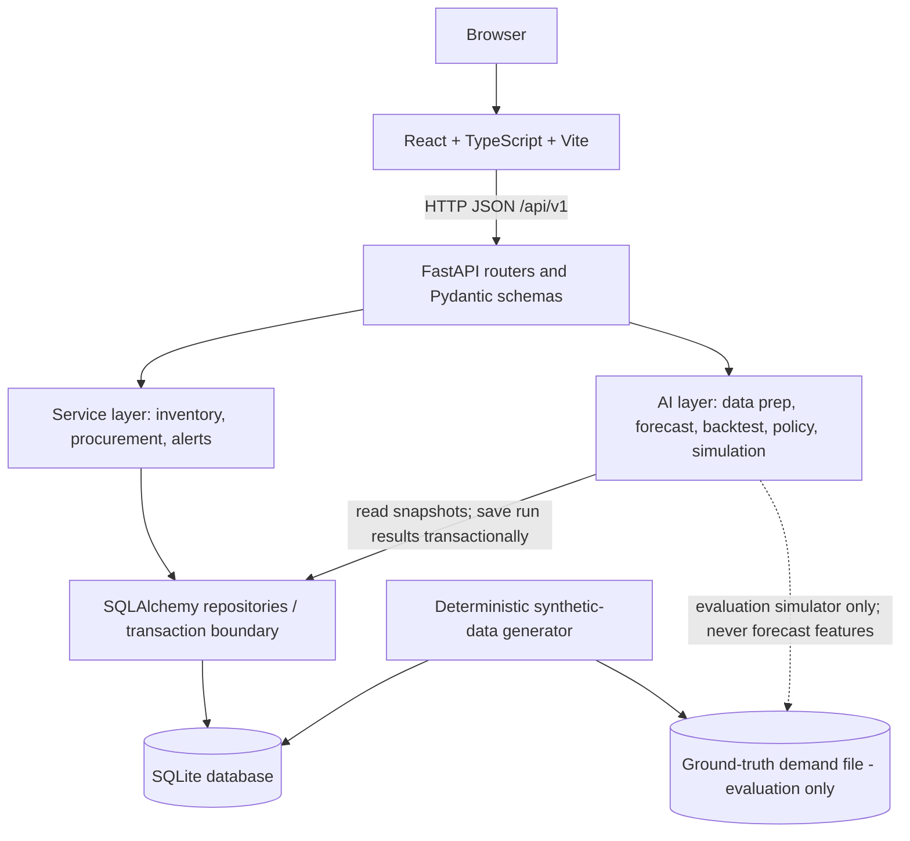
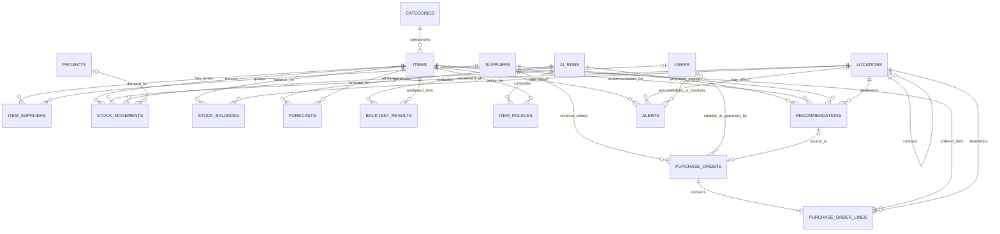
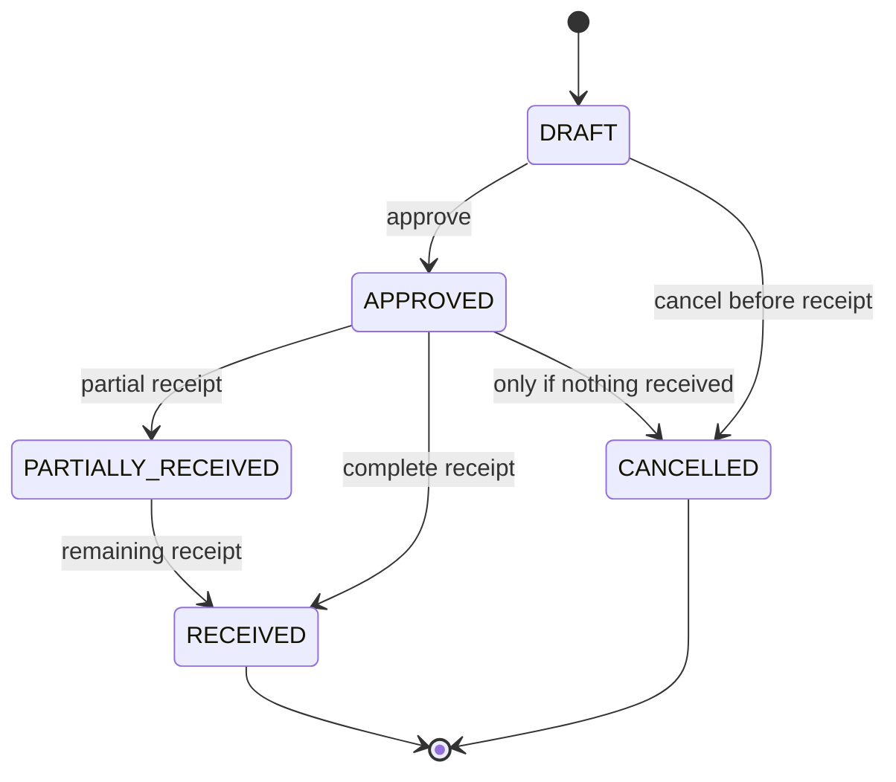

# StockSense — Technical Architecture and Build Plan

**Document:** 02 of 03  
**Status:** Implementation blueprint for the assessment PoC  
**Architecture:** React + TypeScript / FastAPI / SQLAlchemy / SQLite  
**Principle:** Keep deterministic inventory rules separate from probabilistic AI logic.

---

## 1. Architectural goals

The system must be small enough to implement and explain in a short assessment window, while preserving clear boundaries that would make a later production version easier to evolve.

1. **Single source of truth:** stock is represented by a transaction ledger; balances are maintained transactionally and can be checked against that ledger.
2. **Backend owns business rules:** the frontend never writes directly to the database or calculates authoritative inventory balances.
3. **Modular monolith:** one FastAPI application contains routers, services, data access, and AI modules. Do not add microservices for this PoC.
4. **AI is advisory:** forecasting and recommendation code cannot approve POs, receive goods, or change stock without an explicit user action and ordinary business validation.
5. **Reproducibility:** synthetic generation and policy simulations use saved parameters and fixed seeds.
6. **Evidence before claims:** model and policy reports show measured results, including negative or mixed results.
7. **Scope discipline:** the required workflow must be complete before optional ML, LLM, vision, or production-infrastructure work begins.

## 2. Chosen stack

| Layer | Choice | Reason | Assessment-time boundary |
|---|---|---|---|
| Frontend | React + TypeScript + Vite | Familiar component model, good form/table/chart ecosystem, fast development | Build only the pages needed for the golden demo |
| Navigation | React Router | Separates main application pages | Avoid complex nested routing |
| API client | Native `fetch` or Axios | Typed JSON requests and consistent error handling | Choose one; do not duplicate clients |
| Data fetching | TanStack Query, optional | Query caching, loading/error states, mutations, refetching | Use only if already familiar; otherwise a small API layer is sufficient |
| Styling | Tailwind CSS or plain CSS modules | Reusable, predictable UI styles | Do not spend time building a custom design system |
| Charts | Recharts or Plotly through a React-compatible library | Demand-history and evaluation charts | One chart library only |
| Backend | Python 3.11 + FastAPI + Uvicorn | Typed API, request validation, OpenAPI docs | Pin tested dependency versions |
| Validation | Pydantic v2 | Validate inbound requests and outbound schemas | Normalize errors into a predictable response shape |
| Persistence | SQLAlchemy 2.x + SQLite | ORM and simple zero-service database | SQLite is a PoC choice, not a concurrent production-store claim |
| Analytics | pandas, NumPy, SciPy | Time series, statistics, simulation | Avoid unnecessary heavy dependencies |
| Forecasting | Implemented baselines + Croston-family methods | Appropriate starting point for sparse/intermittent demand | LightGBM is optional, not a blocker |
| Tests | pytest, FastAPI TestClient, frontend test or smoke checks | Verify business invariants and API contracts | Prioritize backend integration tests |
| Quality | Ruff and optional GitHub Actions | Formatting/lint consistency and repeatable tests | Run locally before every push |
| Local environment | Docker Compose or documented local commands | Reproducible demo | Use a fresh-clone verification before submission |

### Explicit decisions

- **No Streamlit.** The frontend is React + TypeScript. Remove Streamlit references, dashboard Dockerfile references, and Streamlit dependencies from the implementation.
- **No LLM is required.** This task is an inventory system with an AI/ML component. A read-only chatbot does not strengthen the core deliverable enough to justify the risk.
- **No LightGBM requirement.** Add it only after baseline and intermittent-demand methods, testing, and final evaluation are working.
- **No deep learning requirement.** Do not use LSTM/Transformers solely to make the project appear more AI-heavy.

## 3. High-level architecture



### 3.1 Request path

1. React calls a typed API wrapper.
2. FastAPI validates the request through Pydantic.
3. The router delegates to a service; it must not contain inventory calculations or raw SQL business logic.
4. The service opens a transaction/repository unit of work and enforces state transitions and invariants.
5. SQLAlchemy persists the ledger/balance/PO updates in one transaction.
6. The API returns the current state and stable error response.
7. React updates or refetches data only after the API confirms success.

### 3.2 AI path

1. A user triggers a forecast/replenishment run.
2. The backend creates an `ai_runs` record with parameters, seed and data cutoff.
3. The AI layer takes a consistent read snapshot of observed data available at that cutoff.
4. It constructs weekly series, runs validation/backtests, selects/uses a method, forecasts demand, calculates the policy target, and builds explanations.
5. Results are committed atomically and the run is marked succeeded; on failure, the run is marked failed with a useful error, and previous successful results remain available.
6. The UI polls run status or refreshes the run page.

For the PoC, one AI run at a time is enough. If a background task is used, persist status in the database, prevent overlapping runs, and mark stale `RUNNING` jobs as failed on startup. Do not promise durable distributed job processing.

## 4. Repository structure

Start with a structure that reflects actual responsibilities. Avoid creating dozens of empty modules before functionality exists.

```text
stocksense/
├── README.md
├── .gitignore
├── .env.example
├── pyproject.toml
├── docker-compose.yml
├── Dockerfile.api
├── Makefile                         # optional convenience commands
├── config/
│   └── synthetic.yaml
├── docs/
│   ├── 01-problem-statement.md
│   ├── 02-architecture.md
│   ├── 03-sprint-plan.md
│   ├── synthetic-data.md
│   ├── model-card.md
│   └── decisions.md
├── backend/
│   ├── app/
│   │   ├── main.py
│   │   ├── core/                    # settings, DB/session, error handlers
│   │   ├── db/                      # SQLAlchemy base and initialization
│   │   ├── models/                  # ORM models
│   │   ├── schemas/                 # Pydantic DTOs
│   │   ├── api/v1/                  # route modules
│   │   ├── services/                # inventory and procurement rules
│   │   └── ai/                      # data, forecasts, policy, evaluation
│   └── tests/
├── frontend/
│   ├── package.json
│   ├── vite.config.ts
│   └── src/
│       ├── api/                     # central HTTP client + endpoint functions
│       ├── components/              # shared tables, forms, status messages
│       ├── layouts/
│       ├── pages/
│       ├── types/                   # DTOs and domain types
│       ├── App.tsx
│       └── main.tsx
├── scripts/
│   └── generate_synthetic.py
├── data/                            # local SQLite and generated data; gitignored
└── .github/workflows/ci.yml          # optional
```

It is fine to flatten this structure for speed. The important rule is not the exact folder names; it is that inventory services, API schemas, AI functions, and React API calls have clear responsibilities.

## 5. Data model

Use a small relational model. Do not implement every field from a full ERP.

### 5.1 Table inventory (17 tables)

The assessment schema contains **17 relational tables**. The tables are intentionally small enough to implement in SQLAlchemy, while covering master data, inventory transactions, purchasing, demo-user accountability, and the AI evidence trail.

| # | Table | Purpose | Priority |
|---:|---|---|---|
| 1 | `categories` | Group similar stock items | Must |
| 2 | `items` | Item/SKU master records and base-unit costing | Must |
| 3 | `suppliers` | Supplier master records | Must |
| 4 | `item_suppliers` | Supplier-specific SKU, price, MOQ, order multiple, and lead time | Must |
| 5 | `locations` | Warehouses, yards, and rig/project sites | Must |
| 6 | `projects` | Optional operational destination for issues | Small, useful for domain realism |
| 7 | `users` | Demo user identities and audit attribution | Include table; real authentication is out of scope |
| 8 | `stock_movements` | Append-only ledger: every receipt, issue, transfer, or adjustment | Must |
| 9 | `stock_balances` | Transactionally maintained current stock by item/location | Must |
| 10 | `purchase_orders` | Purchase-order header and lifecycle | Must |
| 11 | `purchase_order_lines` | Ordered/received quantities and destinations | Must |
| 12 | `ai_runs` | AI execution status, cutoff, parameters, version, and errors | Must for reproducible AI runs |
| 13 | `forecasts` | Saved forecast values by item and horizon | Must for model results UI |
| 14 | `backtest_results` | Out-of-sample forecast metrics | Must for defensible evaluation |
| 15 | `item_policies` | Reorder/safety-stock policy produced by an AI run | Must |
| 16 | `recommendations` | Human decision queue for proposed replenishment | Must |
| 17 | `alerts` | Stock-risk and operational warnings | Small MVP if time allows; otherwise implement low-stock warnings first |

Do **not** create a database table for React pages, chart series, or transient UI state. Those are frontend concerns. Do **not** put synthetic ground-truth demand in the operational database used for training: retain it in a separate evaluation-only CSV/file (or a strictly isolated evaluation store) so it cannot leak into forecast features.

### 5.2 Detailed column dictionary

The definitions below are the canonical proposed data model. Use SQLAlchemy models and Pydantic request/response schemas that match it. The SQLite type is shown; SQLAlchemy may use `Integer`, `String/Text`, `Boolean` (stored as 0/1 in SQLite), `Date`, `DateTime`, or `Numeric` according to the documented semantics. All timestamps are UTC ISO-8601. `JSON` values are stored as validated JSON text for SQLite in this PoC.

#### `categories` — item groupings

| Column | SQLite type | Required/default | Rules and example |
|---|---|---|---|
| `id` | INTEGER | PK, auto-generated | Internal identifier |
| `name` | TEXT | NOT NULL | UNIQUE; e.g. `Electrical & Instrumentation` |
| `description` | TEXT | NULL allowed | Optional human-readable explanation |
| `created_at` | TEXT | NOT NULL | UTC timestamp |
| `updated_at` | TEXT | NOT NULL | UTC timestamp |

#### `items` — master data for every SKU

| Column | SQLite type | Required/default | Rules and example |
|---|---|---|---|
| `id` | INTEGER | PK, auto-generated | Internal identifier |
| `sku` | TEXT | NOT NULL | UNIQUE; e.g. `ELEC-0007` |
| `name` | TEXT | NOT NULL | e.g. `Pressure sensor, 0–10 bar` |
| `description` | TEXT | NULL allowed | Optional specification/details |
| `category_id` | INTEGER | NOT NULL | FK → `categories.id` |
| `uom` | TEXT | NOT NULL | Base unit, e.g. `pcs`, `drum`, `kg`; quantities in a SKU's base UOM are integers in this PoC |
| `unit_cost_minor` | INTEGER | NOT NULL, default `0` | `CHECK >= 0`; cost in the smallest unit of the one configured base currency, e.g. cents/piastres. Do not use binary floating point for money |
| `criticality` | TEXT | NOT NULL, default `STANDARD` | CHECK in `CRITICAL`, `STANDARD`, `LOW` |
| `shelf_life_days` | INTEGER | NULL allowed | If present, must be > 0; advisory policy cap only, **not** batch-level expiry tracking |
| `is_active` | INTEGER | NOT NULL, default `1` | CHECK in `0,1`; deactivate instead of hard-delete |
| `introduced_at` | TEXT | NOT NULL | Date the item became available/observable, `YYYY-MM-DD`; prevents false zero-demand history before launch |
| `created_at` | TEXT | NOT NULL | UTC timestamp |
| `updated_at` | TEXT | NOT NULL | UTC timestamp |

#### `suppliers` — supplier directory

| Column | SQLite type | Required/default | Rules and example |
|---|---|---|---|
| `id` | INTEGER | PK, auto-generated | Internal identifier |
| `name` | TEXT | NOT NULL | UNIQUE; e.g. `Delta Industrial Supply` (synthetic) |
| `country` | TEXT | NULL allowed | Country name/code; optional for the PoC |
| `contact_email` | TEXT | NULL allowed | Optional synthetic contact; do not use real personal data |
| `is_import` | INTEGER | NOT NULL, default `0` | CHECK in `0,1`; can inform synthetic lead-time assumptions |
| `is_active` | INTEGER | NOT NULL, default `1` | CHECK in `0,1` |
| `created_at` | TEXT | NOT NULL | UTC timestamp |
| `updated_at` | TEXT | NOT NULL | UTC timestamp |

#### `item_suppliers` — supplier terms for a specific item

| Column | SQLite type | Required/default | Rules and example |
|---|---|---|---|
| `id` | INTEGER | PK, auto-generated | Internal identifier |
| `item_id` | INTEGER | NOT NULL | FK → `items.id` |
| `supplier_id` | INTEGER | NOT NULL | FK → `suppliers.id` |
| `supplier_sku` | TEXT | NULL allowed | Supplier's part code, if different from internal SKU |
| `unit_price_minor` | INTEGER | NOT NULL | `CHECK >= 0`; supplier quote in base-currency minor units |
| `moq` | INTEGER | NOT NULL, default `1` | Minimum order quantity; `CHECK >= 1` |
| `order_multiple` | INTEGER | NOT NULL, default `1` | Order pack multiple; `CHECK >= 1` |
| `lead_time_days_nominal` | INTEGER | NOT NULL | Expected days to delivery; `CHECK > 0` |
| `is_preferred` | INTEGER | NOT NULL, default `0` | CHECK in `0,1`; partial unique index permits at most one preferred supplier per item |
| `created_at` | TEXT | NOT NULL | UTC timestamp |
| `updated_at` | TEXT | NOT NULL | UTC timestamp |

Constraints: `UNIQUE(item_id, supplier_id)`. Never assume the supplier with the lowest price is automatically the preferred/valid supplier.

#### `locations` — physical stock locations

| Column | SQLite type | Required/default | Rules and example |
|---|---|---|---|
| `id` | INTEGER | PK, auto-generated | Internal identifier |
| `code` | TEXT | NOT NULL | UNIQUE; e.g. `WH-01` |
| `name` | TEXT | NOT NULL | e.g. `Main Warehouse` |
| `location_type` | TEXT | NOT NULL | CHECK in `WAREHOUSE`, `YARD`, `RIG_SITE` |
| `parent_id` | INTEGER | NULL allowed | Self-FK → `locations.id` for a simple hierarchy |
| `is_default_replenishment` | INTEGER | NOT NULL, default `0` | CHECK in `0,1`; a partial unique index allows at most one active default replenishment warehouse; require its type to be `WAREHOUSE` in service validation |
| `is_active` | INTEGER | NOT NULL, default `1` | CHECK in `0,1` |
| `created_at` | TEXT | NOT NULL | UTC timestamp |
| `updated_at` | TEXT | NOT NULL | UTC timestamp |

For the PoC, configure exactly one default replenishment warehouse. A policy/recommendation uses stock and open POs for that warehouse only; stock elsewhere is not silently treated as available there.

#### `projects` — optional operational references for issues

| Column | SQLite type | Required/default | Rules and example |
|---|---|---|---|
| `id` | INTEGER | PK, auto-generated | Internal identifier |
| `code` | TEXT | NOT NULL | UNIQUE; e.g. `RIG-A-2026-04` |
| `name` | TEXT | NOT NULL | Campaign/project label |
| `rig_name` | TEXT | NULL allowed | Optional rig or site label |
| `start_date` | TEXT | NOT NULL | `YYYY-MM-DD` |
| `end_date` | TEXT | NULL allowed | If set, must not precede `start_date` |
| `status` | TEXT | NOT NULL, default `PLANNED` | CHECK in `PLANNED`, `ACTIVE`, `COMPLETED` |
| `created_at` | TEXT | NOT NULL | UTC timestamp |
| `updated_at` | TEXT | NOT NULL | UTC timestamp |

`project_id` is allowed on an ISSUE movement only. Projects help explain project-driven demand; they are not required to make the core ledger work.

#### `users` — demo identities and audit accountability

| Column | SQLite type | Required/default | Rules and example |
|---|---|---|---|
| `id` | INTEGER | PK, auto-generated | Internal identifier |
| `full_name` | TEXT | NOT NULL | e.g. `Demo Storekeeper` |
| `email` | TEXT | NOT NULL | UNIQUE; use fictional `example.test` addresses in seed data |
| `role` | TEXT | NOT NULL | CHECK in `STOREKEEPER`, `PROCUREMENT_OFFICER`, `MANAGER`, `ADMIN` |
| `is_active` | INTEGER | NOT NULL, default `1` | CHECK in `0,1` |
| `created_at` | TEXT | NOT NULL | UTC timestamp |
| `updated_at` | TEXT | NOT NULL | UTC timestamp |

**Important scope distinction:** include this table so seeded demo actions and approval records can refer to a stable user ID. Do **not** add plaintext passwords, and do not implement home-grown password authentication for this assessment. There is no real login/RBAC security unless a trusted authentication mechanism is implemented. A UI-selected demo user or `X-Demo-User-ID` may be used only to label local demo actions, and must never be represented as verified identity or production access control. In production, derive the user ID and permissions from an authenticated server-side principal, not from an arbitrary client header.

Recommended deterministic demo seed: one storekeeper, one procurement officer, and one manager, all fictional. Role checks in React are only presentational until the backend has real authentication and authorization.

#### `stock_movements` — append-only source-of-truth ledger

| Column | SQLite type | Required/default | Rules and example |
|---|---|---|---|
| `id` | INTEGER | PK, auto-generated | Movement identifier |
| `item_id` | INTEGER | NOT NULL | FK → `items.id` |
| `location_id` | INTEGER | NOT NULL | FK → `locations.id` |
| `movement_type` | TEXT | NOT NULL | CHECK in `RECEIPT`, `ISSUE`, `TRANSFER_OUT`, `TRANSFER_IN`, `ADJUSTMENT` |
| `quantity` | INTEGER | NOT NULL | Nonzero signed base units. Receipt/transfer-in positive; issue/transfer-out negative; adjustment may be either sign |
| `unit_cost_minor` | INTEGER | NULL allowed | Optional transaction-time cost snapshot in minor units |
| `project_id` | INTEGER | NULL allowed | FK → `projects.id`; permitted only for `ISSUE` |
| `reference_type` | TEXT | NULL allowed | If supplied: `PO_LINE`, `MANUAL`, `COUNT`, `TRANSFER`, `SYNTHETIC` |
| `reference_id` | INTEGER | NULL allowed | ID in the referenced business object; not a polymorphic FK, so validate the pair in service logic |
| `transfer_group_id` | TEXT | NULL allowed | Same UUID on both legs of a transfer |
| `reason` | TEXT | NULL allowed | Required for `ADJUSTMENT`; useful for corrections and audit |
| `idempotency_key` | TEXT | NULL allowed | UNIQUE; external stock-write requests should supply one; internal seed can generate one |
| `request_fingerprint` | TEXT | NULL allowed | Hash of normalized request payload; same key + different fingerprint must return conflict |
| `actor_user_id` | INTEGER | NULL allowed | FK → `users.id`; demo attribution only until authentication exists |
| `actor_label` | TEXT | NOT NULL | Snapshot label for human-readable audit history, e.g. `Demo Storekeeper` or `synthetic-seed` |
| `occurred_at` | TEXT | NOT NULL | Business/event time in UTC |
| `created_at` | TEXT | NOT NULL | System insertion time in UTC |

Add indexes on `(item_id, occurred_at)`, `(location_id, occurred_at)`, `movement_type`, and `(reference_type, reference_id)`. Create database triggers to block UPDATE/DELETE of ledger rows. Validate the sign/type relationship with CHECK constraints and service tests.

#### `stock_balances` — fast current-stock read model

| Column | SQLite type | Required/default | Rules and example |
|---|---|---|---|
| `item_id` | INTEGER | PK part, NOT NULL | FK → `items.id` |
| `location_id` | INTEGER | PK part, NOT NULL | FK → `locations.id` |
| `quantity_on_hand` | INTEGER | NOT NULL, default `0` | CHECK `>= 0`; integer base units |
| `updated_at` | TEXT | NOT NULL | UTC timestamp |

Primary key: `(item_id, location_id)`. Update this table in the **same transaction** as the ledger insert. The ledger is the audit source of truth; balances are a cached projection that must reconcile exactly.

#### `purchase_orders` — purchase-order header

| Column | SQLite type | Required/default | Rules and example |
|---|---|---|---|
| `id` | INTEGER | PK, auto-generated | Internal identifier |
| `po_number` | TEXT | NOT NULL | UNIQUE, human-readable, generated server-side (e.g. `PO-20261013-0001`) |
| `supplier_id` | INTEGER | NOT NULL | FK → `suppliers.id` |
| `status` | TEXT | NOT NULL, default `DRAFT` | CHECK in `DRAFT`, `APPROVED`, `PARTIALLY_RECEIVED`, `RECEIVED`, `CANCELLED` |
| `created_at` | TEXT | NOT NULL | Creation timestamp; distinct from actual order date |
| `order_date` | TEXT | NULL until approval | Actual date order was approved/placed; set during approval |
| `expected_date` | TEXT | NULL allowed | Expected delivery date, if supplied |
| `source_recommendation_id` | INTEGER | NULL allowed | UNIQUE FK → `recommendations.id`; links at most one PO to one recommendation; create after the referenced tables exist or arrange ORM/migration creation order |
| `created_by_user_id` | INTEGER | NULL allowed | FK → `users.id`; demo attribution until auth exists |
| `approved_by_user_id` | INTEGER | NULL allowed | FK → `users.id`; set at approval |
| `approved_at` | TEXT | NULL allowed | UTC approval timestamp |
| `notes` | TEXT | NULL allowed | Optional explanation or supplier note |
| `updated_at` | TEXT | NOT NULL | UTC timestamp |

A draft must not require `order_date` when that date is defined as the actual ordering/approval date. Generate a PO number on the server and enforce state transitions in the service layer.

#### `purchase_order_lines` — items and destination of a PO

| Column | SQLite type | Required/default | Rules and example |
|---|---|---|---|
| `id` | INTEGER | PK, auto-generated | Line identifier |
| `po_id` | INTEGER | NOT NULL | FK → `purchase_orders.id` |
| `item_id` | INTEGER | NOT NULL | FK → `items.id` |
| `destination_location_id` | INTEGER | NOT NULL | FK → `locations.id`; must be active |
| `qty_ordered` | INTEGER | NOT NULL | CHECK `> 0`; base units |
| `qty_received` | INTEGER | NOT NULL, default `0` | CHECK `>= 0` and `<= qty_ordered` |
| `unit_price_minor` | INTEGER | NOT NULL | CHECK `>= 0`; price agreed for this PO line, separate from current `items.unit_cost_minor` |
| `created_at` | TEXT | NOT NULL | UTC timestamp |

Receiving must add a receipt ledger movement and update `qty_received`/PO status atomically. For the MVP, one receipt batch may contain multiple lines and destinations, but each line's received units must not exceed the remaining quantity.

#### `ai_runs` — lineage and run status

| Column | SQLite type | Required/default | Rules and example |
|---|---|---|---|
| `id` | INTEGER | PK, auto-generated | Run identifier |
| `run_type` | TEXT | NOT NULL | CHECK in `FORECAST_AND_POLICY`, `ANOMALY` if anomaly runs are implemented |
| `status` | TEXT | NOT NULL | CHECK in `RUNNING`, `SUCCEEDED`, `FAILED` |
| `started_at` | TEXT | NOT NULL | UTC timestamp |
| `finished_at` | TEXT | NULL until finished | UTC timestamp |
| `data_cutoff` | TEXT | NOT NULL | Latest event time/date included in model inputs; needed for leakage checks |
| `random_seed` | INTEGER | NOT NULL | Seed used for reproducible simulation and/or generator context |
| `params_json` | TEXT | NOT NULL | Validated JSON of configuration and method parameters |
| `metrics_json` | TEXT | NULL allowed | Aggregate run summary JSON |
| `model_version` | TEXT | NOT NULL | Git commit SHA or app/model version |
| `error` | TEXT | NULL allowed | Safe failure summary; do not store secrets |

Keep long-running AI work outside the stock transaction. Persist all results and mark success atomically; on failure, mark the run failed and preserve the previously completed results.

#### `forecasts` — persisted future demand estimates

| Column | SQLite type | Required/default | Rules and example |
|---|---|---|---|
| `id` | INTEGER | PK, auto-generated | Forecast row ID |
| `run_id` | INTEGER | NOT NULL | FK → `ai_runs.id` |
| `item_id` | INTEGER | NOT NULL | FK → `items.id` |
| `period_start` | TEXT | NOT NULL | Forecast bucket start date, `YYYY-MM-DD` (Monday for weekly periods) |
| `horizon_step` | INTEGER | NOT NULL | CHECK `> 0`; period distance from cutoff |
| `mean` | REAL | NOT NULL | Nonnegative expected quantity; forecast means can be fractional even when physical stock is integer |
| `p50` | REAL | NULL allowed | Optional median forecast/quantile if method provides it |
| `p90` | REAL | NULL allowed | Optional 90th percentile if method provides it |
| `method` | TEXT | NOT NULL | Stable name such as `sba`, `tsb`, `ma8` |

Unique constraint: `(run_id, item_id, period_start, horizon_step)`. Never report future values as predictions if they were built with information after `data_cutoff`.

#### `backtest_results` — forecast evidence on held-out windows

| Column | SQLite type | Required/default | Rules and example |
|---|---|---|---|
| `id` | INTEGER | PK, auto-generated | Result ID |
| `run_id` | INTEGER | NOT NULL | FK → `ai_runs.id` |
| `item_id` | INTEGER | NOT NULL | FK → `items.id` |
| `method` | TEXT | NOT NULL | Forecasting method evaluated |
| `evaluation_start` | TEXT | NOT NULL | First date in held-out evaluation window |
| `evaluation_end` | TEXT | NOT NULL | Last date in held-out evaluation window; must be >= start |
| `rmsse` | REAL | NULL allowed | Root mean squared scaled error; null when mathematically undefined |
| `mase` | REAL | NULL allowed | Mean absolute scaled error; null when undefined |
| `bias` | REAL | NULL allowed | Signed forecast error under one documented sign convention |
| `pinball_p90` | REAL | NULL allowed | Quantile loss if a p90 forecast exists |
| `cumulative_abs_error` | REAL | NULL allowed | Absolute error in total demand over the horizon |
| `n_windows` | INTEGER | NOT NULL, default `1` | CHECK `> 0`; number of evaluated rolling windows represented |

Store actual evaluation-window boundaries. Keep method selection data separate from the final reported evaluation data to reduce selection bias.

#### `item_policies` — inventory policy computed by a run

| Column | SQLite type | Required/default | Rules and example |
|---|---|---|---|
| `id` | INTEGER | PK, auto-generated | Policy row ID |
| `run_id` | INTEGER | NOT NULL | FK → `ai_runs.id` |
| `item_id` | INTEGER | NOT NULL | FK → `items.id` |
| `demand_pattern` | TEXT | NOT NULL | CHECK in `smooth`, `erratic`, `intermittent`, `lumpy`, `insufficient_history` |
| `adi` | REAL | NULL allowed | Average demand interval; undefined when there is no nonzero demand |
| `cv2` | REAL | NULL allowed | Squared coefficient of variation for nonzero demand sizes; undefined where appropriate |
| `abc_class` | TEXT | NULL allowed | `A`, `B`, or `C` if calculated |
| `xyz_class` | TEXT | NULL allowed | `X`, `Y`, or `Z` if calculated |
| `selected_method` | TEXT | NOT NULL | Method chosen using training/backtest selection only |
| `low_confidence` | INTEGER | NOT NULL, default `0` | CHECK in `0,1`; e.g. insufficient history/cold start |
| `service_level` | REAL | NOT NULL | CHECK between `0.50` and `0.999` |
| `lead_time_mean_days` | REAL | NOT NULL | Estimated average lead time in days |
| `lead_time_p90_days` | REAL | NOT NULL | Estimated 90th percentile lead time in days |
| `mean_weekly_demand` | REAL | NOT NULL | Nonnegative forecast level |
| `safety_stock` | INTEGER | NOT NULL | CHECK `>= 0` |
| `reorder_point` | INTEGER | NOT NULL | CHECK `>= 0`; target policy protection level under documented review assumptions |
| `order_up_to` | INTEGER | NOT NULL | CHECK `>= 0`; desired inventory position after replenishment, subject to supplier constraints |
| `computed_at` | TEXT | NOT NULL | UTC timestamp |

Unique constraint: `(run_id, item_id)`. For this MVP, this policy is scoped to the single configured default replenishment warehouse. A multi-location policy would add `location_id` to this table and to its unique key.

#### `recommendations` — human-reviewed order proposals

| Column | SQLite type | Required/default | Rules and example |
|---|---|---|---|
| `id` | INTEGER | PK, auto-generated | Recommendation ID |
| `run_id` | INTEGER | NOT NULL | FK → `ai_runs.id` |
| `item_id` | INTEGER | NOT NULL | FK → `items.id` |
| `supplier_id` | INTEGER | NOT NULL | FK → `suppliers.id`; must have valid `item_suppliers` terms for the item |
| `destination_location_id` | INTEGER | NOT NULL | FK → `locations.id`; the configured default replenishment warehouse for MVP |
| `status` | TEXT | NOT NULL, default `OPEN` | CHECK in `OPEN`, `APPROVED`, `DISMISSED`, `EXPIRED` |
| `urgency` | TEXT | NOT NULL | CHECK in `CRITICAL`, `HIGH`, `NORMAL` |
| `on_hand` | INTEGER | NOT NULL | Stock available at the recommendation's destination when generated |
| `on_order` | INTEGER | NOT NULL | Remaining approved PO units due to that same destination |
| `inventory_position` | INTEGER | NOT NULL | Defined as destination on-hand + on-order |
| `reorder_point` | INTEGER | NOT NULL | Saved policy threshold at generation time |
| `suggested_qty` | INTEGER | NOT NULL | Must be positive for an actionable recommendation; should respect MOQ/order multiple unless flagged for human review |
| `stockout_probability` | REAL | NULL allowed | If calculated, must be in `[0,1]`; define it specifically as risk before arrival or risk over the protection interval and label it accordingly |
| `expected_stockout_date` | TEXT | NULL allowed | Approximate indicator only; absent when not meaningful |
| `explanation_json` | TEXT | NOT NULL | Structured inputs/values/rules used; validated JSON |
| `summary_text` | TEXT | NOT NULL | Deterministic human-readable explanation; no invented numbers |
| `decided_by_user_id` | INTEGER | NULL allowed | FK → `users.id`; demo attribution only absent authentication |
| `decided_at` | TEXT | NULL allowed | UTC timestamp for approval/dismissal |
| `decision_note` | TEXT | NULL allowed | Dismissal/edit/approval rationale |
| `created_at` | TEXT | NOT NULL | UTC timestamp |

Add a partial unique index allowing at most one `OPEN` recommendation per item for the MVP's single default warehouse. Link the resulting PO through `purchase_orders.source_recommendation_id` instead of storing a second, redundant PO foreign key on this table. When approving with an edited quantity, store that actual quantity on the created PO line; keep `suggested_qty` as the original AI suggestion for auditability.

#### `alerts` — actionable operational warnings

| Column | SQLite type | Required/default | Rules and example |
|---|---|---|---|
| `id` | INTEGER | PK, auto-generated | Alert ID |
| `alert_type` | TEXT | NOT NULL | CHECK in implemented types, e.g. `LOW_STOCK`, `STOCKOUT_RISK`, `ANOMALOUS_ISSUE`, `SUSPICIOUS_ADJUSTMENT`, `OVERSTOCK`, `NO_SUPPLIER` |
| `severity` | TEXT | NOT NULL | CHECK in `INFO`, `WARNING`, `CRITICAL` |
| `item_id` | INTEGER | NULL allowed | FK → `items.id`; null for a truly system-level alert only |
| `location_id` | INTEGER | NULL allowed | FK → `locations.id` |
| `movement_id` | INTEGER | NULL allowed | FK → `stock_movements.id` |
| `source_run_id` | INTEGER | NULL allowed | FK → `ai_runs.id` |
| `message` | TEXT | NOT NULL | Concise human-readable explanation |
| `details_json` | TEXT | NULL allowed | Structured supporting context |
| `status` | TEXT | NOT NULL, default `OPEN` | CHECK in `OPEN`, `ACKNOWLEDGED`, `RESOLVED` |
| `created_at` | TEXT | NOT NULL | UTC timestamp |
| `acknowledged_by_user_id` | INTEGER | NULL allowed | FK → `users.id`; demo attribution only absent authentication |
| `acknowledged_at` | TEXT | NULL allowed | UTC timestamp |
| `resolved_by_user_id` | INTEGER | NULL allowed | FK → `users.id`; demo attribution only absent authentication |
| `resolved_at` | TEXT | NULL allowed | UTC timestamp |

If time is short, implement `LOW_STOCK` and `NO_SUPPLIER` first. Do not create an anomaly alert that has no tested detection rule or meaningful explanation.

### 5.3 Relationship summary / ER diagram



**Relationship rules:**
- One item may have many suppliers and one supplier may supply many items; `item_suppliers` resolves that many-to-many relationship and stores the terms for each pair.
- One item/location pair has one current balance row, but it can have many ledger movements over time.
- One PO has one or more lines; each line specifies its own item and receiving destination.
- One AI run may create many forecasts, backtest results, policies, and recommendations.
- A recommendation may result in at most one PO; manual POs have no source recommendation.
- User foreign keys provide attribution, not authentication. Nullable attribution is permitted for generated seed transactions or system-originated records.

### 5.4 Data conventions

- Store UTC timestamps in a consistent ISO-8601 format; keep dates separate when their semantics are date-only.
- Quantities are integer base units for the PoC. State this limitation; do not imply fractional units are supported.
- Use `Decimal`/integer minor units for money if practical. If `REAL` is used to save time, document it as a PoC limitation and do not use floating-point comparisons for strict monetary equality.
- Use foreign keys and enable SQLite foreign-key enforcement on every connection.
- Use enum/check constraints for statuses and movement types; validate in both request schemas and business services.
- Use `is_active` rather than hard-deleting referenced items, suppliers, or locations.
- Define `introduced_at`/`demand_start_date` explicitly. Do not fill periods before an item existed with artificial zero demand.
- Avoid a schema that has nullable or redundant fields without an actual workflow requiring them.

## 6. Stock ledger and transaction design

### 6.1 Movement semantics

Use a signed quantity with an explicit movement type:

- `RECEIPT`: quantity must be positive.
- `ISSUE`: quantity must be negative in the ledger; public API may accept a positive requested amount and the service converts it to a negative ledger quantity.
- `TRANSFER_OUT`: negative at the source location.
- `TRANSFER_IN`: positive at the destination location.
- `ADJUSTMENT`: signed delta; a reason is mandatory. If a physical count matches the balance, return a no-op without inserting a zero-quantity movement if zero movements are forbidden.

Do not let callers send arbitrary signed quantities without type/sign validation.

### 6.2 The single stock-posting service

All changes to inventory must go through one service function such as `post_movement(...)`. Its transaction should:

1. Validate the item/location are active and movement type/sign/reason are valid.
2. Validate the idempotency key. A replay with the same request fingerprint returns the original result; the same key with a different payload returns a conflict.
3. Read the current balance and calculate the new value inside the same write transaction.
4. Reject the operation if the new balance would be negative.
5. Insert the immutable ledger movement.
6. Update the balance cache in the same transaction.
7. Commit, then run non-critical side effects such as refreshing alert state.

The exact SQLite transaction configuration must be tested with SQLAlchemy. Merely writing `BEGIN IMMEDIATE` in a comment does not guarantee the connection is configured to use it. A simpler transaction is acceptable if it has correct atomic behavior and tests. Document the concurrency limitations of SQLite.

### 6.3 Invariants to enforce

1. Balances cannot become negative.
2. For every item/location pair, `stock_balances.quantity_on_hand` equals `SUM(stock_movements.quantity)`.
3. Ledger movement rows cannot be updated or deleted through application APIs; SQLite triggers can reinforce this for the PoC.
4. A transfer creates both legs in one transaction with a shared transfer ID.
5. Same idempotency key + same payload does not duplicate an effect; a conflicting payload is rejected.
6. A PO line cannot be received above its ordered quantity.
7. A PO cannot be cancelled after any quantity has been received, unless a separately documented return/close workflow is added.
8. A recommendation cannot create multiple POs through duplicate approval requests.
9. An item with no supplier terms is not given a fully actionable order recommendation; surface a warning instead.
10. An integrity-check endpoint detects discrepancies; do not silently repair corrupted balances without creating an auditable correction.

## 7. Purchase-order lifecycle

### 7.1 State machine



A draft PO has no actual approval date. Therefore, `order_date` should be nullable until approval, or the schema should distinguish `created_at` from the date on which the purchase was formally ordered. Do not require a non-null order date while also saying it is assigned only on approval.

### 7.2 PO receiving

- Receive against a PO line, not as an unrelated manual receipt.
- Validate remaining quantity before posting stock.
- In one transaction, create receipt movement(s), update line received quantities, and update PO state.
- Support partial receiving in the core logic if practical; at minimum test full receiving and over-receipt rejection.
- The same API request retried with the same idempotency key must not receive the goods twice.

### 7.3 Recommendation-to-PO behavior

- Recommendation is `OPEN` until a person approves or dismisses it.
- Approval validates the current recommendation and current inventory state again; do not assume that the state has not changed since the recommendation was created.
- User may edit the suggested quantity and choose a configured supplier/destination, within validation rules.
- Approval and PO creation plus recommendation state change must commit atomically.
- A newly computed run should not silently erase a user's decision. Expire only older still-open recommendations and retain their history.

## 8. API contract

Base path: `/api/v1`. Use JSON request/response schemas and consistent error codes. Keep URL naming and response shape consistent across endpoints.

### 8.1 System and master data

| Method | Path | Purpose | Priority |
|---|---|---|---|
| GET | `/health` | Process liveness | Must |
| GET | `/ready` | Database/schema readiness | Must |
| GET, POST | `/categories` | List/create categories | Must if categories are editable in UI; otherwise seed-only |
| GET, POST | `/items` | List/filter/create items | Must |
| GET, GET/PATCH | `/items/{id}` | Detail/update item | Must |
| GET, POST | `/suppliers` | List/create suppliers | Must |
| GET, POST | `/locations` | List/create locations | Must |
| GET, POST | `/items/{id}/suppliers` | Supplier terms for an item | Must for recommendations |
| GET, POST | `/projects` | Optional issue/project references | Should |

### 8.2 Stock

| Method | Path | Purpose | Priority |
|---|---|---|---|
| GET | `/stock` | Current balances filtered by item/location | Must |
| GET | `/stock/items/{item_id}` | Balance by location and inventory-position summary | Must |
| POST | `/stock/receipts` | Record receipt not tied to a PO, for seed/admin or simple manual flow | Should |
| POST | `/stock/issues` | Issue requested quantity; reject insufficient stock | Must |
| POST | `/stock/transfers` | Atomic source/destination transfer | Must |
| POST | `/stock/adjustments` | Adjust to physical count with reason | Should |
| GET | `/stock/movements` | Paginated, filterable ledger | Must |
| GET | `/stock/integrity-check` | Compare cached balances with ledger sums | Must |

### 8.3 Procurement and AI

| Method | Path | Purpose | Priority |
|---|---|---|---|
| GET, POST | `/purchase-orders` | List/create draft PO | Must |
| GET | `/purchase-orders/{id}` | PO details and lines | Must |
| POST | `/purchase-orders/{id}/approve` | Approve draft PO | Must |
| POST | `/purchase-orders/{id}/receive` | Receive one or more lines | Must |
| POST | `/purchase-orders/{id}/cancel` | Cancel only in allowed state | Should |
| POST | `/ai/runs` | Start forecast/policy run | Must |
| GET | `/ai/runs/{id}` | Run status and metrics | Must if asynchronous |
| GET | `/ai/forecasts` | Forecasts for a run/item | Must |
| GET | `/ai/backtests` | Forecast evaluation evidence | Must |
| GET | `/ai/policies` | Latest policy per item | Must |
| GET | `/recommendations` | Filter open recommendations | Must |
| GET | `/recommendations/{id}` | Full explanation | Must |
| POST | `/recommendations/{id}/approve` | Approve and create PO transactionally | Must |
| POST | `/recommendations/{id}/dismiss` | Dismiss with reason | Should |
| GET | `/alerts` | Low-stock/stockout-risk alerts | Should |
| GET | `/dashboard/summary` | KPI data for overview page | Must |
| GET | `/items/{id}/demand-history` | Actual observed history and forecast series | Must |
| POST | `/admin/seed` | Seed synthetic data; disabled outside demo mode | Must for reproducible demo |

### 8.4 Error contract

Return a predictable error shape, for example:

```json
{
  "error": {
    "code": "INSUFFICIENT_STOCK",
    "message": "Requested quantity exceeds available stock.",
    "details": {
      "item_id": 7,
      "location_id": 1,
      "available": 4,
      "requested": 10
    }
  }
}
```

Recommended status mapping:

- `400` malformed operation or invalid business input where appropriate;
- `404` resource not found;
- `409` insufficient stock, idempotency conflict, duplicate approval, or invalid state transition;
- `422` Pydantic request validation failure;
- `500` unexpected internal failure, with no secret/stack trace exposed to the user.

Normalize FastAPI validation errors if the frontend depends on a common response shape. Never make the UI rely on parsing a human-readable message alone when a stable `code` is available.

## 9. React frontend plan

### 9.1 Pages

Keep the assessment version to five principal navigation areas:

1. **Overview:** active SKUs, current inventory value (if using unit cost), low-stock items, open recommendations, recent alerts, integrity status.
2. **Inventory:** searchable/filterable item table, item detail, stock by location, movement history.
3. **Operations:** receipt, issue, transfer, and (if implemented) count adjustment forms.
4. **Purchase Orders:** list/status filters, PO detail, approve/cancel actions, partial/full receiving.
5. **AI Insights:** demand history/forecast, method and evaluation evidence, recommendations with explanations, baseline-vs-policy results.

Do not build seven separate pages just because the original plan listed seven. A clear combined AI Insights page is adequate.

### 9.2 Suggested frontend structure

```text
frontend/src/
├── api/
│   ├── client.ts                # base URL, headers, common error handling
│   ├── items.ts
│   ├── stock.ts
│   ├── purchaseOrders.ts
│   └── ai.ts
├── components/
│   ├── DataTable.tsx
│   ├── StatusBadge.tsx
│   ├── ErrorMessage.tsx
│   ├── LoadingState.tsx
│   └── ConfirmAction.tsx
├── layouts/AppLayout.tsx
├── pages/
│   ├── DashboardPage.tsx
│   ├── InventoryPage.tsx
│   ├── OperationsPage.tsx
│   ├── PurchaseOrdersPage.tsx
│   └── AIInsightsPage.tsx
├── types/api.ts
├── App.tsx
└── main.tsx
```

### 9.3 Frontend behavioral requirements

- Put API calls in one client layer; do not scatter raw `fetch` calls through the UI.
- Define TypeScript types for key API request/response DTOs.
- Include loading, empty, success, validation-error, conflict, and network-error states.
- Disable submit actions while the corresponding request is in flight.
- On stock/PO mutation, update or refetch affected queries only after backend success.
- Never optimistically display a stock reduction before the server accepts it.
- Show a confirmation for order approval/cancellation; always show the backend's resulting PO number/state.
- For an asynchronous AI run, show `RUNNING`, `SUCCEEDED`, or `FAILED`; poll status at a modest interval and stop after a terminal state.
- The UI must display recommendation assumptions; do not display an opaque “AI says order” result without evidence.
- Use accessible labels, keyboard-operable buttons, readable contrast, and laptop-friendly spacing; visual polish is secondary to reliable behavior.

### 9.4 CORS and local development

Choose one API URL strategy and document it. A clean local approach is for React to request a relative `/api` path and for Vite/Nginx to proxy that path to FastAPI. This avoids hard-coding container-only hostnames in browser code. If direct browser calls to FastAPI are used instead, explicitly configure CORS for the expected development origin; never enable arbitrary origins as a shortcut.

In a container, the browser cannot normally resolve the internal Compose service name `api`. Container hostnames are for service-to-service traffic, not browser DNS. Test the actual browser request path, not only container connectivity.

## 10. Demand data and forecasting design

### 10.1 Forecast target and data cutoff

Forecast **weekly issue demand** for an item using only information available at a given cutoff. Store the cutoff and training window with each AI run. Fill missing weeks with zero only after the item became available for demand; do not invent zero demand before its introduction.

Observed issues may be censored when inventory ran out. In the PoC, the model sees observed issues, while the synthetic evaluation simulator may use hidden true demand solely to measure unfulfilled demand. Clearly label this mismatch as a known data limitation.

### 10.2 Demand-pattern classification

For each eligible series calculate:

- **ADI (average demand interval):** number of eligible periods divided by the number of non-zero demand periods. If there are no non-zero periods, classify as no-demand/insufficient history rather than dividing by zero.
- **CV²:** squared coefficient of variation of the positive demand sizes. If the positive-demand mean is zero or there are too few positive values, flag the classification as unreliable.

Conventional starting cutoffs from the original plan may be used: ADI 1.32 and CV² 0.49 to distinguish smooth, erratic, intermittent, and lumpy patterns. State that these are heuristic categories, not labels supplied by the business.

### 10.3 Forecast methods to implement first

Recommended order:

1. Naive/last-value baseline.
2. Moving-average baseline (e.g., trailing 8 periods).
3. Croston-family method (Croston, SBA, or TSB; implement and test at least one, ideally SBA/TSB if time permits).
4. Optional simple exponential smoothing if it is straightforward to evaluate consistently.
5. LightGBM as an optional extension only after the earlier pipeline and evaluation are correct.

Use a common forecaster interface so methods can be compared without changing the data pipeline. Keep method implementations small and unit-tested. Do not describe all proposed methods as implemented unless they truly are.

### 10.4 Leakage-safe evaluation

Use chronological evaluation. One workable strategy with 52–104 weeks is:

- use early history for initial fit and method selection;
- use rolling-origin validation windows within the development history;
- reserve a later holdout window for final reporting;
- at every forecast origin, use only data dated at or before that origin;
- do not select the winning method on the same holdout window whose result is presented as independent test evidence.

If the project uses a per-pattern selector, method selection must be based on prior validation windows only. When data are insufficient for a clean split, explicitly state that results are exploratory rather than claiming a robust final benchmark.

### 10.5 Metrics

Report metrics only when their assumptions hold:

- MAE or cumulative horizon absolute error for interpretability;
- MASE/RMSSE as scaled comparisons when the scale denominator is non-zero;
- signed bias to identify systematic under- or over-forecasting;
- pinball loss/quantile coverage only if quantile forecasts are implemented and evaluated properly.

All-zero or constant series can make scaled metrics undefined. Flag them and report a suitable absolute metric rather than replacing undefined results with misleading zeros. Report results per demand pattern only where sample size is meaningful.

## 11. Replenishment policy — selected MVP design

The original plan combines a periodic-review protection interval (`lead time + review period`) with a reorder-point trigger and an EOQ-based order-up-to level. That mixes two policy styles and makes the explanation harder to defend. For this PoC, use a coherent **periodic-review order-up-to policy**.

### 11.1 Policy definition

- Review cadence `R`: one week in the synthetic simulator.
- Protection interval: `L + R`, where `L` is a sampled lead time expressed in weeks.
- For each Monte Carlo sample, draw lead time using the item/preferred-supplier lead-time model and draw the required demand over the protection interval using past observed demand. For the starter version, iid resampling is acceptable if its limitations are disclosed; a moving-block bootstrap is optional.
- The target order-up-to level `S` is the selected service-level quantile of simulated total demand over the protection interval.
- For the MVP, configure one default replenishment warehouse and calculate the policy position as stock on hand **at that warehouse** plus open PO quantity **due to that warehouse**. Stock held at other locations remains visible but is not silently treated as available at the target warehouse. Transfers remain a manual operation; the AI does not optimize network-wide transfers. This keeps the policy's recommendation destination and input stock position consistent. A later network-level policy must explicitly model movable stock, transfer lead times, and location-level constraints.
- If the inventory position is below `S`, propose the gap between `S` and inventory position, rounded up to the supplier order multiple and respecting MOQ.
- Run the policy at the review cadence in simulation. In the live app, the user may trigger a run manually; state this operational simplification.

### 11.2 Important policy rules

- The target level is for the **protection interval `L + R`**. Do not call it a continuous-review reorder point and do not trigger a separate `ROP` rule unless you implement that distinct policy. The MVP's policy scope is one configured replenishment warehouse per item, not an optimized network-wide target.
- Estimate stockout-before-arrival risk separately using demand over lead time `L`, not demand over `L + R`. Clearly state whether outstanding PO arrival timing is included; a risk estimate based only on on-hand stock and demand is conservative and must be labelled as such.
- Make service-level assumptions explicit and configurable. Example starting values from the original plan are 0.98 for critical, 0.95 for standard, and 0.90 for low criticality. These values are illustrative defaults, not business-approved targets.
- Show inputs and deterministic calculation steps in the explanation: item, location, observed inventory position, outstanding quantity, selected supplier, lead-time assumptions, service level, target level, rounding, MOQ/order multiple, and policy trigger.
- Do not force a purchase recommendation if no valid supplier terms or destination exist.
- For this deadline, defer EOQ optimization and strict shelf-life capping unless correctly implemented and tested. MOQ, pack size, lead time, and service-level logic are enough for a defendable first policy. If shelf-life data are present, show them as metadata or a review warning, not as a fully solved expiry optimizer.

### 11.3 Handling impossible constraints

MOQ, supplier pack multiple, storage/shelf-life limits, and service-level target can conflict. Do not quietly output an impossible quantity. If constraints cannot all be met, flag the recommendation for human review and explain the conflict. The policy must not silently ignore MOQ or claim an exact optimum when it uses an approximation.

## 12. Replenishment policy evaluation

A forecast metric alone cannot establish that the inventory policy is better. Run a small paired simulation with a simple baseline.

### 12.1 Fair comparison

- Both policies start from the same initial stock and open orders.
- Both see the same synthetic true-demand path and the same sampled lead-time scenarios (common random numbers).
- The policy being evaluated does not see future demand/lead times when making its decision.
- Use a defined review cadence and same receiving/ordering constraints for both policies.
- Use ground-truth demand only in the evaluation simulator for fulfilled/unfulfilled units. The forecasting model must not receive this field.
- Reserve the evaluation period or describe the simulation as an illustrative stress test if it cannot be made independent of tuning.

### 12.2 Baseline and measures

Use a transparent moving-average/min-max or simple order-up-to baseline. Document exact thresholds and review cadence. Report:

- **fill rate:** units fulfilled / true units demanded;
- unfulfilled units or stockout periods;
- average on-hand inventory (and inventory value if costs are meaningful);
- number of purchase orders or order events;
- optionally median replenishment delay and critical-item results.

Report the trade-off, not just one winning metric. Higher fill rate can require higher average inventory or more orders. The result may be mixed; this is acceptable and should be explained honestly.

## 13. Synthetic-data generator design

### 13.1 Configuration

Keep configurable:

- random seed;
- number of items and historical weeks;
- demand-pattern proportions and parameter ranges;
- criticality distribution;
- supplier lead-time means/variability and delay probability;
- starting inventory and replenishment baseline rules;
- project activation/demand effects if implemented.

### 13.2 Suggested generation process

1. Generate categories, items, locations, suppliers, supplier terms and item criticality.
2. Generate weekly true demand by item using a pattern-specific occurrence probability and a positive-demand size distribution.
3. Simulate stock availability and receipts if building a stockout-aware history; write fulfilled issues as movements and retain true demand separately.
4. Generate PO receipt timing consistent with the lead-time model if full receiving history is simulated.
5. Load operational history into SQLite through the same validated transaction/service path where practical, or use a clearly isolated seed/import path with invariant checks.
6. Calculate a stable hash or a small data profile with the seed to support reproducibility.
7. Run the integrity checker at the end and fail seeding if the result is inconsistent.

Do not make the generator so realistic that it prevents a complete project. Begin with simple deterministic data and progressively introduce censoring/lead-time effects.

## 14. Testing plan

### 14.1 Unit tests — inventory and procurement

- issue exactly available amount succeeds;
- issue more than available fails with no ledger/balance changes;
- receipt increments correct location only;
- transfer creates two linked movements and conserves total stock;
- failed transfer leaves both locations unchanged;
- adjustment requires a reason and applies `counted - current`;
- same idempotency key and same request does not duplicate movement;
- same idempotency key with different payload returns conflict;
- ledger update/delete are denied through app logic (and database triggers if installed);
- integrity checker detects an artificially altered balance;
- PO approve rejects invalid states;
- partial receipt updates received amount and PO status;
- over-receipt is rejected atomically;
- duplicate recommendation approval does not create two POs;
- cancellation after receipt is rejected.

### 14.2 Unit tests — AI

- ADI/CV² for hand-checked series;
- no-demand/all-zero history does not divide by zero;
- forecast output shape and non-negative constraints;
- intermittent forecaster produces a valid output on sparse data;
- rolling-origin cutoffs exclude future rows;
- metric guards handle constant/all-zero series;
- higher selected service level does not lower the simulated target for the same samples;
- increasing lead time does not decrease the target in deterministic controlled tests;
- MOQ and order multiple are applied;
- missing supplier terms prevent an actionable recommendation;
- simulation uses same demand and lead-time path for both policies;
- ground-truth demand is not present in forecast training features.

### 14.3 API/frontend integration tests

- frontend can load items and stock from the configured API path;
- API returns a standard error for invalid requests and stock conflicts;
- successful receipt/issue refetches stock and ledger data;
- approving a recommendation displays the resulting PO;
- AI run status reaches a terminal state and failures are visible;
- no UI success message appears before the server confirms success.

### 14.4 Minimum test order

First test transaction invariants, then PO lifecycle, then time-split and policy mathematics, then the end-to-end API flow. Do not chase an arbitrary test count; protect the highest-risk business invariants.

## 15. Security and reliability boundary

This is a local assessment PoC, not a deployable production service.

- Do not commit `.env`, credentials, access tokens, or private company data.
- Keep admin seed/reset endpoints disabled unless explicit demo mode is enabled; never expose destructive reset functionality as an unauthenticated public service.
- If authentication is not implemented, state it prominently and run the demonstration locally or in a restricted environment.
- The `users` table and demo actor selector provide audit attribution only. Do not treat `X-Demo-User-ID`, a free-text actor label, or a React role check as verified authentication or authorization.
- Restrict CORS to the selected development origin or use same-origin proxying.
- Return safe user-facing errors; log useful details server-side without exposing secrets.
- Apply pagination to list endpoints and sane limits to input values.
- Bound AI run concurrency and simulation parameters to prevent runaway work.
- SQLite is acceptable for a single-user PoC but has a single-writer limitation. A production migration would require PostgreSQL, migrations, proper concurrency design, authenticated access, backups, and monitoring.

## 16. Configuration and operations

Use environment variables for runtime settings rather than hard-coding them in code. At minimum:

| Variable | Purpose |
|---|---|
| `DATABASE_URL` | Database connection URL; defaults to local SQLite |
| `API_PREFIX` | Versioned API prefix, default `/api/v1` if used |
| `CORS_ORIGINS` | Explicit allowed browser origins if not using a same-origin proxy |
| `ENABLE_ADMIN` | Gates demo seed/reset endpoints; default false outside demo mode |
| `RANDOM_SEED` | Reproducible synthetic data and simulation |
| `MC_SIMULATIONS` | Number of Monte Carlo draws; bounded to a sensible maximum |
| `SERVICE_LEVEL_CRITICAL` | Configurable starting service target |
| `SERVICE_LEVEL_STANDARD` | Configurable starting service target |
| `SERVICE_LEVEL_LOW` | Configurable starting service target |
| `VITE_API_BASE_URL` or Vite proxy settings | Frontend API routing; do not confuse browser URLs and Compose service DNS |

Provide simple commands such as:

```bash
# Start the local application using the chosen documented setup
# Seed deterministic data
# Run the AI pipeline
# Run all tests
# Run lint/format checks
```

The README must contain the exact commands that actually work in the repository. Do not document a Makefile command until it exists and has been tested.

## 17. Decision log (short architecture decision records)

Record these decisions in `docs/decisions.md` or short ADR files. One paragraph per decision is enough.

| Decision | Why | Trade-off / limitation |
|---|---|---|
| React instead of Streamlit | Matches the intended frontend and demonstrates client/API separation | More integration work; keep page count small |
| FastAPI modular monolith | Clear boundaries and OpenAPI docs with little operational overhead | Modules still share one process/deployment |
| SQLite for PoC | No separate database service; easy clean-clone demo | Limited concurrent writes; not a production multi-user assumption |
| Append-only ledger + balance cache | Auditable movements and fast current-stock reads | Must update both transactionally and run reconciliation checks |
| Baselines + intermittent-demand methods | Suitable starting point for sparse series and easy to compare/explain | Limited data and assumptions may limit real-world accuracy |
| Periodic-review order-up-to policy | Consistent with weekly series and an explicit review period | Approximate model; depends on forecast, lead time, and service target |
| Human approval | Preserves control and accountability | More manual work; intentional for the PoC |
| Synthetic data | No business dataset was supplied; reproducible controlled scenarios | Cannot establish actual business performance |
| No LLM/vision in MVP | Reduces risk and focuses on core assessment | Fewer optional features, stronger reliability |

## 18. Correctness checks against the original plan

Before implementation, reconcile these known design conflicts rather than copying them unchanged:

1. **Review policy vs reorder-point policy:** use the defined periodic-review order-up-to policy in this document. Do not combine a trigger based on a lead-time-only ROP with a target derived from `L + R` without defining a coherent hybrid.
2. **Stockout probability:** estimate demand over lead time `L` for stockout-before-arrival risk; use `L + R` for the periodic-review target.
3. **Demand target:** the forecast pipeline trains on observable issues. Synthetic true demand is for simulation/evaluation only.
4. **Backtest leakage:** method selection and final evaluation must use separate periods; no future features may leak into earlier origins.
5. **Location:** the MVP policy is evaluated for a configured replenishment warehouse, and every actionable recommendation must carry that destination. Stock at another location is not counted unless a transfer is recorded.
6. **PO dates:** drafts may have no actual order date; set it on approval or distinguish order date from creation timestamp.
7. **Idempotency:** compare request fingerprints when a key is reused; reject key/payload conflicts.
8. **EOQ/shelf life:** defer the EOQ and strict shelf-life-cap features until the core periodic-review policy is correct. If implemented later, define fallbacks for zero unit cost and conflicts with MOQ/multiples.
9. **SQLite concurrency:** test the actual transaction mode through SQLAlchemy; comments alone do not create serialization guarantees.
10. **Lead-time observations:** define whether measured lead time means first receipt or complete receipt, and use the same definition in the model/report.

## 19. Production roadmap — not part of the assessment deadline

If the PoC is accepted, later work may include PostgreSQL + migrations, authentication/roles, tenant separation, per-location policies, lot/expiry/FEFO, real ERP connectors, scheduled jobs, durable task processing, monitoring/drift detection, real-data onboarding, supplier performance, and load/concurrency testing. List these as a roadmap, not as current capabilities.
