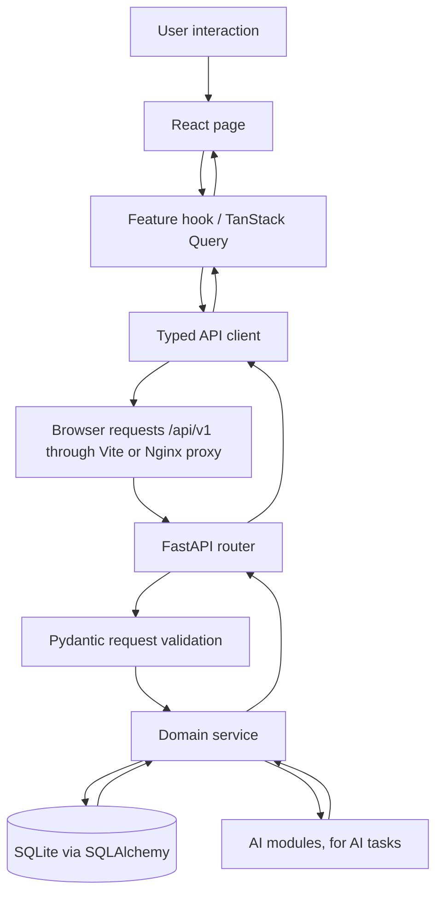

# StockSense — Frontend Plan

**Document:** 04 — Frontend UX, Pages, Routing, and API Connections  
**Purpose:** Implementation-ready guide for the React frontend of the StockSense AI-assisted inventory assessment.  
**Target:** Demonstrate a coherent inventory workflow by the assessment interview, not reproduce a full commercial ERP.  
**Stack:** React + TypeScript + Vite, React Router, TanStack Query, React Hook Form + Zod (optional but useful), one chart library such as Recharts, and Tailwind CSS only if already familiar.  
**Backend:** FastAPI + Pydantic + SQLAlchemy + SQLite.  
**API base path:** `/api/v1`.

---

## 1. Research: patterns from established inventory products

This is a short UI/workflow review of established products, not a market-share ranking. These products target different company sizes and should be treated as references for established interaction patterns—not as a requirement to copy every feature.

| Reference product | Documented interaction / page pattern | What StockSense should learn from it | What StockSense should not build for this assessment |
|---|---|---|---|
| **Odoo Inventory** | An operations overview organizes incoming receipts, deliveries, transfers, and late or pending work. Warehouse operations can be processed and validated as explicit steps. | Put operational queues and exceptions near the dashboard; make receipts and transfers visible as work to complete. | Barcode/mobile scanning, routing rules, manufacturing integration, multi-step warehouse routes. |
| **ERPNext Stock** | Stock Entry supports receipts, issues, transfers, source/target warehouses, and quantities. Stock Reconciliation handles physical count versus recorded stock. Stock Ledger reports show a transaction-level history. | Give each stock movement a clear purpose; separate regular movements from count reconciliation; make transaction history inspectable. | Manufacturing flows, accounting valuation, batch/serial complexity, full ERP accounting. |
| **InvenTree** | Part/stock details connect a stock quantity to a physical location and supplier; stock history records changes and actors. Purchase orders can be filtered in a table and received fully or line-by-line. | Show item totals and location breakdowns together; preserve movement history; support partial purchase-order receipt. | BOM/build-order, serial tracking, plugin and production workflows. |
| **Zoho Inventory** | Dashboard highlights metrics, top items/vendors, pending actions, purchase receipts, and recent activity. The product also has item, warehouse, purchase, stock-count, and inventory-report areas. | Make KPIs navigable; show pending receipts/orders and recent activity; make tables filterable and link records to detail pages. | Sales-channel, shipping, invoicing, payments, and broad integration screens unrelated to this assessment. |

### Source links

- Odoo, *Inventory dashboards*: https://www.odoo.com/documentation/19.0/applications/inventory_and_mrp/inventory/warehouses_storage/reporting/dashboards.html
- Odoo, *Process receipts and deliveries with barcodes*: https://www.odoo.com/documentation/master/applications/inventory_and_mrp/barcode/operations/receipts_deliveries.html
- ERPNext, *Stock Entry*: https://docs.frappe.io/erpnext/stock-entry
- ERPNext, *Stock Reconciliation*: https://docs.frappe.io/erpnext/stock-reconciliation
- ERPNext, *Stock Ledger Report*: https://docs.frappe.io/erpnext/stock-ledger
- InvenTree, *Stock Items and Locations*: https://docs.inventree.org/en/stable/stock/
- InvenTree, *Purchase Orders*: https://docs.inventree.org/en/stable/purchasing/purchase_order/
- InvenTree, *Stock Tracking*: https://docs.inventree.org/en/stable/stock/tracking/
- Zoho Inventory, *The Dashboard*: https://www.zoho.com/inventory/help/getting-started/dashboard.html

**Design conclusion:** StockSense should be operations-first, table-driven, traceable, and exception-focused. Its differentiator is an explainable replenishment recommendation and evaluation view—not decorative charts or an LLM chat screen.

---

## 2. Frontend goals and non-goals

### Goals

1. A storekeeper can quickly issue, transfer, receive, and reconcile stock without silently creating an invalid balance.
2. A procurement user can understand open purchase orders, partial receipts, and what needs action.
3. A manager can identify low-stock/stockout-risk items and understand why the AI recommends replenishment.
4. Every displayed number comes from the API; React does not reimplement stock or AI policy calculations.
5. A reviewer can follow one complete demo workflow without opening the database or editing records manually.

### Non-goals for the assessment

- Full ERP replacement, real ERP integration, mobile app, barcode scanning, batch/serial/expiry management, sales orders, invoices, supplier portal, multi-company tenancy, elaborate permissions administration, or a general-purpose AI chatbot.
- Real authentication unless time remains after the business workflows work. A demo user selector is only for audit attribution, not a security boundary.
- Dashboard charts whose numbers cannot be traced to an endpoint and a documented calculation.

---

## 3. Information architecture and navigation

Use a persistent left sidebar on desktop, a compact header, and one main content region. Collapse the sidebar on narrow screens. Keep one primary action per page and do not hide critical workflow actions inside decorative cards.

```text
StockSense
├── Overview
├── Inventory
│   ├── Items list
│   └── Item detail
├── Operations
│   ├── Issue stock
│   ├── Transfer stock
│   ├── Stock count / adjustment
│   └── Manual receipt (optional; prefer receiving against a PO)
├── Purchase Orders
│   ├── Purchase-order list
│   ├── Create draft PO
│   └── Purchase-order detail / receive goods
├── AI & Replenishment
│   ├── Recommendations
│   └── Forecasts & Model Report
└── Activity & Integrity
    ├── Stock movement ledger
    ├── Alerts
    └── Inventory integrity check
```

For speed, **Activity & Integrity** can be a single route with tabs, and **AI & Replenishment** can be one route with tabs. This gives the app six top-level destinations, not a large set of unrelated pages.

### Route map

| Route | Page | Priority |
|---|---|---|
| `/` | Redirect to `/overview` | Must |
| `/overview` | Overview dashboard | Must |
| `/inventory` | Inventory table | Must |
| `/inventory/items/:itemId` | Item detail | Must |
| `/operations` | Operations landing + transaction tabs | Must |
| `/purchase-orders` | Purchase-order list | Must |
| `/purchase-orders/new` | Create draft PO | Must |
| `/purchase-orders/:poId` | PO details and receiving | Must |
| `/ai` | Recommendations, forecasts, evaluation tabs | Must |
| `/activity` | Ledger, alerts, integrity-check tabs | Should; ledger itself is Must |
| `/not-found` | Not-found state | Must |

Do not create a separate frontend route for every database table. Routes should represent user tasks; tables are backend implementation details.

---

## 4. App shell and shared components

### 4.1 App shell

**Left sidebar**
- StockSense wordmark and compact navigation labels/icons.
- Overview, Inventory, Operations, Purchase Orders, AI & Replenishment, Activity & Integrity.
- Current selected route visibly highlighted.

**Top bar**
- Page title and breadcrumb where useful.
- Optional global SKU/name search. If global search is too much, keep search in the Inventory page instead.
- Demo actor selector (e.g. Storekeeper, Procurement Officer, Manager) only to attach an actor identifier to audited actions. Label this clearly as a demo identity selector.
- Optional selected warehouse filter. Do not let it imply that the AI policy supports all warehouses if the MVP policy is configured for a single default replenishment warehouse.
- User-facing API/network status only if it is useful; avoid technical noise in the main UI.

### 4.2 Shared components

Implement a small, consistent set:

- `AppLayout`, `Sidebar`, `PageHeader`, `Breadcrumbs`
- `KpiCard`, `StatusBadge`, `SeverityBadge`
- `DataTable`, `TableToolbar`, `Pagination`, `EmptyState`
- `LoadingState`, `ErrorState`, `InlineFieldError`, `Toast`
- `ConfirmDialog`, `ReasonDialog`, `QuantityInput`
- `StockLevelIndicator`, `LocationStockBreakdown`
- `ForecastChart`, `DemandPatternBadge`, `RecommendationExplanation`

Build the table and error components first because they are reused on the inventory, PO, recommendation, and ledger pages.

### 4.3 Visual direction

Use a restrained, readable operations UI. Prioritize dense-but-readable tables, clear numeric alignment, consistent status labels, sufficient contrast, and obvious primary actions. Use severity color only when it conveys meaning—e.g. a genuine critical stockout risk—not as decoration. Desktop-first is reasonable for the interview demo, but forms and tables must remain usable on tablet-width displays.

---

## 5. Page-by-page specification

## Page 1 — Overview (`/overview`)

### Purpose
Show what requires attention now and provide shortcuts into real workflows. This is not a sales dashboard.

### Layout

1. **Page heading:** “Inventory Overview”, last-updated time, refresh action if needed.
2. **KPI row:** active SKUs; inventory value if the costing assumptions are clearly labelled; items at/below reorder point; zero-stock items with recent demand; open recommendations; critical alerts.
3. **Needs attention:** top critical/high recommendations and open alerts. Each row links to the underlying item or recommendation.
4. **Open purchasing work:** draft, approved, and partially received POs; show expected dates and late/overdue state only if dates exist.
5. **Recent stock activity:** latest receipts, issues, transfers, and adjustments with timestamp, item, location, quantity, and actor.
6. **Inventory integrity indicator:** last integrity-check status, with a “Run/check details” action if endpoint design permits safe read-only execution.

### Data connections

- `GET /api/v1/dashboard/summary`
- `GET /api/v1/recommendations?status=OPEN&limit=...`
- `GET /api/v1/alerts?status=OPEN&limit=...` (if alerts are implemented)
- `GET /api/v1/stock/movements?limit=...`
- `GET /api/v1/purchase-orders?status=...&limit=...`
- `GET /api/v1/stock/integrity-check` (if it is safe and reasonably fast to call on page load; otherwise invoke on demand)

If an endpoint does not exist yet, either add it to the API plan or omit that widget. Do not fabricate metrics in React.

### Interactions

- Clicking a KPI applies a useful filter on its destination page.
- Clicking a recommendation opens its explanation.
- Clicking a recent movement opens item detail or ledger history.
- Empty states explain what to do next; they do not look like broken pages.

---

## Page 2 — Inventory (`/inventory`)

### Purpose
Find items quickly and understand where stock is held.

### Table columns

- SKU
- Item name
- Category
- Criticality
- Base unit of measure
- On hand at default replenishment warehouse
- On hand across all locations (label this separately if shown)
- On order to the default warehouse
- Reorder point (when a policy exists)
- Status: In stock / Low / Out of stock / Inactive / No policy
- Row action: View details

### Search and filters

- Search by SKU or item name (`q`).
- Category, criticality, active/inactive, location, and below-reorder filters when supported by API.
- Sort by SKU/name, stock quantity, criticality, or urgency.
- Pagination; do not load every movement or every item in one request.
- Show an explicit clear-filters action and a result count.

### Item detail (`/inventory/items/:itemId`)

Use a page with summary header and tabs:

**Summary tab**
- SKU, name, category, criticality, UOM, active status.
- On-hand stock by location, configured replenishment destination, on-order quantity, inventory position.
- Preferred supplier and supplier terms (unit price, MOQ, order multiple, nominal lead time).
- Latest policy data only if a successful AI run exists.

**Movement history tab**
- Timestamp, movement type, signed quantity, location, reason/reference, actor.
- Filters by type and date; link to full ledger route if present.

**Demand & forecast tab**
- Historical weekly issues and forecast in clearly distinct visual styles.
- Forecast horizon and AI run timestamp/model/method.
- Demand pattern label and a short description in plain English.
- Make clear that recorded issues may understate real demand in periods when stock was unavailable.

**Recommendations/policy tab**
- Reorder point, safety stock, target/order-up-to level, service level, supplier lead-time estimate, and last run.
- Link to the recommendation record; do not create an independent duplicated approval workflow here.

### Data connections

- `GET /api/v1/items` and `GET /api/v1/items/{id}`
- `GET /api/v1/stock` and `GET /api/v1/stock/items/{item_id}`
- `GET /api/v1/stock/movements?item_id=...`
- `GET /api/v1/items/{id}/demand-history`
- `GET /api/v1/items/{id}/suppliers` or the matching supplier-terms endpoint
- `GET /api/v1/ai/policies?item_id=...`
- `GET /api/v1/recommendations?item_id=...` if this filter is exposed

### Actions

- “Issue stock” links to Operations with the item preselected.
- “Transfer” links to Operations with item preselected.
- “Create PO” or “View recommendation” links to Purchasing/AI. Keep the selected item in route state or query parameters; the backend remains authoritative.

---

## Page 3 — Operations (`/operations`)

### Purpose
Provide safe forms for recording the physical movements that drive stock balances and the demand history.

Use tabs or segmented navigation: **Issue**, **Transfer**, **Count adjustment**, and optionally **Manual receipt**. Receiving against a PO should normally happen on the PO detail page to maintain traceability.

### A. Issue stock

Fields:
- Item (searchable selector showing SKU + name)
- Source location
- Positive quantity entered by the user
- Project/reference (optional if no project selected for this use case)
- Reason/notes where appropriate
- Confirmation summary: current available stock, requested quantity, resulting estimated balance

Behavior:
- Frontend may prevent obviously invalid input, but only backend validation is authoritative.
- Do not submit if quantity is missing, zero, negative, or not an integer under the MVP's quantity convention.
- Generate one idempotency key per logical submission and reuse it on retry of that same request. Never generate a new key just because the request timed out.
- On `409 INSUFFICIENT_STOCK`, show the available/requested quantities and preserve the form values.
- On success, show movement reference and returned balance, then refetch the affected stock and history queries.

API: `POST /api/v1/stock/issues`, `GET /api/v1/stock/items/{item_id}`.

### B. Transfer stock

Fields:
- Item
- Source location
- Destination location (must differ from source)
- Positive quantity
- Reason/reference if required

Behavior:
- Show source available balance before submission.
- One submission must result in an atomic OUT + IN pair from the backend. React must never send two independent stock mutations for the two legs.
- Display success only after backend confirmation.

API: `POST /api/v1/stock/transfers`.

### C. Count adjustment

Fields:
- Item
- Location
- System quantity (read-only)
- Physical counted quantity
- Mandatory reason
- Difference calculated in the UI for preview only

Behavior:
- Submit the physical count; let the backend compute/validate the ledger delta based on current state.
- Show the exact adjustment posted after success.
- Confirmation required for large differences, if a threshold is configured.

API: `POST /api/v1/stock/adjustments` if included in the MVP.

### D. Manual receipt (optional)

If kept, it must be clearly labelled as a receipt not linked to a PO. For the main demo, receiving against a purchase order is better because it shows the full procurement loop.

API: `POST /api/v1/stock/receipts` if included.

---

## Page 4 — Purchase Orders (`/purchase-orders`)

### List view

Columns:
- PO number
- Supplier
- Creation/order date
- Expected date
- Total line count / quantity (if the API supplies these values)
- Destination warehouse
- Status
- Source: Manual or AI recommendation
- Row action: Open

Filters: status, supplier, and date/status where supported. Use clear badges for `DRAFT`, `APPROVED`, `PARTIALLY_RECEIVED`, `RECEIVED`, and `CANCELLED`.

Primary action: **Create draft PO**.

### Create draft PO (`/purchase-orders/new`)

Fields:
- Supplier
- Destination warehouse
- Expected delivery date (optional)
- Notes/reference
- One or more lines: item, quantity, unit price

Behavior:
- Validate positive quantities, known items, supplier selection, and destination before submit.
- Do not mark a newly created manual PO as approved.
- On successful create, navigate to PO detail and show the server-assigned PO number and status.

API: `POST /api/v1/purchase-orders`.

### PO detail (`/purchase-orders/:poId`)

Header:
- PO number, supplier, status, destination, created/order date, expected date, creator, approver (where available), source recommendation.

Lines table:
- SKU/item
- Ordered quantity
- Received quantity
- Remaining quantity (ordered minus received)
- Unit price
- Destination
- Receive action

Actions:
- Approve draft PO.
- Receive part/all of a line with quantity and actual receiving location.
- Cancel only if backend says cancellation is allowed.

Partial receipt workflow:
1. User enters a received quantity for each line being received.
2. UI shows remaining quantity and prevents obvious over-entry.
3. Backend revalidates line/PO status and quantities atomically.
4. Backend records receipt stock movements and updates PO status.
5. UI shows resulting status and movement references and refetches PO detail, stock, and recent activity.

Never update stock quantity directly from the frontend. A “Received” label by itself must not change inventory; only the successful receiving API should do so.

API:
- `GET /api/v1/purchase-orders`
- `POST /api/v1/purchase-orders`
- `GET /api/v1/purchase-orders/{id}`
- `POST /api/v1/purchase-orders/{id}/approve`
- `POST /api/v1/purchase-orders/{id}/receive`
- `POST /api/v1/purchase-orders/{id}/cancel`

---

## Page 5 — AI & Replenishment (`/ai`)

This is the product's main differentiator. Keep it explainable. Do not turn it into an AI chat page.

### Tab A: Recommendations

List columns:
- Urgency
- SKU / item
- Destination warehouse
- On hand
- On order
- Inventory position
- Reorder point
- Suggested quantity
- Supplier
- Stockout risk estimate (only if calculated correctly and defined)
- Status

Filters: status, urgency, item, demand pattern. Sort highest urgency first.

Selecting a row opens a detail page or side panel containing:
- **Why now:** the exact rule that triggered the recommendation.
- Forecast mean / demand pattern / selected method.
- Protection interval and lead-time assumptions.
- Service-level target, reorder point, safety stock, and order-up-to level.
- Supplier MOQ and order multiple constraints.
- Known conflicts or low-confidence flags.
- Data cutoff, AI run ID, run time, and method version.
- Actions: approve (with editable order quantity where supported) or dismiss (reason required).

Approval flow:
1. UI opens a confirmation that states supplier, destination, item, quantity, and expected date assumptions.
2. User confirms one time.
3. UI calls the backend approval endpoint with an idempotency strategy if supported by the API contract.
4. Backend rechecks the current recommendation and inventory state, creates the PO, and updates recommendation state atomically.
5. UI displays the returned PO link. Do not simulate approval optimistically.

API:
- `GET /api/v1/recommendations`
- `GET /api/v1/recommendations/{id}`
- `POST /api/v1/recommendations/{id}/approve`
- `POST /api/v1/recommendations/{id}/dismiss`

### Tab B: Forecasts

- Item selector.
- Historical weekly issue chart plus forecast horizon.
- Clearly label actual/observed history vs future forecast; do not draw a forecast as if it were actual stock.
- Show the chosen method, demand pattern, horizon, data cutoff, and confidence/quantile definition if available.
- Show a visible “low confidence / insufficient history” state for cold-start items.

API:
- `GET /api/v1/items/{id}/demand-history`
- `GET /api/v1/ai/forecasts?item_id=...&run_id=...`
- `GET /api/v1/ai/policies?item_id=...`

### Tab C: Model Report

- AI run status and last successful run.
- Run button only if the API supports it.
- During a run: `RUNNING` status and modest polling of `GET /api/v1/ai/runs/{run_id}`; stop polling on `SUCCEEDED` or `FAILED`.
- Forecast metrics (e.g. RMSSE/MASE/bias) split by demand pattern, with sample counts.
- Policy comparison: baseline vs StockSense policy using the same evaluation window and assumptions.
- Inventory outcomes: fill rate, unmet demand/stockout weeks, average inventory, number of orders.
- Synthetic dataset profile and prominent limitations statement.

API:
- `POST /api/v1/ai/runs`
- `GET /api/v1/ai/runs/{id}`
- `GET /api/v1/ai/backtests`
- Any explicit policy simulation/report endpoint needed for comparison (add this to the backend contract if not already present).
- `POST /api/v1/admin/seed` only in demo mode and never exposed as a normal end-user action in a deployed production UI.

**Critical UX rule:** if no AI run has completed, show an empty state and a button to run the pipeline. Do not present example values as real model outputs. Put “synthetic-data evaluation” on the report so users cannot confuse it with a real customer performance guarantee.

---

## Page 6 — Activity & Integrity (`/activity`)

### Ledger tab

Display movement rows from `GET /api/v1/stock/movements`:
- Timestamp
- Movement type
- Item SKU/name
- Location
- Signed quantity
- Reference type/ID
- Actor
- Reason

Filters: SKU, location, movement type, time range. Every movement should link to item detail where practical. Never expose edit/delete controls for posted ledger entries.

### Alerts tab

If alerts are part of the MVP, show severity, type, SKU, location, message, creation time, and status. Allow acknowledge/resolve actions only through backend endpoints.

### Integrity tab

Show whether ledger-derived balances match cached stock balances. List mismatches in a useful diagnostic table if any are found. This is a key demo proof that the stock model is internally consistent. If the check is read-only, label it clearly as an audit/diagnostic action.

API:
- `GET /api/v1/stock/movements`
- `GET /api/v1/stock/integrity-check`
- `GET /api/v1/alerts`
- `POST /api/v1/alerts/{id}/acknowledge` / `resolve` if implemented

---

## 6. How the frontend connects to the backend

### 6.1 Request path



### 6.2 API-client ownership

All network calls belong in `frontend/src/api/` (or equivalent), never directly inside large JSX components.

Suggested modules:

```text
frontend/src/
├── api/
│   ├── client.ts              # Base URL, JSON parsing, shared error class
│   ├── items.ts               # Item/master-data queries
│   ├── stock.ts               # Balances, movements, stock mutations
│   ├── purchaseOrders.ts      # PO list, detail, approve, receive, cancel
│   ├── recommendations.ts    # AI recommendation actions
│   ├── ai.ts                  # Runs, forecasts, backtests, policies
│   └── dashboard.ts           # Dashboard summary
├── app/
│   ├── router.tsx
│   └── queryClient.ts
├── components/
│   ├── layout/
│   ├── tables/
│   ├── forms/
│   ├── feedback/
│   └── charts/
├── features/
│   ├── overview/
│   ├── inventory/
│   ├── operations/
│   ├── purchasing/
│   ├── replenishment/
│   └── activity/
├── hooks/
├── types/
│   └── api.ts
├── App.tsx
└── main.tsx
```

It is acceptable to start with fewer folders; preserve the separation of concerns rather than creating empty abstractions.

### 6.3 Base URL and proxy

**Recommended local setup:** React calls a relative URL such as `/api/v1/items`. Configure Vite to proxy `/api` to `http://127.0.0.1:8000`; configure Nginx/reverse proxy similarly in Docker deployment. The browser should not call a Compose-internal hostname such as `http://api:8000` directly.

If using a direct browser URL instead, define `VITE_API_BASE_URL` in environment configuration and explicitly allow the frontend development origin in FastAPI CORS settings. Do not permit every origin just to make development work.

### 6.4 Query and local state

- Use TanStack Query (or a small equivalent) for API server state, cache, refetch, loading, and error handling.
- Use local React state for open dialogs, currently edited form fields, and selected tabs.
- Encode table filters/page number in URL search parameters where practical, so a link preserves the current view.
- Do not introduce Redux for this assessment unless a real cross-page state problem justifies it.
- Invalidate/refetch affected queries after the backend confirms a mutation. Example: after receiving a PO, refetch that PO, balances for received items, the overview summary, and recent movements.

### 6.5 DTOs and types

Create TypeScript types for the API request/response objects used by the pages. Use FastAPI OpenAPI at `/docs` (and its OpenAPI JSON) as the source of truth. Avoid maintaining contradictory frontend-only types by hand. If generation setup takes too long, hand-write the small set of DTOs and add a note to keep them synchronized.

### 6.6 Common error handling

Build one API error parser that understands the backend's stable error format:

```json
{
  "error": {
    "code": "INSUFFICIENT_STOCK",
    "message": "Requested quantity exceeds available stock.",
    "details": { "available": 4, "requested": 10 }
  }
}
```

Map stable codes to helpful UI messages. Required states include:

- Loading: skeleton or spinner with context.
- Empty: explain how to create/seed the first data.
- Validation: show errors next to fields.
- Conflict (`409`): preserve inputs, show the business reason, allow safe correction.
- Network/server failure: retry where safe and retain form inputs.
- Success: confirm the server-authoritative record ID/status.

Do not display Python tracebacks or sensitive internal exception details to the user.

---

## 7. Frontend forms and business rules

| Rule | Frontend responsibility | Backend responsibility |
|---|---|---|
| Quantity must be positive | Prevent obvious input mistakes | Validate authoritatively |
| Issue cannot exceed available stock | Preview available stock; show readable conflict | Lock/validate current balance and reject atomically |
| Transfer has different source/destination | Prevent selecting identical locations | Revalidate and post both ledger legs atomically |
| Adjustment needs a reason | Mark reason as required | Enforce reason and validate current balance |
| PO cannot be over-received | Show remaining quantity and stop obvious over-entry | Re-check all lines/status in one transaction |
| PO state transitions | Hide or disable actions that clearly don't apply | Own the state machine and reject invalid transitions |
| AI cannot auto-approve | Require explicit human action | Approval endpoint performs atomic recommendation→PO transition |
| Demo actor attribution | Include selected demo actor in API request only if contract supports it | Treat as attribution, not verified identity |
| Idempotency | Keep same key for retry of one logical request | Match key + request hash and prevent duplicate effects |
| Inventory KPIs | Format values and provide definitions | Compute authoritative metrics and document definitions |

Never calculate authoritative reorder points, stock balances, PO status, or available quantity in the frontend. UI-derived values may be displayed as previews but must be revalidated by the API.

---

## 8. Frontend testing and acceptance criteria

### Component/unit tests

- Status/severity badges render every supported value.
- Forms reject blank/zero/negative quantities before submission.
- API errors map `INSUFFICIENT_STOCK`, `INVALID_STATE`, and validation errors to friendly messages.
- Empty and error states render correctly.
- Recommendation explanation displays the actual returned assumptions without hiding low-confidence flags.

### Integration/smoke tests

1. Frontend can fetch `/api/v1/items` through the configured proxy.
2. Inventory filters change the requested query and display the server result.
3. Issue stock successfully updates balance and movement history after refetch.
4. An over-issue receives `409`, leaves the database unchanged, and preserves the user input.
5. A transfer succeeds as a single operation and updates both locations.
6. A draft PO can be created and approved.
7. A partial receipt updates received quantity, PO state, stock, and ledger.
8. Approving a recommendation produces one PO; repeated attempts do not duplicate it.
9. Starting an AI run shows `RUNNING`, and the page handles `SUCCEEDED` and `FAILED` states.
10. A fresh clone can start backend and frontend using the README instructions.

### Definition of done for each page

- Data is fetched from documented endpoints (or there is an explicit, documented mock boundary during early UI development).
- Loading, empty, error, and success states exist.
- Buttons cause real actions; no decorative/inert submit buttons.
- Mutations only show success after the server responds successfully.
- Page actions respect current business status, while the backend remains authoritative.
- A screenshot is captured only after the page works against the API.

---

## 9. Implementation order and what to cut

### Build in this order

1. Create Vite + React + TypeScript, Router, the app shell, API base client, and one health/items connection.
2. Build the Inventory table and item detail so the end-to-end browser/API/database path is proven early.
3. Build Operations forms and shared loading/error/confirmation components.
4. Build PO list/detail and partial receipt workflow.
5. Build Recommendations and approve→PO workflow.
6. Add Forecast and Model Report charts.
7. Add Overview KPI cards and Activity/Integrity details using existing endpoints.
8. Polish spacing, responsive behavior, and screenshots; run the entire golden demo from a fresh clone.

### Cut order if behind

1. Global search; use search on Inventory only.
2. Manual receipt form; receive against a PO in the main demo.
3. Separate Activity page; fold ledger/alerts/integrity into tabs or item detail.
4. Advanced chart interactions and extra filter combinations.
5. Anomaly visualization and optional batch PO approval.

**Do not cut:** inventory table, issue/transfer core if included in backend, PO receiving, recommendation explanation and approval, API error handling, and one working evaluation view.

Do not build an LLM chat assistant, barcode scanning, advanced role-management UI, or custom chart framework before the main workflow is complete.

---

## 10. Golden demo path

Rehearse this exact sequence and make sure all pages link to the next step:

1. Overview: point out a low-stock item and open recommendation.
2. Inventory: open its item detail; show location-level stock and movement history.
3. Operations: record a valid issue; show the updated balance and ledger entry.
4. AI & Replenishment: open a recommendation and explain the rule, forecast, lead time, service level, destination, and quantity.
5. Approve the recommendation: because approving the recommendation is the explicit human approval, the API creates an `APPROVED` PO in one transaction. A manually created PO follows the separate `DRAFT` → `APPROVED` flow.
6. Purchase Orders: open the resulting PO and receive part of a line.
7. Return to Inventory/Activity: show the balance and ledger reflecting the receipt.
8. Model Report: show forecast metrics and baseline-versus-policy results, including limitations and synthetic-data caveats.

A demo must never rely on manually altering SQLite or fabricating a success message. Seed/reset should be a documented development command and disabled as a normal UI action.

---

## 11. Research notes vs StockSense recommendations

The observations in Section 1 are derived from public product documentation. The proposed StockSense page hierarchy, cut order, React stack, and simplified workflow are implementation recommendations for this assessment, not claims that the referenced products use this exact design.

The goal is to borrow proven interaction patterns—actionable dashboards, filtered tables, explicit transaction workflows, traceable histories, and partial receiving—while keeping StockSense small enough to build, test, and explain.
