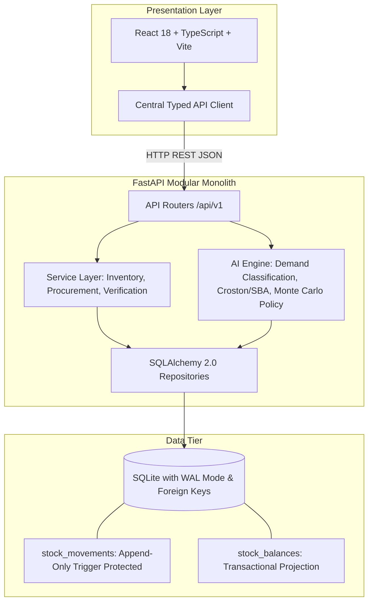

# StockSense — AI-Assisted Inventory Management System

[](https://fastapi.tiangolo.com)
[](https://react.dev)
[-003B57?logo=sqlite&logoColor=white)](https://sqlite.org)
[](https://python.org)
[](LICENSE)

> **StockSense** is an end-to-end, auditable inventory management system with human-in-the-loop AI replenishment recommendations tailored for spare parts and consumables in intermittent demand operating environments.

---

## 1. Problem Statement & Solution

### Context & Operating Assumptions
In operations handling spare parts and consumables (such as oilfield maintenance, rigs, and industrial logistics), inventory teams face a structural dilemma:
- **Intermittent & Lumpy Demand:** Many periods show zero demand, punctuated by sudden project-driven spikes. Standard moving averages and simple min/max rules produce severe overstock or catastrophic stockouts.
- **Variable Supplier Lead Times:** Critical imported components experience non-stationary delivery delays.
- **Data Integrity & Traceability:** Traditional mutable inventory tables can silently overwrite balances, destroying the audit trail.
- **Opaque Procurement Actions:** Rule-based ERP alerts rarely explain *why* an order is needed, how much should be ordered, or what the financial/operational trade-off is.

### How StockSense Solves It
1. **Deterministic Inventory Core:** Built on an **append-only stock movement ledger** with a transactional running-balance projection. Database check constraints (`CHECK quantity_on_hand >= 0`) enforce non-negativity at the storage engine level.
2. **Advisory AI Replenishment:** Integrates specialized intermittent-demand forecasting methods (Syntetos-Boylan Approximation / Croston / TSB) alongside Monte Carlo lead-time risk simulations.
3. **Strict Human-In-The-Loop Control:** Probabilistic models never place purchase orders autonomously. The AI submits structured recommendations with full explanations, confidence indicators, and calculated risks to a procurement review queue.
4. **Time-Safe Evaluation:** Historical cutoffs guarantee zero future leakage during training and backtesting. Evaluation demand is isolated from operational feature tables.

---

## 2. System Architecture



### Architectural Principles
- **Separation of Concerns:** Business logic and stock calculations reside exclusively in the backend service layer; the UI never computes authoritative inventory balances.
- **Atomic Double-Entry Movements:** Transfers between locations are executed as paired, atomic `TRANSFER_OUT` and `TRANSFER_IN` movements sharing a `transfer_group_id`.
- **Zero-Service Portability:** SQLite in WAL (Write-Ahead Logging) mode provides immediate, zero-configuration local reproducibility while maintaining ACID guarantees.

---

## 3. Sprint Plan & Milestones

| Sprint / Milestone | Focus Area | Status | Deliverables |
|---|---|---|---|
| **Sprint 1: Foundation & Environment** | Environment & Skeletons | **Completed** | Git repository, docs architecture, SQLite WAL engine, FastAPI health API, React+Vite app, typed client, test harness. |
| **Sprint 2: Core Inventory & Ledger** | Master Data & Movements | Up Next | 17-table schema, append-only ledger triggers, receipt/issue/transfer transactions, zero-mismatch integrity check. |
| **Sprint 3: Purchasing & Lifecycle** | Procurement Flow | In Queue | Purchase orders (Draft -> Approved -> Partially Received -> Received), partial receiving, audit attribution. |
| **Sprint 4: AI & Replenishment** | Forecasting & Simulation | In Queue | Syntetos-Boylan Approximation (SBA), Croston, ADI/CV² classification, Monte Carlo safety stock, explainable recommendations. |
| **Sprint 5: User Interface & Golden Demo** | Operations UI | In Queue | Modern responsive dashboard, inventory ledger viewer, PO workflow, recommendation review modal, integrity check UI. |
| **Sprint 6: Evaluation & Hardening** | Backtesting & Verification | In Queue | Out-of-sample backtest, paired simulation (baseline vs AI), fresh clone smoke test, rehearsal guide. |

---

## 4. Quick Start Guide

### Prerequisites
- Python 3.11+ (Python 3.12 supported)
- Node.js 18+ (Node 24 supported)
- Git

### 1. Clone & Setup Environment
```bash
# Clone the repository
git clone <repo-url>
cd inventory-poc-project

# Copy environment variables
cp .env.example .env
```

### 2. Backend Setup
```bash
# Create and activate Python virtual environment
python3 -m venv .venv
source .venv/bin/activate

# Install dependencies
pip install -r backend/requirements.txt

# Run backend tests
pytest backend/tests -v

# Start FastAPI development server
uvicorn backend.app.main:app --reload --host 127.0.0.1 --port 8000
```
API Documentation will be live at:
- **Interactive Swagger UI:** [http://127.0.0.1:8000/docs](http://127.0.0.1:8000/docs)
- **ReDoc:** [http://127.0.0.1:8000/redoc](http://127.0.0.1:8000/redoc)
- **Health Check:** [http://127.0.0.1:8000/api/v1/health](http://127.0.0.1:8000/api/v1/health)

### 3. Frontend Setup
```bash
# In a new terminal window
cd frontend

# Install npm dependencies
npm install

# Start Vite dev server
npm run dev
```
The application interface will be accessible at:
- **StockSense Dashboard:** [http://localhost:5173](http://localhost:5173)

---

## 5. Repository Structure

```text
stocksense/
├── .agents/                    # Custom agent skills and domain rules
│   └── skills/stocksense/      # StockSense domain rules & architectural invariants
├── docs/                       # Project specifications, sprint plans, frontend guide
│   ├── 01-problem-statement.md
│   ├── 02-technical-architecture.md
│   ├── 03-sprint-plan.md
│   ├── 04-frontend-plan.md
│   └── stocksense-technical-plan.md
├── backend/
│   ├── app/
│   │   ├── main.py             # FastAPI entrypoint, middleware, lifespan
│   │   ├── core/               # Configuration, SQLite engine, WAL pragma, exceptions
│   │   ├── models/             # SQLAlchemy 2.0 ORM models (17 tables)
│   │   ├── schemas/            # Pydantic v2 schemas and validation
│   │   ├── api/v1/             # Modular REST API endpoints (/health, /ready, etc.)
│   │   ├── services/           # Inventory, ledger, procurement domain services
│   │   └── ai/                 # Demand classification, SBA/Croston, policy simulation
│   ├── tests/                  # Backend pytest suite
│   ├── scripts/                # Database initialization & synthetic generation
│   └── requirements.txt        # Pinned Python dependencies
├── frontend/
│   ├── src/
│   │   ├── api/                # Typed REST API client & Axios/fetch wrapper
│   │   ├── components/         # Reusable UI widgets, badges, tables, alerts
│   │   ├── layouts/            # Sidebar navigation & header
│   │   ├── pages/              # Overview, Inventory, Operations, Purchasing, AI
│   │   └── types/              # TypeScript domain types & API models
│   ├── package.json
│   └── vite.config.ts          # Vite proxy configured for /api/v1
├── data/                       # Local SQLite database (gitignored)
├── .env.example                # Sample environment variables
├── .gitignore
└── README.md
```

---

## 6. Data Model Overview (17 Tables)

1. `categories` — Item classifications.
2. `items` — SKU master data, base unit of measure, unit cost in minor currency units, criticality (`CRITICAL`, `STANDARD`, `LOW`).
3. `suppliers` — Vendor directory.
4. `item_suppliers` — Supplier terms, unit price, MOQ, order multiple, and nominal lead time.
5. `locations` — Physical warehouses, yards, and rig sites.
6. `projects` — Campaign destinations for demand issues.
7. `users` — Stable demo identities for audit attribution (`STOREKEEPER`, `PROCUREMENT_OFFICER`, `MANAGER`, `ADMIN`).
8. `stock_movements` — Append-only source-of-truth ledger (`RECEIPT`, `ISSUE`, `TRANSFER_OUT`, `TRANSFER_IN`, `ADJUSTMENT`).
9. `stock_balances` — High-performance current stock balances (`quantity_on_hand >= 0`).
10. `purchase_orders` — PO header and lifecycle (`DRAFT`, `APPROVED`, `PARTIALLY_RECEIVED`, `RECEIVED`, `CANCELLED`).
11. `purchase_order_lines` — PO lines, ordered/received quantities, agreed pricing, destination locations.
12. `ai_runs` — Audit log of forecasting & replenishment model executions with data cutoffs.
13. `forecasts` — Step-by-step future demand estimates.
14. `backtest_results` — Out-of-sample metrics (RMSSE, MASE, bias) across rolling origins.
15. `item_policies` — Calculated safety stock, reorder point ($ROP$), and order-up-to ($OUT$) targets.
16. `recommendations` — Human decision queue for suggested orders with structured explanations.
17. `alerts` — Exception notices (stockout risks, zero suppliers, abnormal adjustments).

---

## 7. AI Replenishment & Decision Intelligence

- **Intermittent Demand Forecasting:** Utilizes Croston's Method and Syntetos-Boylan Approximation (SBA) to decouple demand inter-arrival times from non-zero order sizes, avoiding biased moving average projections.
- **Lead-Time Risk & Monte Carlo:** Simulates lead-time demand distributions under variable supply delay assumptions to derive quantile-based safety stock.
- **Explainability First:** Every recommendation records an `explanation_json` containing the formula, inputs (current on-hand, on-order, supplier MOQ, lead time p90, target service level), and human-readable text justification.

---

## 8. Verification & Golden Demo Flow

The system is tested against the Golden End-to-End Workflow:
1. Verify database integrity check (0 mismatches between ledger and balances).
2. Record an item issue and verify balance decrements and non-negativity constraint.
3. Attempt over-issue and confirm immediate rejection.
4. Run AI Replenishment to generate recommendations.
5. Inspect recommendation explanation in UI and approve purchase order.
6. Partially receive goods against the PO and observe ledger and balance updates.
7. Re-run integrity check verifying total balance equals the sum of ledger transactions.

---

## 9. Acknowledgments & Design References
StockSense draws architectural inspiration from prominent open-source inventory paradigms:
- **InvenTree**: Part master data, location hierarchies, and purchasing structures.
- **ERPNext**: Append-only stock ledger entry (`Stock Ledger Entry`) paired with running balances (`Bin`).
*(All code in StockSense is implemented independently; no code was copied).*
