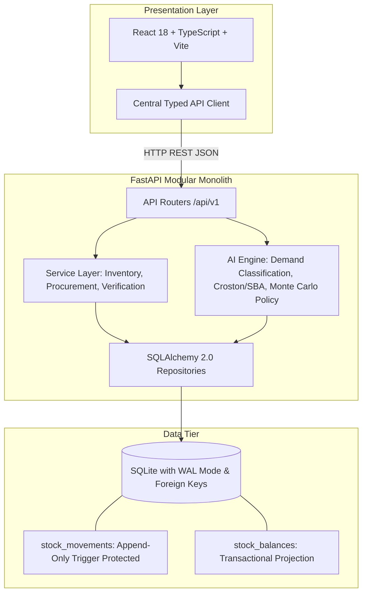

# StockSense — AI-Assisted Inventory Management System

[](https://fastapi.tiangolo.com)
[](https://react.dev)
[-003B57?logo=sqlite&logoColor=white)](https://sqlite.org)
[](https://python.org)
[](LICENSE)

> **StockSense** is an end-to-end, auditable inventory management system with human-in-the-loop AI replenishment recommendations tailored for spare parts and consumables in intermittent demand operating environments.

---

## 1. Problem Statement & Solution

### Context & Operating Assumptions
In operations handling spare parts and consumables (such as oilfield maintenance, rigs, and industrial logistics), inventory teams face a structural dilemma:
- **Intermittent & Lumpy Demand:** Many periods show zero demand, punctuated by sudden project-driven spikes. Standard moving averages and simple min/max rules produce severe overstock or catastrophic stockouts.
- **Variable Supplier Lead Times:** Critical imported components experience non-stationary delivery delays.
- **Data Integrity & Traceability:** Traditional mutable inventory tables can silently overwrite balances, destroying the audit trail.
- **Opaque Procurement Actions:** Rule-based ERP alerts rarely explain *why* an order is needed, how much should be ordered, or what the financial/operational trade-off is.

### How StockSense Solves It
1. **Deterministic Inventory Core:** Built on an **append-only stock movement ledger** with a transactional running-balance projection. Database check constraints (`CHECK quantity_on_hand >= 0`) enforce non-negativity at the storage engine level.
2. **Advisory AI Replenishment:** Integrates specialized intermittent-demand forecasting methods (Syntetos-Boylan Approximation / Croston / TSB) alongside Monte Carlo lead-time risk simulations.
3. **Strict Human-In-The-Loop Control:** Probabilistic models never place purchase orders autonomously. The AI submits structured recommendations with full explanations, confidence indicators, and calculated risks to a procurement review queue.
4. **Time-Safe Evaluation:** Historical cutoffs guarantee zero future leakage during training and backtesting. Evaluation demand is isolated from operational feature tables.

---

## 2. System Architecture



### Architectural Principles
- **Separation of Concerns:** Business logic and stock calculations reside exclusively in the backend service layer; the UI never computes authoritative inventory balances.
- **Atomic Double-Entry Movements:** Transfers between locations are executed as paired, atomic `TRANSFER_OUT` and `TRANSFER_IN` movements sharing a `transfer_group_id`.
- **Zero-Service Portability:** SQLite in WAL (Write-Ahead Logging) mode provides immediate, zero-configuration local reproducibility while maintaining ACID guarantees.

---

## 3. Documentation Suite & Developer Playbook

All specifications, architectural RFCs, sprint roadmaps, and autonomous agent guides are indexed under the [`docs/`](./docs) directory:

| Document | Title | Purpose |
|---|---|---|
| 📑 **[`docs/INDEX.md`](./docs/INDEX.md)** | **Master Index & AI Agent Playbook** | Complete architectural index, senior directory critique, developer onboarding guide, skills manual, and enterprise production roadmap. |
| 🎯 **[`docs/01-problem-statement.md`](./docs/01-problem-statement.md)** | **Problem Statement & Operating Context** | Oilfield spare parts & consumables domain, pain points (P1–P6), persona journeys, and the Golden Demo scenario. |
| 🏗️ **[`docs/02-technical-architecture.md`](./docs/02-technical-architecture.md)** | **Technical Architecture & Data Model** | System architecture diagrams, 17-table data dictionary, append-only ledger mechanics, and non-negative constraints. |
| 📊 **[`docs/02b-system-design-and-data-flows.md`](./docs/02b-system-design-and-data-flows.md)** | **System Design Charts & Data Flow Diagrams** | Visual diagrams: layered system topology, core stock movement transactions, double-entry transfers, AI advisory replenishment pipeline, and PO lifecycle. |
| 🗓️ **[`docs/03-sprint-plan.md`](./docs/03-sprint-plan.md)** | **Sprint Plan & Delivery Roadmap** | Milestone tracking (Sprint 1 to Sprint 6), P0/P1/P2 scope management, exit criteria, and interview preparation. |
| 🎨 **[`docs/04-frontend-plan.md`](./docs/04-frontend-plan.md)** | **Frontend UX & Page Routing Guide** | InvenTree/ERPNext inspired interaction patterns, 6 screens, design system tokens, and API interaction states. |
| 🤖 **[`docs/05-ai-engine-and-activity-log.md`](./docs/05-ai-engine-and-activity-log.md)** | **AI Engine Specification & Activity Log** | Dynamic living registry: demand classification formulas, Croston/SBA algorithms, policy math, live execution history log, and recommendation audit trail. |
| 📖 **[`docs/stocksense-technical-plan.md`](./docs/stocksense-technical-plan.md)** | **Master Technical Plan (Single Source of Truth)** | Comprehensive architectural reference covering domain models, intermittent forecasting math, Monte Carlo policy, and ADRs. |

---

## 4. Sprint Plan & Milestones

| Sprint / Milestone | Focus Area | Status | Deliverables |
|---|---|---|---|
| **Sprint 1: Foundation & Environment** | Environment & Skeletons | **Completed** | Git repository, docs architecture, SQLite WAL engine, FastAPI health API, React+Vite app, typed client, test harness. |
| **Sprint 2: Core Inventory & Ledger** | Master Data & Movements | **Completed** | 17-table schema, append-only movements, atomic balance sync, over-issue rejection, paired transfers, 0-mismatch check, seed data, modular UI. |
| **Sprint 3: Purchasing & Lifecycle** | Procurement Flow | **Completed** | Purchase orders (Draft -> Approved -> Partially Received -> Received), partial receiving, over-receipt prohibition, Procurement UI. |
| **Sprint 4: AI & Replenishment** | Forecasting & Advisory | **Completed** | Zero-leakage demand extraction, Croston & SBA intermittent demand models, risk policies, human approval to Draft PO, AI Insights screen. |
| **Sprint 5: Golden Demo Verification** | Workflow Hardening | **Completed** | Automated golden flow integration test, end-to-end audit reconciliation, zero-mismatch verification, verification script. |
| **Sprint 6: Ergonomics & User Audit** | Workspace & Directory | **Completed** | Collapsible rail sidebar with local persistence, streamlined header, real database user directory, and non-repudiable ledger audit attribution. |

---

## 5. Quick Start Guide

### Prerequisites
- Python 3.11+ (Python 3.12 supported)
- Node.js 18+ (Node 24 supported)
- Git

### 1. One-Command Quick Start (Recommended)

To automatically verify environment dependencies, initialize the database, seed test records, and start both the FastAPI backend and React frontend concurrently:

```bash
./run.sh
```

- **StockSense Dashboard:** [http://localhost:5173](http://localhost:5173)
- **Interactive Swagger Docs:** [http://127.0.0.1:8000/docs](http://127.0.0.1:8000/docs)
- **Backend Health Check:** [http://127.0.0.1:8000/api/v1/health](http://127.0.0.1:8000/api/v1/health)

Press `Ctrl+C` at any time to gracefully stop all services.

---

### 2. Manual / Granular Setup
```bash
# Copy environment variables
cp .env.example .env
```

### 2. Backend Setup
```bash
# Create and activate Python virtual environment
python3 -m venv .venv
source .venv/bin/activate

# Install dependencies
pip install -r backend/requirements.txt

# Run backend tests
pytest backend/tests -v

# Start FastAPI development server
uvicorn backend.app.main:app --reload --host 127.0.0.1 --port 8000
```
API Documentation will be live at:
- **Interactive Swagger UI:** [http://127.0.0.1:8000/docs](http://127.0.0.1:8000/docs)
- **ReDoc:** [http://127.0.0.1:8000/redoc](http://127.0.0.1:8000/redoc)
- **Health Check:** [http://127.0.0.1:8000/api/v1/health](http://127.0.0.1:8000/api/v1/health)

### 3. Frontend Setup
```bash
# In a new terminal window
cd frontend

# Install npm dependencies
npm install

# Start Vite dev server
npm run dev
```
The application interface will be accessible at:
- **StockSense Dashboard:** [http://localhost:5173](http://localhost:5173)

---

## 6. Repository Structure

```text
stocksense/
├── .agents/                    # Custom agent skills and domain rules (14 installed)
│   └── skills/                 # stocksense, ui-ux-pro-max, backend-scalable, etc.
├── docs/                       # Project specifications, sprint plans, frontend guide
│   ├── INDEX.md                # Master Documentation Index & AI Agent Playbook
│   ├── README.md               # Docs Hub Overview
│   ├── 01-problem-statement.md
│   ├── 02-technical-architecture.md
│   ├── 02b-system-design-and-data-flows.md
│   ├── 03-sprint-plan.md
│   ├── 04-frontend-plan.md
│   ├── 05-ai-engine-and-activity-log.md
│   └── stocksense-technical-plan.md
├── backend/
│   ├── ai/                     # Dedicated AI & Advisory Engine (Self-contained)
│   │   ├── demand_extractor.py # Time-safe weekly demand extractor (zero future leakage)
│   │   ├── agent.py            # ReplenishmentAgent advisory service
│   │   ├── classification.py   # Demand pattern classification (ADI & CV²)
│   │   ├── forecasting.py      # Croston, SBA, MA8, SES algorithms
│   │   ├── policy.py           # Safety stock, ROP, Order-Up-To calculations
│   │   ├── evaluator.py        # Out-of-sample evaluation & backtesting
│   │   ├── models.py           # SQLAlchemy AI models
│   │   ├── demand_extractor.py # Zero-leakage 52-week demand extractor
│   │   ├── pipeline.py         # Per-item calculation pipeline (Croston/SBA, policies, proposals)
│   │   ├── schemas.py          # Pydantic v2 AI DTOs
│   │   ├── service.py          # AI orchestration service & HITL queue
│   │   └── router.py           # AI REST endpoints (/api/v1/ai)
│   ├── app/
│   │   ├── main.py             # FastAPI entrypoint, middleware, lifespan
│   │   ├── core/               # Configuration, SQLite engine, WAL pragma
│   │   ├── models/             # Master data & stock ledger models (12 tables)
│   │   ├── schemas/            # Pydantic v2 schemas and validation (health, inventory, purchase_orders)
│   │   ├── api/v1/             # Modular REST API endpoints (/health, /inventory, /po, /ai)
│   │   └── services/           # Authoritative domain services
│   │       ├── inventory_service.py   # Movements, over-issue rejection, paired transfers
│   │       ├── integrity_service.py   # Ledger-sum vs running-balance reconciliation
│   │       └── procurement_service.py # PO state machine, goods receiving, over-receipt check
│   ├── tests/                  # Backend pytest suite (27 passed, full golden flow integration)
│   ├── scripts/                # Database initialization & synthetic generation (init_db, seed_data)
│   └── requirements.txt        # Pinned Python dependencies
├── frontend/
│   ├── src/
│   │   ├── api/                # Central typed REST API client (client.ts)
│   │   ├── components/         # Modular UI views (Sidebar, Header, InventoryView, LedgerView, ProcurementView, AIInsightsView, AIMetricsCards, AIRowItem, RecommendationModal, MovementModal, etc.)
│   │   ├── types/              # TypeScript domain types & API models (index.ts)
│   │   ├── App.tsx             # Concise layout coordinator (<260 lines)
│   │   ├── index.css           # Industrial dark slate design tokens & styles
│   │   └── main.tsx            # React application entrypoint
│   ├── package.json
│   └── vite.config.ts          # Vite proxy configured for /api/v1
├── config/                     # Configuration templates
├── data/                       # Local SQLite database (WAL mode, gitignored)
├── scripts/                    # Developer & operations helper scripts
│   ├── run_app.sh              # Unified one-command runner (backend + frontend)
│   └── verify_system.sh        # Health & verification test runner
├── run.sh                      # Convenient root runner entrypoint (./run.sh)
├── .env.example                # Sample environment variables
├── .gitignore
├── pytest.ini
└── README.md
```

---

## 7. Data Model Overview (17 Tables)

1. `categories` — Item classifications.
2. `items` — SKU master data, base unit of measure, unit cost in minor currency units, criticality (`CRITICAL`, `STANDARD`, `LOW`).
3. `suppliers` — Vendor directory.
4. `item_suppliers` — Supplier terms, unit price, MOQ, order multiple, and nominal lead time.
5. `locations` — Physical warehouses, yards, and rig sites.
6. `projects` — Campaign destinations for demand issues.
7. `users` — Stable demo identities for audit attribution (`STOREKEEPER`, `PROCUREMENT_OFFICER`, `MANAGER`, `ADMIN`).
8. `stock_movements` — Append-only source-of-truth ledger (`RECEIPT`, `ISSUE`, `TRANSFER_OUT`, `TRANSFER_IN`, `ADJUSTMENT`).
9. `stock_balances` — High-performance current stock balances (`quantity_on_hand >= 0`).
10. `purchase_orders` — PO header and lifecycle (`DRAFT`, `APPROVED`, `PARTIALLY_RECEIVED`, `RECEIVED`, `CANCELLED`).
11. `purchase_order_lines` — PO lines, ordered/received quantities, agreed pricing, destination locations.
12. `ai_runs` — Audit log of forecasting & replenishment model executions with data cutoffs.
13. `forecasts` — Step-by-step future demand estimates.
14. `backtest_results` — Out-of-sample metrics (RMSSE, MASE, bias) across rolling origins.
15. `item_policies` — Calculated safety stock, reorder point ($ROP$), and order-up-to ($OUT$) targets.
16. `recommendations` — Human decision queue for suggested orders with structured explanations.
17. `alerts` — Exception notices (stockout risks, zero suppliers, abnormal adjustments).

---

## 8. AI Replenishment & Decision Intelligence

- **Intermittent Demand Forecasting:** Utilizes Croston's Method and Syntetos-Boylan Approximation (SBA) to decouple demand inter-arrival times from non-zero order sizes, avoiding biased moving average projections.
- **Lead-Time Risk & Monte Carlo:** Simulates lead-time demand distributions under variable supply delay assumptions to derive quantile-based safety stock.
- **Explainability First:** Every recommendation records an `explanation_json` containing the formula, inputs (current on-hand, on-order, supplier MOQ, lead time p90, target service level), and human-readable text justification.

---

## 9. Verification & Golden Demo Flow

The system is tested against the Golden End-to-End Workflow:
1. Verify database integrity check (0 mismatches between ledger and balances).
2. Record an item issue and verify balance decrements and non-negativity constraint.
3. Attempt over-issue and confirm immediate rejection.
4. Run AI Replenishment to generate recommendations.
5. Inspect recommendation explanation in UI and approve purchase order.
6. Partially receive goods against the PO and observe ledger and balance updates.
7. Re-run integrity check verifying total balance equals the sum of ledger transactions.

---

## 10. Acknowledgments & Design References
StockSense draws architectural inspiration from prominent open-source inventory paradigms:
- **InvenTree**: Part master data, location hierarchies, and purchasing structures.
- **ERPNext**: Append-only stock ledger entry (`Stock Ledger Entry`) paired with running balances (`Bin`).
*(All code in StockSense is implemented independently; no code was copied).*

