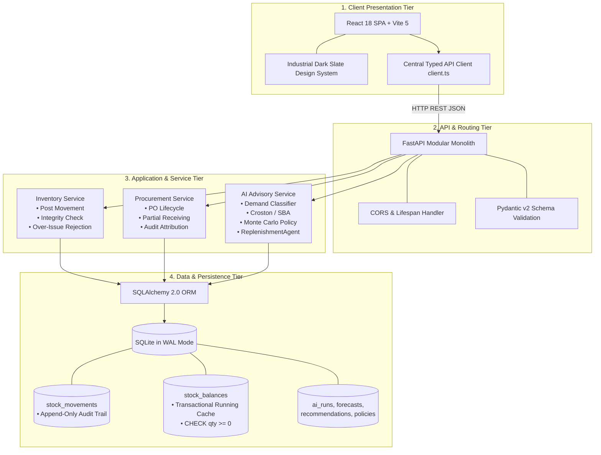
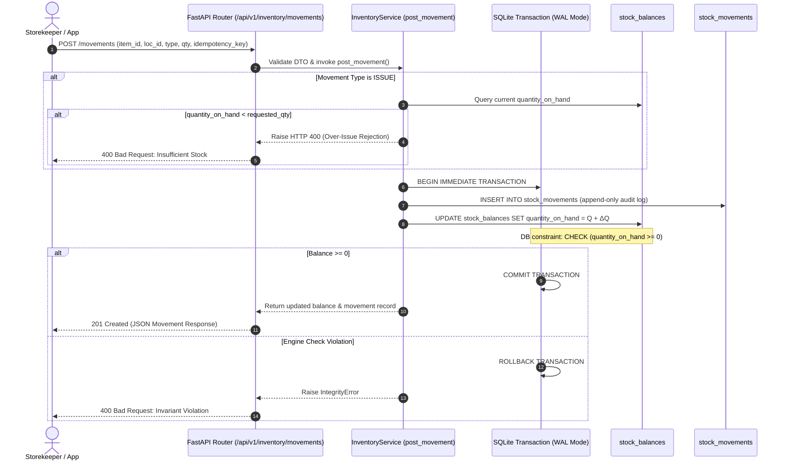
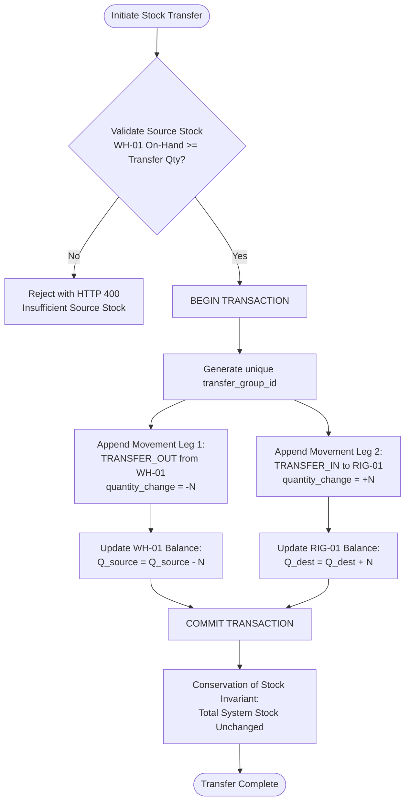
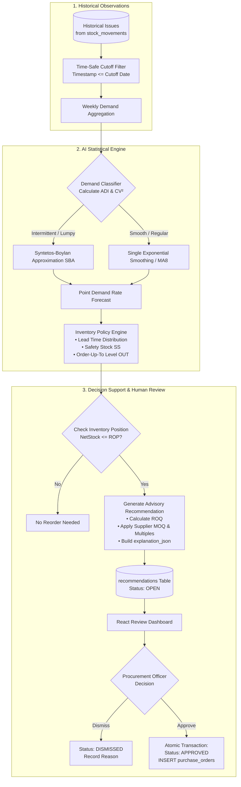
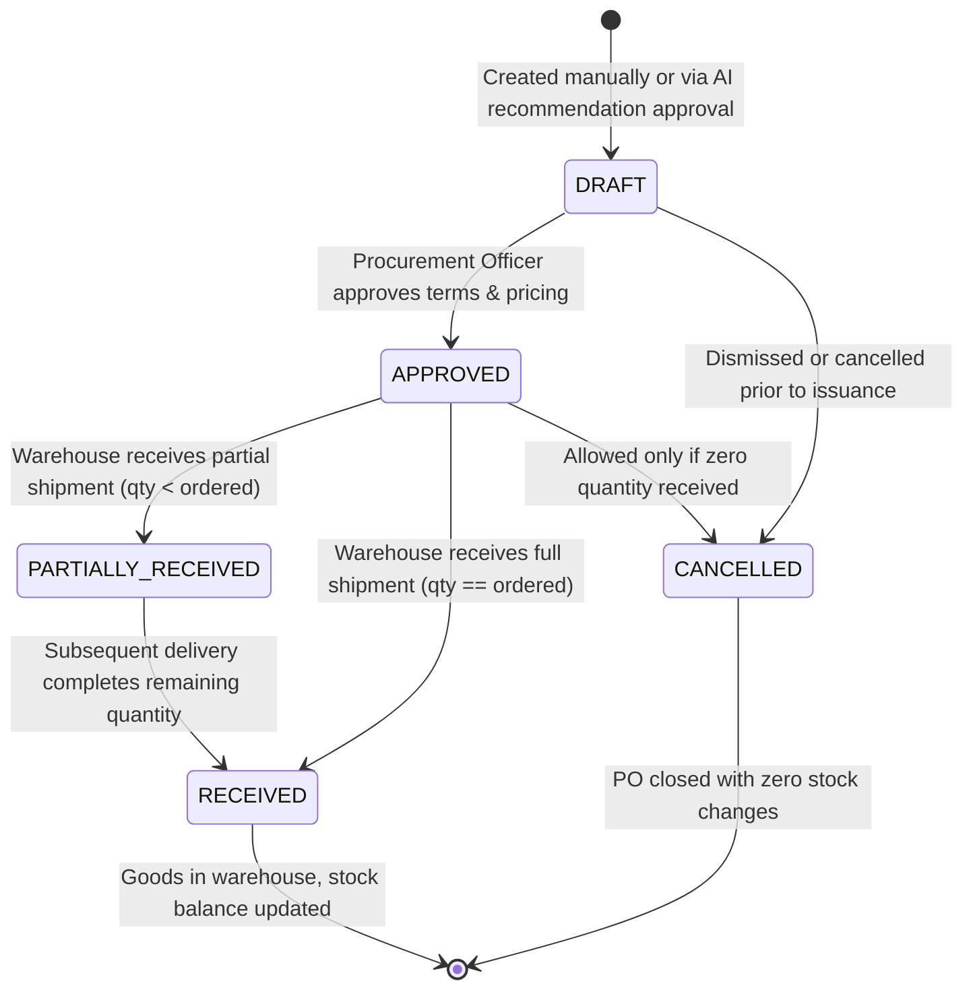
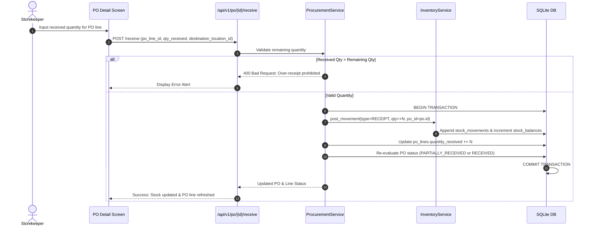
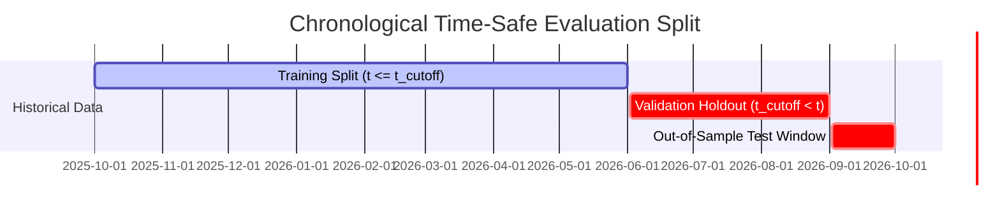
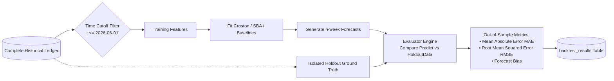
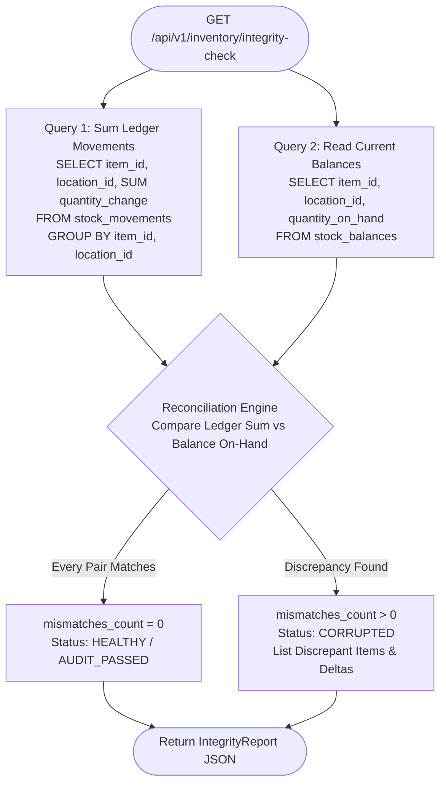

# StockSense — System Design Charts & Data Flow Diagrams

> **Document:** 02b of 05  
> **Status:** Visual Architecture Reference  
> **Focus:** End-to-end component topology, transactional workflows, and AI data flows.

---

## 1. System Topology & Architectural Layers

StockSense implements a clean, decoupled modular architecture where the **deterministic inventory ledger** is strictly isolated from the **probabilistic AI advisory engine**.

---

## 2. Core Stock Transaction Data Flow (Receipt & Issue)

All physical stock changes pass through a single, authoritative transactional pipeline. Balances are never modified directly; every change requires an append-only ledger record.

---

## 3. Double-Entry Inter-Location Transfer Data Flow

Transfers between physical locations (e.g., Central Warehouse `WH-01` to Rig Site `RIG-01`) execute atomically as paired double-entry ledger rows sharing a single `transfer_group_id`.

---

## 4. AI Advisory Replenishment & Decision Pipeline

The AI engine takes historical observations, classifies intermittency, runs debiased forecasting, simulates policy targets, and produces explainable proposals for human review.

---

## 5. Purchase Order Lifecycle & Goods Receiving Data Flow

Purchase orders manage the inbound procurement pipeline. Receiving updates the stock ledger atomically and prohibits over-receiving.

### Goods Receiving Sequence:

---

## 6. Zero-Leakage Time Cutoff Evaluation Data Flow

To ensure scientific validity, model evaluation prevents any data from the holdout testing period from leaking into feature extraction or model selection.

---

## 7. Ledger vs. Balance Integrity Reconciliation Flow

The system provides an automated audit endpoint that verifies the mathematical equivalence between the append-only ledger and current running balances.

