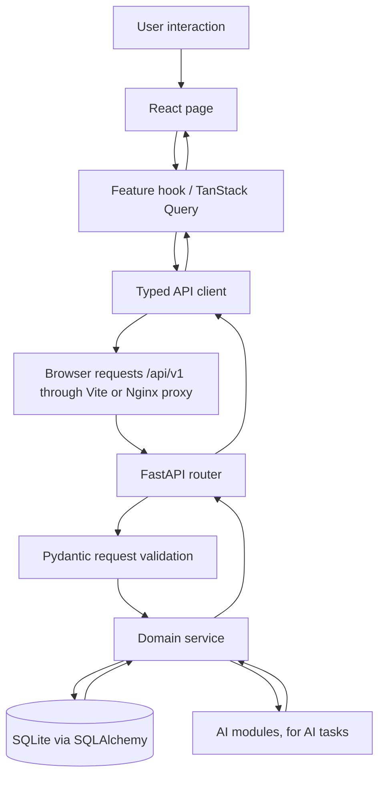

# StockSense — Frontend Plan

**Document:** 04 — Frontend UX, Pages, Routing, and API Connections  
**Purpose:** Implementation-ready guide for the React frontend of the StockSense AI-assisted inventory assessment.  
**Target:** Demonstrate a coherent inventory workflow by the assessment interview, not reproduce a full commercial ERP.  
**Stack:** React + TypeScript + Vite, React Router, TanStack Query, React Hook Form + Zod (optional but useful), one chart library such as Recharts, and Tailwind CSS only if already familiar.  
**Backend:** FastAPI + Pydantic + SQLAlchemy + SQLite.  
**API base path:** `/api/v1`.

---

## 1. Research: patterns from established inventory products

This is a short UI/workflow review of established products, not a market-share ranking. These products target different company sizes and should be treated as references for established interaction patterns—not as a requirement to copy every feature.

| Reference product | Documented interaction / page pattern | What StockSense should learn from it | What StockSense should not build for this assessment |
|---|---|---|---|
| **Odoo Inventory** | An operations overview organizes incoming receipts, deliveries, transfers, and late or pending work. Warehouse operations can be processed and validated as explicit steps. | Put operational queues and exceptions near the dashboard; make receipts and transfers visible as work to complete. | Barcode/mobile scanning, routing rules, manufacturing integration, multi-step warehouse routes. |
| **ERPNext Stock** | Stock Entry supports receipts, issues, transfers, source/target warehouses, and quantities. Stock Reconciliation handles physical count versus recorded stock. Stock Ledger reports show a transaction-level history. | Give each stock movement a clear purpose; separate regular movements from count reconciliation; make transaction history inspectable. | Manufacturing flows, accounting valuation, batch/serial complexity, full ERP accounting. |
| **InvenTree** | Part/stock details connect a stock quantity to a physical location and supplier; stock history records changes and actors. Purchase orders can be filtered in a table and received fully or line-by-line. | Show item totals and location breakdowns together; preserve movement history; support partial purchase-order receipt. | BOM/build-order, serial tracking, plugin and production workflows. |
| **Zoho Inventory** | Dashboard highlights metrics, top items/vendors, pending actions, purchase receipts, and recent activity. The product also has item, warehouse, purchase, stock-count, and inventory-report areas. | Make KPIs navigable; show pending receipts/orders and recent activity; make tables filterable and link records to detail pages. | Sales-channel, shipping, invoicing, payments, and broad integration screens unrelated to this assessment. |

### Source links

- Odoo, *Inventory dashboards*: https://www.odoo.com/documentation/19.0/applications/inventory_and_mrp/inventory/warehouses_storage/reporting/dashboards.html
- Odoo, *Process receipts and deliveries with barcodes*: https://www.odoo.com/documentation/master/applications/inventory_and_mrp/barcode/operations/receipts_deliveries.html
- ERPNext, *Stock Entry*: https://docs.frappe.io/erpnext/stock-entry
- ERPNext, *Stock Reconciliation*: https://docs.frappe.io/erpnext/stock-reconciliation
- ERPNext, *Stock Ledger Report*: https://docs.frappe.io/erpnext/stock-ledger
- InvenTree, *Stock Items and Locations*: https://docs.inventree.org/en/stable/stock/
- InvenTree, *Purchase Orders*: https://docs.inventree.org/en/stable/purchasing/purchase_order/
- InvenTree, *Stock Tracking*: https://docs.inventree.org/en/stable/stock/tracking/
- Zoho Inventory, *The Dashboard*: https://www.zoho.com/inventory/help/getting-started/dashboard.html

**Design conclusion:** StockSense should be operations-first, table-driven, traceable, and exception-focused. Its differentiator is an explainable replenishment recommendation and evaluation view—not decorative charts or an LLM chat screen.

---

## 2. Frontend goals and non-goals

### Goals

1. A storekeeper can quickly issue, transfer, receive, and reconcile stock without silently creating an invalid balance.
2. A procurement user can understand open purchase orders, partial receipts, and what needs action.
3. A manager can identify low-stock/stockout-risk items and understand why the AI recommends replenishment.
4. Every displayed number comes from the API; React does not reimplement stock or AI policy calculations.
5. A reviewer can follow one complete demo workflow without opening the database or editing records manually.

### Non-goals for the assessment

- Full ERP replacement, real ERP integration, mobile app, barcode scanning, batch/serial/expiry management, sales orders, invoices, supplier portal, multi-company tenancy, elaborate permissions administration, or a general-purpose AI chatbot.
- Real authentication unless time remains after the business workflows work. A demo user selector is only for audit attribution, not a security boundary.
- Dashboard charts whose numbers cannot be traced to an endpoint and a documented calculation.

---

## 3. Information architecture and navigation

Use a persistent left sidebar on desktop, a compact header, and one main content region. Collapse the sidebar on narrow screens. Keep one primary action per page and do not hide critical workflow actions inside decorative cards.

```text
StockSense
├── Overview
├── Inventory
│   ├── Items list
│   └── Item detail
├── Operations
│   ├── Issue stock
│   ├── Transfer stock
│   ├── Stock count / adjustment
│   └── Manual receipt (optional; prefer receiving against a PO)
├── Purchase Orders
│   ├── Purchase-order list
│   ├── Create draft PO
│   └── Purchase-order detail / receive goods
├── AI & Replenishment
│   ├── Recommendations
│   └── Forecasts & Model Report
└── Activity & Integrity
    ├── Stock movement ledger
    ├── Alerts
    └── Inventory integrity check
```

For speed, **Activity & Integrity** can be a single route with tabs, and **AI & Replenishment** can be one route with tabs. This gives the app six top-level destinations, not a large set of unrelated pages.

### Route map

| Route | Page | Priority |
|---|---|---|
| `/` | Redirect to `/overview` | Must |
| `/overview` | Overview dashboard | Must |
| `/inventory` | Inventory table | Must |
| `/inventory/items/:itemId` | Item detail | Must |
| `/operations` | Operations landing + transaction tabs | Must |
| `/purchase-orders` | Purchase-order list | Must |
| `/purchase-orders/new` | Create draft PO | Must |
| `/purchase-orders/:poId` | PO details and receiving | Must |
| `/ai` | Recommendations, forecasts, evaluation tabs | Must |
| `/activity` | Ledger, alerts, integrity-check tabs | Should; ledger itself is Must |
| `/not-found` | Not-found state | Must |

Do not create a separate frontend route for every database table. Routes should represent user tasks; tables are backend implementation details.

---

## 4. App shell and shared components

### 4.1 App shell

**Left sidebar**
- StockSense wordmark and compact navigation labels/icons.
- Overview, Inventory, Operations, Purchase Orders, AI & Replenishment, Activity & Integrity.
- Current selected route visibly highlighted.

**Top bar**
- Page title and breadcrumb where useful.
- Optional global SKU/name search. If global search is too much, keep search in the Inventory page instead.
- Demo actor selector (e.g. Storekeeper, Procurement Officer, Manager) only to attach an actor identifier to audited actions. Label this clearly as a demo identity selector.
- Optional selected warehouse filter. Do not let it imply that the AI policy supports all warehouses if the MVP policy is configured for a single default replenishment warehouse.
- User-facing API/network status only if it is useful; avoid technical noise in the main UI.

### 4.2 Shared components

Implement a small, consistent set:

- `AppLayout`, `Sidebar`, `PageHeader`, `Breadcrumbs`
- `KpiCard`, `StatusBadge`, `SeverityBadge`
- `DataTable`, `TableToolbar`, `Pagination`, `EmptyState`
- `LoadingState`, `ErrorState`, `InlineFieldError`, `Toast`
- `ConfirmDialog`, `ReasonDialog`, `QuantityInput`
- `StockLevelIndicator`, `LocationStockBreakdown`
- `ForecastChart`, `DemandPatternBadge`, `RecommendationExplanation`

Build the table and error components first because they are reused on the inventory, PO, recommendation, and ledger pages.

### 4.3 Visual direction

Use a restrained, readable operations UI. Prioritize dense-but-readable tables, clear numeric alignment, consistent status labels, sufficient contrast, and obvious primary actions. Use severity color only when it conveys meaning—e.g. a genuine critical stockout risk—not as decoration. Desktop-first is reasonable for the interview demo, but forms and tables must remain usable on tablet-width displays.

---

## 5. Page-by-page specification

## Page 1 — Overview (`/overview`)

### Purpose
Show what requires attention now and provide shortcuts into real workflows. This is not a sales dashboard.

### Layout

1. **Page heading:** “Inventory Overview”, last-updated time, refresh action if needed.
2. **KPI row:** active SKUs; inventory value if the costing assumptions are clearly labelled; items at/below reorder point; zero-stock items with recent demand; open recommendations; critical alerts.
3. **Needs attention:** top critical/high recommendations and open alerts. Each row links to the underlying item or recommendation.
4. **Open purchasing work:** draft, approved, and partially received POs; show expected dates and late/overdue state only if dates exist.
5. **Recent stock activity:** latest receipts, issues, transfers, and adjustments with timestamp, item, location, quantity, and actor.
6. **Inventory integrity indicator:** last integrity-check status, with a “Run/check details” action if endpoint design permits safe read-only execution.

### Data connections

- `GET /api/v1/dashboard/summary`
- `GET /api/v1/recommendations?status=OPEN&limit=...`
- `GET /api/v1/alerts?status=OPEN&limit=...` (if alerts are implemented)
- `GET /api/v1/stock/movements?limit=...`
- `GET /api/v1/purchase-orders?status=...&limit=...`
- `GET /api/v1/stock/integrity-check` (if it is safe and reasonably fast to call on page load; otherwise invoke on demand)

If an endpoint does not exist yet, either add it to the API plan or omit that widget. Do not fabricate metrics in React.

### Interactions

- Clicking a KPI applies a useful filter on its destination page.
- Clicking a recommendation opens its explanation.
- Clicking a recent movement opens item detail or ledger history.
- Empty states explain what to do next; they do not look like broken pages.

---

## Page 2 — Inventory Workstation (`/inventory`)

### Purpose
High-density operational inventory management and availability tracking across all oilfield warehouses. Implements a responsive split-pane workstation combining an authoritative master data table with a real-time item deep-dive inspection panel.

### Layout Topology
```text
┌────────────────────────────────────────────────────────────────────────────────────────┐
│ Page Header: [Cube Icon] Inventory | "Manage your stock, track movements..."          │
├────────────────────────────────────────────────────────────────────────────────────────┤
│ 4 KPI Metric Cards:                                                                    │
│ [Total Items: 248]  [Stock Value: $482,350]  [Low Stock: 18]  [Open POs: 7]            │
├─────────────────────────────────────────┬──────────────────────────────────────────────┤
│ Left Column (~68% width)                │ Right Column (~32% width)                    │
│ • Toolbar: Search, 3 Filters, Export    │ • Selected Item Header (Thumbnail, SKU, Name)│
│ • Data Table (10 items / page)          │ • Navigation Tabs (Overview, Levels, Ledger) │
│   - Checkbox, Vector Thumbnail, Item    │ • 4 Metric Tiles (On Hand, Rsv, Avail, ROP)  │
│   - Category, Warehouse, On Hand, Rsv,  │ • 12-Week Interactive SVG Stock Trend Chart  │
│     Avail, Status, Action Dropdown      │ • Recent Movements Audit Table               │
│ • Pagination Footer (1-10 of 248 items) │ • CTA: [Create Stock Movement]               │
└─────────────────────────────────────────┴──────────────────────────────────────────────┘
```

### 1. KPI Metric Row (`InventoryKpiCards.tsx`)
- **Total Items**: Aggregate item catalog count with monthly trend comparison (+12%).
- **Total Stock Value**: Cumulative valuation derived from unit costs and on-hand counts (+8%).
- **Low Stock Items**: Count of parts at or below their configured Reorder Point (-32%).
- **Open POs**: Active purchase orders pending goods receipt (+2%).

### 2. Search & Multi-Filter Toolbar (`InventoryToolbar.tsx`)
- **Real-Time Search**: Filters by SKU code, part description, or specification keyword.
- **Category Dropdown**: `All Categories`, `Mechanical Parts`, `Pipes & Tubes`, `Tools & Equipment`, `Chemicals`, `Filters`, `Electrical`, `PPE`.
- **Location Dropdown**: `All Locations`, `Main Warehouse (WH-MAIN)`, `Field Warehouse (WH-FIELD)`, `Free Zone (WH-FZ)`.
- **Status Filter**: `All Stock Status`, `In Stock`, `Low Stock`, `Out of Stock`.
- **CSV Data Export**: `↓ Export` button compiles the currently filtered rows into a timestamped RFC 4180 compliant CSV download.

### 3. Master Inventory Table (`InventoryTable.tsx`)
- **Deterministic Vector Thumbnails** (`ItemPartThumbnail.tsx`): Crisp SVG isometric renderings for mechanical parts, valves, drill bits, lubricants, filters, gaskets, and PPE.
- **Sortable Columns**: Interactive sorting for Part Name, Category, On Hand, Reserved, and Available quantities.
- **Status Pills**:
  - `In Stock` (Emerald pill: `#10b981`, `#064e3b`).
  - `Low Stock` (Amber pill: `#f59e0b`, `#78350f`).
  - `Out of Stock` (Crimson pill: `#ef4444`, `#7f1d1d`).
- **Interactive Row Selection**: Highlights active row with blue glow (`#0066fe`) and immediately synchronizes the right inspection panel.
- **Pagination Footer**: Standard 10/20/50 page size selector with previous/next controls.

### 4. Right Inspection Panel (`InventoryItemDetail.tsx`)
- **Part Deep-Dive Card**: High-resolution vector thumbnail, SKU badge, taxonomy chips.
- **4 Key Numeric Metrics**: On Hand, Reserved (allocated to active projects), Available (`On Hand - Reserved`), and Reorder Point (amber warning alert).
- **Interactive SVG Stock Trend** (`StockTrendChart.tsx`): 12-week time-series area chart with cubic bezier smoothing, linear gradients, ROP threshold line, and interactive data point hover tooltips.
- **Recent Movements Ledger**: Mini-table displaying the 5 most recent transactions with date, movement type badge (`Issue`, `Receipt`, `Transfer`), signed quantity, and reference document ID (`WO-0045`, `PO-0123`, `TR-0078`).
- **One-Click Atomic Transaction**: `Create Stock Movement` primary button directly launches the `MovementModal` pre-populated with the active item ID for atomic SQLite execution.

### 5. Backend API Endpoints
- `GET /api/v1/inventory/items`: Retrieves all items with dynamic category names, primary warehouse locations, reserved quantities, available stock, and calculated reorder points.
- `GET /api/v1/inventory/categories`: Retrieves all catalog categories.
- `GET /api/v1/inventory/ledger?item_id={id}&limit=10`: Retrieves chronological movement ledger audit trail for the selected item.
- `POST /api/v1/inventory/movements`: Atomic receipt, issue, and adjustment transaction posting with non-negative stock constraint validation.
- `POST /api/v1/inventory/transfer`: Double-entry atomic transfer between warehouse locations.

---

## Page 3 — Operations (`/operations` / Workstation)

### Purpose & Architecture
The Operations Workstation represents the high-frequency physical warehouse transaction hub. Built as a responsive split-pane workstation matching enterprise references (Odoo, ERPNext, InvenTree):

```
+----------------------------------------------------------------------------------------------------+
| Header: "Operations", subtitle, sprint date filter ["Oct 1, 2026 - Oct 15, 2026 v"]                |
+----------------------------------------------------------------------------------------------------+
| 4 Action Cards: [ Issue Stock ]  [ Transfer Stock ]  [ Receive Stock ]  [ Adjust Count ]           |
|                 [ New Issue ]    [ New Transfer ]    [ New Receipt ]    [ New Adjustment ]         |
+-------------------------------------------------------------+--------------------------------------+
| Left Section (~68% width): Recent Operations Table          | Right Rail (~32% width):             |
| - Segmented Filter Tabs: [All] [Issues] [Transfers] ...     | 1. Quick Actions List (Hover chevrons)|
| - Table: Date & Time, Type, Item, SKU, Qty, From->To, Ref,  | 2. Operation Stats 2x2 Grid (7 days) |
|          Status, Actions (...)                              | 3. Recent Activity Timeline Feed     |
| - Pagination: Showing 1-8 of 24 operations  < [1] [2] [3] > |                                      |
+-------------------------------------------------------------+--------------------------------------+
```

### Components Implemented
1. **`OperationsView.tsx`**: Workstation orchestrator with dynamic date range selector and modal binding.
2. **`OperationsActionCards.tsx`**: Top 4 callout cards with distinct color identities (Emerald, Royal Blue, Violet, Amber) triggering immediate pre-configured modal flows.
3. **`OperationsTable.tsx`**: Interactive transaction ledger with type filtering (`ALL`, `ISSUE`, `TRANSFER`, `RECEIPT`, `ADJUSTMENT`), timestamp sorting, signed quantity coloration (`+10` green, `-5` red), status badges, `...` dropdown menu (Audit details, Copy reference, Print waybill), and pagination.
4. **`OperationsQuickActions.tsx`**: Right rail action launcher with interactive transitions.
5. **`OperationsStatsCard.tsx`**: 2x2 metric grid querying `GET /api/v1/inventory/operations/stats` with timeframe selector (`7 days`, `14 days`, `30 days`) and period-over-period trend indicators.
6. **`OperationsActivityFeed.tsx`**: Chronological timeline showing human-readable movement summaries and relative timestamps (`2h ago`, `4h ago`).
7. **`MovementModal.tsx`**: Unified 4-mode transaction modal supporting Receipts, Issues (with Rig/Project destination), Transfers (origin & destination warehouses), and Adjustments (Cycle Count Surplus `+` vs Shrinkage `-`).

### Backend Endpoints & Domain Invariants
- `GET /api/v1/inventory/operations/stats?days=7`: Calculates live movement counts and trend percentages.
- `GET /api/v1/inventory/ledger`: Enriched with `route_display` (`From → To`), `reference_display`, `item_name`, and `status`.
- `POST /api/v1/inventory/movements`: Handles Receipts, Issues, and bidirectional Adjustments atomically with `CHECK (quantity_on_hand >= 0)` enforcement.
- `POST /api/v1/inventory/transfer`: Creates linked `TRANSFER_OUT` and `TRANSFER_IN` pair sharing `transfer_group_id`.
- `GET /api/v1/inventory/integrity-check`: Confirms 0 mismatches across all items and locations.

---

## Page 4 — Purchase Orders (`/purchase-orders`)

### Architecture & Workstation Overview
Page 4 is implemented as an industrial procurement workstation managed by [`ProcurementView.tsx`](../frontend/src/components/ProcurementView.tsx) with three seamless view modes (`LIST`, `CREATE`, `DETAIL`), client-side RFC 4180 CSV export, and full SQLite WAL backend transactional synchronization.

```text
/purchase-orders (ProcurementView.tsx)
├── 4 KPI Summary Cards (Click-to-Filter Binding)
│   ├── Open Purchase Orders (DRAFT, APPROVED, PARTIALLY_RECEIVED)
│   ├── Awaiting Approval (DRAFT)
│   ├── Partially Received (PARTIALLY_RECEIVED)
│   └── Overdue Deliveries (expected_date < today AND status in open states)
├── Filter Toolbar & Actions
│   ├── Search Input (PO number or supplier name)
│   ├── Status Pill Bar (All, Draft, Approved, Partial, Received, Cancelled)
│   ├── Supplier Dropdown Selector
│   ├── Clear Filters Action
│   ├── Export CSV Button
│   └── + Create Purchase Order CTA
├── Main Purchase-Order Table (Click row → Navigates to Detail Workstation)
├── Dedicated Creation Workstation (POCreateView.tsx at /purchase-orders/new)
│   ├── Section 1: Order Information (Supplier, Warehouse, Expected Date, Ref, Notes)
│   ├── Section 2: Lines Table (SKU, Qty, Unit Cost, Subtotal, Add/Remove Line)
│   └── Order Total & Action Bar (Cancel, Save Draft PO)
├── Dedicated Details Workstation (PODetailView.tsx at /purchase-orders/:poId)
│   ├── Header Card: PO number, status badge, vendor, warehouse, AI Rec link
│   ├── Metadata Grid: Total value, expected arrival, fulfillment percentage
│   ├── Line Fulfillment Table: Ordered, Received, Remaining, Progress Bar
│   └── Status-Gated Actions: Approve, Receive Goods, Cancel PO
└── Modals Suite
    ├── Window C (POApprovalModal.tsx): Confirmation prompt with committed total & warning
    ├── Window D (POReceiveModal.tsx): Dock receiving dialog with partial delivery review
    └── Window E (POCancelModal.tsx): Invariant enforcement (rejects cancellation if goods received)
```

### Backend Endpoints & Domain Invariants
- `GET /api/v1/po`: Lists purchase orders with line counts, status, and supplier names.
- `GET /api/v1/po/suppliers`: Fetches approved active suppliers.
- `GET /api/v1/po/{id}`: Returns authoritative PO detail with line-by-line `remaining_quantity = max(0, qty_ordered - qty_received)`.
- `POST /api/v1/po`: Creates a draft purchase order in `DRAFT` status with line items.
- `POST /api/v1/po/{id}/approve`: Moves PO to `APPROVED` workflow with timestamp and user attribution.
- `POST /api/v1/po/{id}/receive`: Commits atomic receipt movements to `stock_movements`, increments `qty_received` on PO lines, transitions PO to `PARTIALLY_RECEIVED` or `RECEIVED`, and updates `stock_balances`. Rejects over-receipt with HTTP 400.
- `POST /api/v1/po/{id}/cancel`: Sets PO to `CANCELLED`. Rejects cancellation with HTTP 400 if any goods have already been received.

### Styling & Tokens
All procurement styles are modularly scoped to [`frontend/src/styles/procurement.css`](../frontend/src/styles/procurement.css) adhering strictly to the Vercel Geist Monochromatic Dark Zinc design system (`#000000` canvas, `#09090b` card surfaces, `#141416` inputs, `#222222` hairline borders).

---


## Page 5 — AI & Replenishment (`/ai`)

This is the product's main differentiator. Keep it explainable. Do not turn it into an AI chat page.

### Tab A: Recommendations

List columns:
- Urgency
- SKU / item
- Destination warehouse
- On hand
- On order
- Inventory position
- Reorder point
- Suggested quantity
- Supplier
- Stockout risk estimate (only if calculated correctly and defined)
- Status

Filters: status, urgency, item, demand pattern. Sort highest urgency first.

Selecting a row opens a detail page or side panel containing:
- **Why now:** the exact rule that triggered the recommendation.
- Forecast mean / demand pattern / selected method.
- Protection interval and lead-time assumptions.
- Service-level target, reorder point, safety stock, and order-up-to level.
- Supplier MOQ and order multiple constraints.
- Known conflicts or low-confidence flags.
- Data cutoff, AI run ID, run time, and method version.
- Actions: approve (with editable order quantity where supported) or dismiss (reason required).

Approval flow:
1. UI opens a confirmation that states supplier, destination, item, quantity, and expected date assumptions.
2. User confirms one time.
3. UI calls the backend approval endpoint with an idempotency strategy if supported by the API contract.
4. Backend rechecks the current recommendation and inventory state, creates the PO, and updates recommendation state atomically.
5. UI displays the returned PO link. Do not simulate approval optimistically.

API:
- `GET /api/v1/recommendations`
- `GET /api/v1/recommendations/{id}`
- `POST /api/v1/recommendations/{id}/approve`
- `POST /api/v1/recommendations/{id}/dismiss`

### Tab B: Forecasts

- Item selector.
- Historical weekly issue chart plus forecast horizon.
- Clearly label actual/observed history vs future forecast; do not draw a forecast as if it were actual stock.
- Show the chosen method, demand pattern, horizon, data cutoff, and confidence/quantile definition if available.
- Show a visible “low confidence / insufficient history” state for cold-start items.

API:
- `GET /api/v1/items/{id}/demand-history`
- `GET /api/v1/ai/forecasts?item_id=...&run_id=...`
- `GET /api/v1/ai/policies?item_id=...`

### Tab C: Model Report

- AI run status and last successful run.
- Run button only if the API supports it.
- During a run: `RUNNING` status and modest polling of `GET /api/v1/ai/runs/{run_id}`; stop polling on `SUCCEEDED` or `FAILED`.
- Forecast metrics (e.g. RMSSE/MASE/bias) split by demand pattern, with sample counts.
- Policy comparison: baseline vs StockSense policy using the same evaluation window and assumptions.
- Inventory outcomes: fill rate, unmet demand/stockout weeks, average inventory, number of orders.
- Synthetic dataset profile and prominent limitations statement.

API:
- `POST /api/v1/ai/runs`
- `GET /api/v1/ai/runs/{id}`
- `GET /api/v1/ai/backtests`
- Any explicit policy simulation/report endpoint needed for comparison (add this to the backend contract if not already present).
- `POST /api/v1/admin/seed` only in demo mode and never exposed as a normal end-user action in a deployed production UI.

**Critical UX rule:** if no AI run has completed, show an empty state and a button to run the pipeline. Do not present example values as real model outputs. Put “synthetic-data evaluation” on the report so users cannot confuse it with a real customer performance guarantee.

---

## Page 6 — Activity & Integrity (`/activity`)

### Ledger tab

Display movement rows from `GET /api/v1/stock/movements`:
- Timestamp
- Movement type
- Item SKU/name
- Location
- Signed quantity
- Reference type/ID
- Actor
- Reason

Filters: SKU, location, movement type, time range. Every movement should link to item detail where practical. Never expose edit/delete controls for posted ledger entries.

### Alerts tab

If alerts are part of the MVP, show severity, type, SKU, location, message, creation time, and status. Allow acknowledge/resolve actions only through backend endpoints.

### Integrity tab

Show whether ledger-derived balances match cached stock balances. List mismatches in a useful diagnostic table if any are found. This is a key demo proof that the stock model is internally consistent. If the check is read-only, label it clearly as an audit/diagnostic action.

API:
- `GET /api/v1/stock/movements`
- `GET /api/v1/stock/integrity-check`
- `GET /api/v1/alerts`
- `POST /api/v1/alerts/{id}/acknowledge` / `resolve` if implemented

---

## 6. How the frontend connects to the backend

### 6.1 Request path



### 6.2 API-client ownership

All network calls belong in `frontend/src/api/` (or equivalent), never directly inside large JSX components.

Suggested modules:

```text
frontend/src/
├── api/
│   ├── client.ts              # Base URL, JSON parsing, shared error class
│   ├── items.ts               # Item/master-data queries
│   ├── stock.ts               # Balances, movements, stock mutations
│   ├── purchaseOrders.ts      # PO list, detail, approve, receive, cancel
│   ├── recommendations.ts    # AI recommendation actions
│   ├── ai.ts                  # Runs, forecasts, backtests, policies
│   └── dashboard.ts           # Dashboard summary
├── app/
│   ├── router.tsx
│   └── queryClient.ts
├── components/
│   ├── layout/
│   ├── tables/
│   ├── forms/
│   ├── feedback/
│   └── charts/
├── features/
│   ├── overview/
│   ├── inventory/
│   ├── operations/
│   ├── purchasing/
│   ├── replenishment/
│   └── activity/
├── hooks/
├── types/
│   └── api.ts
├── App.tsx
└── main.tsx
```

It is acceptable to start with fewer folders; preserve the separation of concerns rather than creating empty abstractions.

### 6.3 Base URL and proxy

**Recommended local setup:** React calls a relative URL such as `/api/v1/items`. Configure Vite to proxy `/api` to `http://127.0.0.1:8000`; configure Nginx/reverse proxy similarly in Docker deployment. The browser should not call a Compose-internal hostname such as `http://api:8000` directly.

If using a direct browser URL instead, define `VITE_API_BASE_URL` in environment configuration and explicitly allow the frontend development origin in FastAPI CORS settings. Do not permit every origin just to make development work.

### 6.4 Query and local state

- Use TanStack Query (or a small equivalent) for API server state, cache, refetch, loading, and error handling.
- Use local React state for open dialogs, currently edited form fields, and selected tabs.
- Encode table filters/page number in URL search parameters where practical, so a link preserves the current view.
- Do not introduce Redux for this assessment unless a real cross-page state problem justifies it.
- Invalidate/refetch affected queries after the backend confirms a mutation. Example: after receiving a PO, refetch that PO, balances for received items, the overview summary, and recent movements.

### 6.5 DTOs and types

Create TypeScript types for the API request/response objects used by the pages. Use FastAPI OpenAPI at `/docs` (and its OpenAPI JSON) as the source of truth. Avoid maintaining contradictory frontend-only types by hand. If generation setup takes too long, hand-write the small set of DTOs and add a note to keep them synchronized.

### 6.6 Common error handling

Build one API error parser that understands the backend's stable error format:

```json
{
  "error": {
    "code": "INSUFFICIENT_STOCK",
    "message": "Requested quantity exceeds available stock.",
    "details": { "available": 4, "requested": 10 }
  }
}
```

Map stable codes to helpful UI messages. Required states include:

- Loading: skeleton or spinner with context.
- Empty: explain how to create/seed the first data.
- Validation: show errors next to fields.
- Conflict (`409`): preserve inputs, show the business reason, allow safe correction.
- Network/server failure: retry where safe and retain form inputs.
- Success: confirm the server-authoritative record ID/status.

Do not display Python tracebacks or sensitive internal exception details to the user.

---

## 7. Frontend forms and business rules

| Rule | Frontend responsibility | Backend responsibility |
|---|---|---|
| Quantity must be positive | Prevent obvious input mistakes | Validate authoritatively |
| Issue cannot exceed available stock | Preview available stock; show readable conflict | Lock/validate current balance and reject atomically |
| Transfer has different source/destination | Prevent selecting identical locations | Revalidate and post both ledger legs atomically |
| Adjustment needs a reason | Mark reason as required | Enforce reason and validate current balance |
| PO cannot be over-received | Show remaining quantity and stop obvious over-entry | Re-check all lines/status in one transaction |
| PO state transitions | Hide or disable actions that clearly don't apply | Own the state machine and reject invalid transitions |
| AI cannot auto-approve | Require explicit human action | Approval endpoint performs atomic recommendation→PO transition |
| Demo actor attribution | Include selected demo actor in API request only if contract supports it | Treat as attribution, not verified identity |
| Idempotency | Keep same key for retry of one logical request | Match key + request hash and prevent duplicate effects |
| Inventory KPIs | Format values and provide definitions | Compute authoritative metrics and document definitions |

Never calculate authoritative reorder points, stock balances, PO status, or available quantity in the frontend. UI-derived values may be displayed as previews but must be revalidated by the API.

---

## 8. Frontend testing and acceptance criteria

### Component/unit tests

- Status/severity badges render every supported value.
- Forms reject blank/zero/negative quantities before submission.
- API errors map `INSUFFICIENT_STOCK`, `INVALID_STATE`, and validation errors to friendly messages.
- Empty and error states render correctly.
- Recommendation explanation displays the actual returned assumptions without hiding low-confidence flags.

### Integration/smoke tests

1. Frontend can fetch `/api/v1/items` through the configured proxy.
2. Inventory filters change the requested query and display the server result.
3. Issue stock successfully updates balance and movement history after refetch.
4. An over-issue receives `409`, leaves the database unchanged, and preserves the user input.
5. A transfer succeeds as a single operation and updates both locations.
6. A draft PO can be created and approved.
7. A partial receipt updates received quantity, PO state, stock, and ledger.
8. Approving a recommendation produces one PO; repeated attempts do not duplicate it.
9. Starting an AI run shows `RUNNING`, and the page handles `SUCCEEDED` and `FAILED` states.
10. A fresh clone can start backend and frontend using the README instructions.

### Definition of done for each page

- Data is fetched from documented endpoints (or there is an explicit, documented mock boundary during early UI development).
- Loading, empty, error, and success states exist.
- Buttons cause real actions; no decorative/inert submit buttons.
- Mutations only show success after the server responds successfully.
- Page actions respect current business status, while the backend remains authoritative.
- A screenshot is captured only after the page works against the API.

---

## 9. Implementation order and what to cut

### Build in this order

1. Create Vite + React + TypeScript, Router, the app shell, API base client, and one health/items connection.
2. Build the Inventory table and item detail so the end-to-end browser/API/database path is proven early.
3. Build Operations forms and shared loading/error/confirmation components.
4. Build PO list/detail and partial receipt workflow.
5. Build Recommendations and approve→PO workflow.
6. Add Forecast and Model Report charts.
7. Add Overview KPI cards and Activity/Integrity details using existing endpoints.
8. Polish spacing, responsive behavior, and screenshots; run the entire golden demo from a fresh clone.

### Cut order if behind

1. Global search; use search on Inventory only.
2. Manual receipt form; receive against a PO in the main demo.
3. Separate Activity page; fold ledger/alerts/integrity into tabs or item detail.
4. Advanced chart interactions and extra filter combinations.
5. Anomaly visualization and optional batch PO approval.

**Do not cut:** inventory table, issue/transfer core if included in backend, PO receiving, recommendation explanation and approval, API error handling, and one working evaluation view.

Do not build an LLM chat assistant, barcode scanning, advanced role-management UI, or custom chart framework before the main workflow is complete.

---

## 10. Golden demo path

Rehearse this exact sequence and make sure all pages link to the next step:

1. Overview: point out a low-stock item and open recommendation.
2. Inventory: open its item detail; show location-level stock and movement history.
3. Operations: record a valid issue; show the updated balance and ledger entry.
4. AI & Replenishment: open a recommendation and explain the rule, forecast, lead time, service level, destination, and quantity.
5. Approve the recommendation: because approving the recommendation is the explicit human approval, the API creates an `APPROVED` PO in one transaction. A manually created PO follows the separate `DRAFT` → `APPROVED` flow.
6. Purchase Orders: open the resulting PO and receive part of a line.
7. Return to Inventory/Activity: show the balance and ledger reflecting the receipt.
8. Model Report: show forecast metrics and baseline-versus-policy results, including limitations and synthetic-data caveats.

A demo must never rely on manually altering SQLite or fabricating a success message. Seed/reset should be a documented development command and disabled as a normal UI action.

---

## 11. Research notes vs StockSense recommendations

The observations in Section 1 are derived from public product documentation. The proposed StockSense page hierarchy, cut order, React stack, and simplified workflow are implementation recommendations for this assessment, not claims that the referenced products use this exact design.

The goal is to borrow proven interaction patterns—actionable dashboards, filtered tables, explicit transaction workflows, traceable histories, and partial receiving—while keeping StockSense small enough to build, test, and explain.

---

## 12. Sprint I: Vercel Geist Monochrome Design System Architecture

### 12.1 Refactoring & Consolidation Rationale
As pages were iteratively added across Sprints A through H (Overview, Inventory Master, Operations Workstation, Procurement, AI & Replenishment), page-specific stylesheets appended redundant selectors, bloating `index.css` to 3,263 lines and introducing disparate electric/cyan blue accents (`#0066fe`, `#38bdf8`).

In Sprint I, the frontend stylesheet was systematically refactored and consolidated down by ~40% (to 2,067 structured lines, compiled production bundle: 30.5 kB CSS) into a unified, token-driven Vercel Geist aesthetic.

### 12.2 Design Token Specification (`:root`)
- **Canvas & Surfaces:**
  - Background Canvas: `#000000` (pitch black foundation)
  - Surface Containers: `#0a0a0a` (cards, sidebar, panels)
  - Elevated Surfaces: `#111111` / `#141416` (popovers, modals, inputs)
  - Active Pills: `#171717` with hairline border `#27272a`
- **Hairline Borders:**
  - Border Subtle: `rgba(255, 255, 255, 0.08)` / `#222222`
  - Border Hover: `#333333`
  - Border Focus: `#52525b`
- **Typography:**
  - Font Families: `'Inter', -apple-system, BlinkMacSystemFont, 'Segoe UI', Roboto, sans-serif`
  - Monospace Figures: `'Geist Mono', 'JetBrains Mono', monospace` with `font-variant-numeric: tabular-nums`
  - Text Primary: `#ededed` (high-contrast white)
  - Text Secondary: `#888888`
  - Text Muted: `#52525b`
- **Vercel Inverted Buttons:**
  - Primary CTA (`.btn-primary`): Pure white background (`#ffffff`), solid black text (`#000000`), hover `#e5e5e5`
  - Secondary CTA (`.btn-secondary`): Dark carbon background (`#121214`), white text (`#ededed`), border `#222222`
- **Contained Semantic Accents:**
  - Success / Normal / Receipts: `#10b981` (emerald)
  - Warning / Low Stock / Discrepancies: `#f59e0b` (amber)
  - Critical / Out of Stock / Stockouts: `#ef4444` (rose)
  - Neutral / Transfers / Drafts: `#a1a1aa` (zinc/slate)
- **Zero Aggressive Blues:**
  - All scattered `#0066fe` and `#38bdf8` instances across all components, SVGs, and charts eliminated.

---

## 13. Sprint J: Modular CSS Architecture & Directory Structure

### 13.1 Deconstruction of Monolithic Stylesheet
To prevent CSS bloat and maintain a production-grade codebase, the 3,435-line monolithic `frontend/src/index.css` was decomposed into 7 isolated domain modules under `frontend/src/styles/`:

| Module | File Path | Focus & Component Domain |
|---|---|---|
| **Design Tokens** | `frontend/src/styles/tokens.css` | Global `:root` variables, surface grays, dark zinc colors, semantic status shades, typography tokens. |
| **Base & Reset** | `frontend/src/styles/base.css` | Box sizing reset, root body rules, smooth scrollbars, live pulse keyframe animations. |
| **Shell & Layout** | `frontend/src/styles/layout.css` | Persistent collapsible sidebar, top bar header, quick search, global notification banners, promo cards. |
| **Components** | `frontend/src/styles/components.css` | Reusable UI primitives: `.btn`, `.btn-primary`, `.btn-secondary`, form controls, inputs, selects, modals, badges. |
| **Overview** | `frontend/src/styles/overview.css` | Executive dashboard KPI cards, triad layout, SVG donut allocation charts, weekly throughput bars. |
| **Inventory** | `frontend/src/styles/inventory.css` | Inventory split-pane table, inspection drawer, AI intelligence card, responsive 12-week stock trend SVG. |
| **Operations** | `frontend/src/styles/operations.css` | 4-card action grid, Recent Operations data table, borderless pills, status indicators, 2x2 stats card, activity feed. |

### 13.2 Manifest Import Pattern
`frontend/src/index.css` now serves strictly as a lightweight entry manifest:
```css
@import './styles/tokens.css';
@import './styles/base.css';
@import './styles/layout.css';
@import './styles/components.css';
@import './styles/overview.css';
@import './styles/inventory.css';
@import './styles/operations.css';
```

---

## 14. Operations Workstation Architecture & Database Integration

### 14.1 View Topology & Information Density
The Operations Workstation (`/operations`, rendered via `OperationsView.tsx`) matches enterprise warehouse and storekeeper reference designs with a high-density, multi-panel layout:
1. **Header Bar**:
   - Workspace title with icon badge.
   - Interactive date range selector dropdown with presets (`Current Sprint`, `Last 7 Days`, `Last 30 Days`, `All Operations`).
2. **Top 4 Direct Action Cards (`OperationsActionCards.tsx`)**:
   - **Issue Stock** (`New Issue` button): Dispatches `MovementModal` preset to `ISSUE` mode with destination routing (Rig-12, Workshop, etc.).
   - **Transfer Stock** (`New Transfer` button): Dispatches `MovementModal` preset to `TRANSFER` mode with source-to-target location validation.
   - **Receive Stock** (`New Receipt` button): Dispatches `MovementModal` preset to `RECEIPT` mode for incoming delivery ledger recording.
   - **Adjust Stock Count** (`New Adjustment` button): Dispatches `MovementModal` preset to `ADJUSTMENT` mode with Surplus (+) / Shrinkage (-) directional toggles.
3. **Recent Operations Table (`OperationsTable.tsx`)**:
   - **Live Data Source**: Backed by `stock_movements` from `/api/v1/inventory/ledger` with enriched item SKU, location code, route display, and reference strings.
   - **Tabbed Filter Buttons**: Instant client-side filtering by operation category: `All`, `Issues`, `Transfers`, `Receipts`, `Adjustments`.
   - **Date & Time Column Sorter**: Ascending / descending toggle sorting by `occurred_at`.
   - **Status & Type Indicators**: Borderless transparent pills with 6px luminous colored indicator dots.
   - **Row Action Menu Popover (`...`)**:
     - *Audit Details*: Opens dedicated inspection modal with full transaction payload, actor label, timestamp, and signed deltas.
     - *Copy Reference*: Copies tracking reference (`PO-0123`, `REQ-0034`, etc.) to clipboard with interactive checkmark feedback.
     - *Print Waybill*: Triggers browser print preview for physical warehouse transit documents.
   - **Pagination Bar**: Dynamic page counter (`Showing 1–8 of N`) with previous/next chevron buttons and direct page number jumps.
4. **Operations Stats Widget (`OperationsStatsCard.tsx`)**:
   - Real-time aggregation via `/api/v1/inventory/operations/stats?days={n}`.
   - Timeframe dropdown selector: `Last 7 days`, `Last 14 days`, `Last 30 days`.
   - 2x2 grid displaying counts and trend percentage deltas for Issues, Transfers, Receipts, and Adjustments.
5. **Recent Activity Feed (`OperationsActivityFeed.tsx`)**:
   - Chronological stream of recent ledger entries showing relative time, actor attribution, signed quantities, and warehouse locations.

### 14.2 Database Connectivity & Atomic Transactions
- **Atomic WAL Transactions**: Form submissions inside `MovementModal` route through `App.tsx` directly to the FastAPI endpoints `/api/v1/inventory/movements` and `/api/v1/inventory/transfers`.
- **Integrity Guarantee**: Stock balances and ledger rows update atomically in SQLite WAL. Over-issues and invalid transfers are validated and rejected server-side with rollback safety.
- **Auto-Reconciliation**: Upon transaction commit, `fetchData()` re-queries the database, automatically syncing the Operations table, metric cards, inventory balances, and Overview dashboards.

---

## 15. Pages 4, 5 & 6 Production Workstations Specification (COMPLETED)

### 15.1 Page 4: Purchase Orders & Dock Receiving Workstation (`/purchase-orders`)
- **Main View (`ProcurementView.tsx`)**:
  - 4 KPI summary cards with click-to-filter binding: *Open Orders*, *Awaiting Approval*, *Partially Received*, *Overdue Deliveries*.
  - Search by PO / supplier, status pills, supplier dropdown, and RFC 4180 CSV export.
- **Dedicated Creation Workstation (`POCreateView.tsx` at `/purchase-orders/new`)**:
  - Live stock on-hand & cost preview, multi-line order construction, real-time totals calculation.
- **Dedicated Order Details Workstation (`PODetailView.tsx` at `/purchase-orders/:poId`)**:
  - Line-by-line fulfillment tracking: `Ordered`, `Received`, `Remaining`, and progress bars.
  - Lifecycle state machine controls: Approve, Receive Goods, and Cancel.
- **Dialogs**:
  - Window C (`POApprovalModal.tsx`): Approval confirmation with committed value review.
  - Window D (`POReceiveModal.tsx`): Dock receiving with partial delivery and over-receipt prevention.
  - Window E (`POCancelModal.tsx`): Cancellation confirmation respecting physical receipt restrictions.
- **Scoped Stylesheet**: `frontend/src/styles/procurement.css`.

### 15.2 Page 5: AI & Replenishment Intelligence Workstation (`/ai`)
- **Main View (`AIInsightsView.tsx`)**:
  - Top status strip with TSB algorithm active badge, synthetic ledger disclaimer, and last run metadata.
  - 4 Summary KPI cards with click-to-filter: *Open Recommendations*, *Critical Replenishment Risks*, *Items Below Reorder Point*, *Low-Confidence Forecasts*.
  - 3 Workstation Tabs:
    - **Tab 1 (Recommendations)**: Urgency pills, position vs ROP indicators, confidence ribbons, click-to-inspect drawer.
    - **Tab 2 (Forecasts & Observed Demand)** (`AIForecastsTab.tsx`): 52-week historical issues SVG timeline, P50/P90 probabilistic quantile ribbons, horizon selector.
    - **Tab 3 (AI Model Backtest Report)** (`AIModelReportTab.tsx`): Holdout backtest evaluation (RMSSE, MASE, Forecast Bias %), naive comparison, and policy simulation.
- **Drawer & Modals**:
  - Explainability Drawer (`AIDrawer.tsx`): 6-section "Why this item?" audit drawer.
  - Window A (`AIApproveModal.tsx`): Order review dialog enforcing MOQ & order multiples, generating draft PO and routing to Procurement.
  - Window B (`AIDismissModal.tsx`): Recommendation dismissal dialog requiring audit reason.
  - Window C (`AIRunModal.tsx`): Forecast run dialog with service level slider and method selection.
- **Scoped Stylesheet**: `frontend/src/styles/ai.css`.

### 15.3 Page 6: Activity & Integrity Center (`/activity`)
- **Main View (`ActivityView.tsx`)**:
  - Header with title, subtitle, RFC 4180 CSV export, and manual refresh.
  - 4 Summary KPI cards: *Total Ledger Events*, *Active System Exceptions*, *Critical Risk Alerts*, *Ledger Consistency (100% PASS)*.
  - 3 Workstation Tabs:
    - **Tab 1 (Stock Ledger)**: Immutable table with signed deltas (`+` in green, `-` in red), movement type badges, routes, reference codes, actor attribution, and time window filters.
    - **Tab 2 (Alerts & Exceptions)** (`AlertsTab.tsx`): System alerts stream with CRITICAL / WARNING / INFO badges, status filters, and interactive Acknowledge & Resolve actions.
    - **Tab 3 (Integrity Diagnostic)** (`IntegrityTab.tsx`): 100% consistency certificate, SQLite WAL isolation status, foreign keys enforcement, non-negative checks, and deep audit CTA.
- **Side Drawer (`MovementDetailDrawer.tsx`)**:
  - Full movement event metadata, hero signed delta box, item/location identifiers, reference notes, and non-repudiable actor stamps.
  - **Paired Transfer Navigation**: Discovers `transfer_group_id` on transfer records and provides a one-click button to jump directly to the complementary transfer leg (`TRANSFER_OUT` ↔ `TRANSFER_IN`).
- **Scoped Stylesheet**: `frontend/src/styles/activity.css`.

---

## 16. Upcoming Workstation Modules (Roadmap)

### 16.1 Storekeeper Document Attachments & Printable Waybills (COMPLETED)
- **Drag-and-Drop Dropzones (COMPLETED)**: Integrated into `MovementModal.tsx` and `POReceiveModal.tsx` allowing storekeepers to upload signed physical dockets, inspection reports, or defect photos (PDF/PNG/JPEG) with live file chip feedback.
- **Drawer Attachment Explorer (COMPLETED)**: Embedded in `MovementDetailDrawer.tsx` and `PODetailView.tsx` with file type badges, preview links, download triggers, and modular styling in `frontend/src/styles/attachments.css`.
- **Printable Warehouse Waybill / Delivery Docket (`WaybillModal.tsx` - COMPLETED)**:
  - Official oilfield transit docket with company header, Waybill reference, carrier metadata, vehicle license plate, origin/destination warehouse, manifest lines with quantities, notes, vector Code128 barcode, and dual sign-off blocks (Storekeeper Dispatcher & Material Inspector).
  - Derived dynamically from existing `stock_movements`, `items`, and `locations`—ensuring zero schema migrations or data redundancy.
  - Print-ready stylesheet `@media print` (`frontend/src/styles/waybill.css`) providing clean black-and-white paper printouts and native "Save as PDF" capability without heavy backend PDF dependencies.
  - Wired into `OperationsTable.tsx`, `OperationsView.tsx`, `ActivityView.tsx`, and `App.tsx`.


### 16.2 Warehouse Mobility & Inbound Receiving: Barcode & QR Scanner, Thermal Printing & Item Onboarding (COMPLETED)

#### 16.2.1 Universal Hardware-Agnostic Scanner HUD (`BarcodeScannerModal.tsx`)
- **Global USB & Optical Scanner Gun Listener (`frontend/src/hooks/useBarcodeScanner.ts`)**:
  - Automatically captures hardware keystroke bursts (<50ms inter-character latency ending in `Enter`) across physical USB HID scanner guns and mobile Bluetooth wedges.
  - 1,500ms debounce gate prevents duplicate accidental scans.
  - Web Audio API synthesized tactile confirmation (`frontend/src/utils/audio.ts`): 800Hz positive sine chime for valid scans, 220Hz buzz for unrecognized barcodes.
  - Accessible system-wide via global `F2` hotkey and top bar `Scan SKU` button.

- **Multi-Format Code Resolution Engine**:
  1. **Purchase Order Packing Slips (`PO-*`)**:
     - Automatically parses purchase order barcodes (e.g., `PO-2026-0001`).
     - Renders an interactive PO overview with supplier metadata, status pill, and line-level fulfillment progress bars (`received / ordered`).
     - **In-Scanner Goods Receiving**: Allows the storekeeper to select destination warehouse location, specify received quantity, and execute goods receipt directly from the scanner HUD without navigating away.
     - **Thermal Label Print Action**: 1-click action to print thermal shelf bin tags immediately after receiving.
  2. **Vendor Part Numbers / Supplier SKU Aliases (`VND-*`)**:
     - Cross-references incoming supplier labels (e.g., `VND-SLV-SEAT-01`) against `item_suppliers.supplier_sku`.
     - Automatically resolves to internal enterprise SKU (`SLV-SEAT-01`).
     - Displays a prominent visual alias badge: `Vendor Part: VND-SLV-SEAT-01 → Internal SKU: SLV-SEAT-01`.
  3. **Internal Master SKUs**:
     - Resolves internal item master data with real-time stock balances across all warehouse locations and yards.
     - 1-click quick-action routing: Record Issue (Pick), Record Receipt, Paired Transfer, Adjustment, or Print Shelf Tag.
  4. **Unrecognized / Unlisted Barcodes**:
     - Renders an alert stating the barcode was not found in active POs, supplier aliases, or internal SKUs.
     - Displays a prominent **`[+ Register New Item]`** button that immediately opens the Fast-Track Master Catalog Onboarding modal with the scanned barcode pre-filled.

- **Interview Demo Test Presets**:
  - Includes interactive quick-chips for simulated testing:
    - `PO-2026-0001` (Active PO Docket Receiving)
    - `VND-SLV-SEAT-01` (Vendor Cross-Referenced Alias)
    - `HVAC-FLT-001`, `VALV-CHK-002`, `ELEC-MOD-005` (Internal SKUs)
    - `UNLISTED-BARCODE-99` (Unregistered Scanned Part)

#### 16.2.2 Fast-Track Master Catalog Onboarding (`NewItemModal.tsx`)
- **Enterprise Dock Onboarding Workflow**:
  - Accessible via `[+ Register Item]` in the Inventory toolbar or from the scanner HUD when an unlisted barcode is scanned.
  - Clean modal with full master catalog fields: SKU, Item Name, Category, Base UoM, Criticality rating (`CRITICAL`, `STANDARD`, `LOW`), Unit Cost (in minor currency units/cents), Initial Stock, Initial Location, Primary Supplier, Supplier Part # (Vendor SKU), Supplier Unit Price, Minimum Order Quantity (MOQ), and Lead Time (Days).
  - **Atomic Transactional Guarantee**: Calls `POST /api/v1/inventory/items`. If initial stock > 0, the backend initializes `stock_balances` and writes an immutable `RECEIPT` row into `stock_movements` within the exact same database transaction, maintaining 100% zero-mismatch ledger integrity.

#### 16.2.3 Thermal Label Generator & Isolated Iframe Print Pipeline (`BinLabelModal.tsx`)
- **Zebra ZD421/ZT230 Compliant Printable Label Generator**:
  - Form-factor toggle: 4"×2" Rack/Bin Tag and 2"×1" Compact Part Sticker.
  - Zero-dependency mathematical vector Code 128 (Subset B) 1D barcode and 2D Matrix QR code SVG renderer (`frontend/src/utils/barcode.ts`), guaranteeing 100% crisp vector output on thermal print heads without anti-aliasing raster blur.
  - Full industrial metadata: rack bin location coordinates, SKU, item description, category, criticality rating, ROP, stock on-hand, and unit cost.
#### 16.2.4 Authoritative KPI Synchronization & Route Persistence Architecture (COMPLETED)
- **Bidirectional Route Persistence (`window.location.hash` & `localStorage`)**:
  - Workstation views synchronize bidirectionally with the browser location hash (`#/overview`, `#/inventory`, `#/ledger`, `#/procurement`, `#/ai`, `#/activity`, `#/users`, `#/sprint`, `#/diagnostics`).
  - Active tab is read from `window.location.hash` on initial page mount with `localStorage` fallback.
  - Listens to native `window.hashchange` events, ensuring browser reload (<kbd>F5</kbd>), back, and forward navigation keep the user precisely on their current workstation without resetting to Overview.
- **Harmonized Authoritative KPI Calculations**:
  - Eliminated conflicting metrics between Overview and Inventory. Both workstations now compute metrics dynamically from the live database:
    - **Total Items**: `items.length` (`124` items)
    - **Total Stock Value**: `items.reduce((sum, itm) => sum + (itm.total_on_hand * itm.unit_cost_minor) / 100, 0)` (`$943,314`)
    - **Low Stock Items**: `items.filter(i => i.total_on_hand <= (i.reorder_point ?? 10)).length` (`56` items)
    - **Open Purchase Orders**: `orders.filter(o => o.status === 'DRAFT' || o.status === 'APPROVED').length` (`224` orders)
- **Elimination of Loading Number Flashes**:
  - Removed static placeholder fallbacks (`248 / $482,350 / 18 / 7`) that previously caused numbers to visibly flash and jump when database queries resolved.
  - During asynchronous loading, metric cards display a clean placeholder (`—`) and smoothly populate with true database numbers upon resolution.
- **Master Data Purity in Inventory Table**:
  - Removed synthetic mock items from `InventoryView.tsx`. The inventory table now binds directly to authoritative SQLite items, ensuring all row clicks, barcode scans, and modal actions operate on valid database foreign keys.
- **Dynamic Category Donut & Low Stock Table**:
  - Overview's "Stock by Category" SVG donut chart computes real-time category distribution percentages directly from `items`.
  - Overview's "Low Stock Items" operational table dynamically surfaces the top 5 items closest to stockout ordered by ascending on-hand quantity.

#### 16.2.5 Warehouse-Specific Inventory Balances & Over-Issue Guards (`MovementModal.tsx`) (COMPLETED)
- **Per-Warehouse Real-Time Balance Reflection**:
  - The movement modal dynamically reads authoritative SQLite `stock_balances` across all warehouses (`api.getBalances()`).
  - Dropdown options display location-specific stock availability (e.g. `WH-01 — Central Warehouse (Cairo Base) (10 EA available)`).
  - Below the location selector, an **Active Location Stock Card** displays exact on-hand units, real-time stock status (in-stock vs out-of-stock), and a cross-warehouse summary with 1-click shortcut buttons to switch immediately to warehouses with positive inventory.
- **Intelligent Warehouse Auto-Switching**:
  - When an item is selected for an issue or transfer, if the currently selected warehouse has 0 stock but another warehouse holds inventory, the modal automatically selects the stocked warehouse location to prevent operator frustration.
- **Client-Side Over-Issue Protection & Live Validation**:
  - During depleting transactions (`ISSUE`, `TRANSFER`, or `ADJUSTMENT - SHRINKAGE`), the input dynamically enforces `max={availableAtLocation}`.
  - If an operator enters a quantity greater than available (e.g., entering 18 when only 10 exist at `WH-01`):
    - Input border turns red with a distinct danger glow.
    - An immediate in-form warning appears: `Cannot issue 18 EA. Requested quantity exceeds available stock at WH-01 (Max: 10 EA).`
    - The submit button is disabled with text `Exceeds Available (10)` or `Zero Stock at Location`.
  - Provides a **1-click `[Set Max (X)]` button** next to the quantity label to instantly autofill the maximum permissible quantity.
- **In-Modal Server Error Banner (400 Bad Request Surface)**:
  - Previously, if the backend returned `400 Bad Request` (e.g., `Insufficient stock for PUMP-SEAL-99 at WH-01. Available: 10, requested: 18`), the error was captured in `App.tsx` behind the modal overlay backdrop, leaving the modal open with no visual feedback.
  - The modal now receives `modalError` and renders a prominent, red server rejection alert banner directly inside the modal with full backend details.
  - Includes a loading spinner state (`Recording Movement...`) and disables duplicate submissions during asynchronous flight.

### 16.3 Production Authentication & Role-Based Navigation
- **Login / Session Shell**: Dedicated login modal and token management.
- **Role-Scoped Interfaces**:
  - Storekeeper persona: Restricted to physical inventory, movement modals, and waybill printing.
  - Procurement persona: Focused on purchase orders, supplier management, and receiving.
  - Operations Manager persona: Comprehensive access including AI policy adjustments, exception resolutions, and system health.


