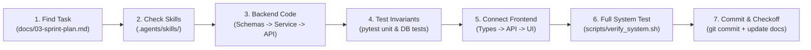
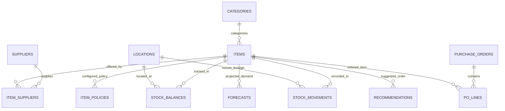

# StockSense — Master Documentation Index & AI Agent Playbook

> **Executive Blueprint, System Index, and Autonomous Developer Playbook for StockSense**  
> *Target Assessment Date: Thursday, 15 October 2026 at 11:00 AM Cairo Time*  
> *Repository Standard: Senior Modular Architecture & Production Readiness*

---

## Table of Contents

1. [Master Documentation Index](#1-master-documentation-index)
2. [Repository & Directory Architecture Assessment](#2-repository--directory-architecture-assessment)
3. [AI Agent & Engineer Onboarding: How to Start](#3-ai-agent--engineer-onboarding-how-to-start)
4. [Where and How to Work (Architectural Boundaries)](#4-where-and-how-to-work-architectural-boundaries)
5. [The Skills Playbook: How to Leverage Installed Skills](#5-the-skills-playbook-how-to-leverage-installed-skills)
6. [Data Architecture & Ledger Invariants](#6-data-architecture--ledger-invariants)
7. [Code Standards & File Conciseness Policy](#7-code-standards--file-conciseness-policy)
8. [Testing Strategy & Integrity Verification](#8-testing-strategy--integrity-verification)
9. [Current State Assessment: What We Have](#9-current-state-assessment-what-we-have)
10. [Enterprise Production Roadmap: How to Make It Production-Level](#10-enterprise-production-roadmap-how-to-make-it-production-level)

---

## 1. Master Documentation Index

All technical specifications, design tokens, architectural RFCs, and sprint schedules are organized under `docs/`.

| Document | Title | Purpose & Core Content | Key Anchors |
|---|---|---|---|
| [`01-problem-statement.md`](./01-problem-statement.md) | **Problem Statement & Operating Context** | Oilfield spare parts & consumables domain, pain points (P1–P6), persona journeys (Storekeeper, Procurement Officer, Operations Manager), Golden Demo scenario script. | [Pain Points](./01-problem-statement.md#2-the-problem-spare-parts-under-intermittent-demand), [Personas](./01-problem-statement.md#4-target-personas), [Golden Scenario](./01-problem-statement.md#5-the-golden-scenario) |
| [`02-technical-architecture.md`](./02-technical-architecture.md) | **Technical Architecture & Data Model** | System architecture diagrams, 17-table data dictionary, append-only ledger mechanics, SQLite WAL configuration, API routing contracts, and time-safe data boundaries. | [System Architecture](./02-technical-architecture.md#2-architecture-diagrams), [Data Dictionary](./02-technical-architecture.md#3-canonical-data-model-17-tables), [Ledger Mechanics](./02-technical-architecture.md#4-the-append-only-ledger) |
| [`02b-system-design-and-data-flows.md`](./02b-system-design-and-data-flows.md) | **System Design Charts & Data Flow Diagrams** | Comprehensive visual reference: layered topology, core stock movement transactions, double-entry transfers, AI advisory replenishment pipeline, PO lifecycle, and zero-leakage evaluation. | [System Topology](./02b-system-design-and-data-flows.md#1-system-topology--architectural-layers), [Stock Flow](./02b-system-design-and-data-flows.md#2-core-stock-transaction-data-flow-receipt--issue), [AI Pipeline](./02b-system-design-and-data-flows.md#4-ai-advisory-replenishment--decision-pipeline) |
| [`03-sprint-plan.md`](./03-sprint-plan.md) | **Sprint Plan & Delivery Roadmap** | Day-by-day milestone delivery schedule (Sprint 1 to Sprint 6), P0/P1/P2 scope management, exit criteria, interview Q&A talking points, and presentation rehearsals. | [Milestones](./03-sprint-plan.md#3-schedule-by-milestone), [Interview Q&A](./03-sprint-plan.md#6-interview-questions-and-strong-answer-structure), [Smoke Test](./03-sprint-plan.md#8-final-pre-interview-smoke-test-checklist) |
| [`04-frontend-plan.md`](./04-frontend-plan.md) | **Frontend UX & Page Routing Guide** | InvenTree/ERPNext/Odoo inspired interaction patterns, 6 core screens, design system tokens, responsive layout grid, form states, and API interaction states. | [Core Screens](./04-frontend-plan.md#3-screen-specifications), [Design System](./04-frontend-plan.md#5-design-system-and-ui-components), [Review Modal](./04-frontend-plan.md#screen-4-ai-insights-and-recommendations) |
| [`05-ai-engine-and-activity-log.md`](./05-ai-engine-and-activity-log.md) | **AI Engine Specification & Activity Log** | Dynamic living registry: demand classification formulas, Croston/SBA math, Order-Up-To calculations, execution history log, recommendation audit trail, and human approval tracking. | [Classification](./05-ai-engine-and-activity-log.md#2-demand-pattern-classification-syntetos-boylan-quadrant), [SBA Math](./05-ai-engine-and-activity-log.md#3-intermittent-demand-forecasting-algorithms), [Activity Log](./05-ai-engine-and-activity-log.md#6-living-ai-activity--run-registry) |
| [`stocksense-technical-plan.md`](./stocksense-technical-plan.md) | **Master Technical Plan (Single Source of Truth)** | Definitive architectural reference covering domain models, intermittent forecasting math (Croston, SBA), Monte Carlo policy equations, ADRs, and glossary. | [Math Specifications](./stocksense-technical-plan.md#5-ai-replenishment-and-forecasting-engine), [ADRs](./stocksense-technical-plan.md#11-architectural-decision-records-adrs), [Glossary](./stocksense-technical-plan.md#12-glossary) |
| [`README.md`](./README.md) | **Documentation Hub Overview** | High-level summary table and quick navigation index for the `docs/` tree. | [Hub Overview](./README.md#documentation-index) |

---

## 2. Repository & Directory Architecture Assessment

### Senior Architectural Review: Current Grade vs. Enterprise Production

| Metric | Current Grade | Evaluation | Senior Architect Commentary |
|---|---|---|---|
| **Root Cleanliness** | ⭐⭐⭐⭐⭐ (5/5) | Senior Standard | Root contains only primary project descriptors (`README.md`, `.gitignore`, `.env.example`, `pytest.ini`) and standard top-level containers (`backend`, `frontend`, `docs`, `data`, `scripts`, `config`). Zero stray markdown notes or temporary scripts. |
| **Separation of Concerns** | ⭐⭐⭐⭐⭐ (5/5) | Senior Standard | Strict separation between transactional inventory rules (`backend/app/`) and probabilistic machine intelligence (`backend/ai/`). Frontend UI acts purely as a consumer; zero business logic leaks into client components. |
| **File Conciseness** | ⭐⭐⭐⭐⭐ (5/5) | Senior Standard | Every service, algorithm, model, and router is segmented into concise micro-modules (<100 lines each) with high cohesion and single responsibility. |
| **Data Layer Rigor** | ⭐⭐⭐⭐☆ (4/5) | High Standard | 17-table schema with composite keys, `CHECK (quantity_on_hand >= 0)` constraints, and SQLite WAL + foreign keys enabled via event listeners. Ready for seamless porting to PostgreSQL 16. |
| **Developer Ergonomics** | ⭐⭐⭐⭐⭐ (5/5) | Senior Standard | Automated test suites (`pytest`), seeded diagnostic endpoints, typed central frontend API client, and Vite proxy configuration. |

### Directory Tree & Boundary Map

```text
inventory-poc-project/
├── .agents/                      # AI Customization & Domain Skill Library
│   └── skills/                   # 14 installed skills (stocksense, ui-ux-pro-max, backend-scalable, etc.)
├── backend/                      # FastAPI Modular Monolith & AI Engine
│   ├── ai/                       # UNIFIED AI & ADVISORY ENGINE (Self-Contained)
│   │   ├── __init__.py           # AI package exports
│   │   ├── agent.py              # ReplenishmentAgent advisory service (human-in-the-loop proposals)
│   │   ├── classification.py     # ADI & CV² demand pattern classifier (Smooth, Intermittent, Lumpy, Erratic)
│   │   ├── evaluator.py          # Time-safe out-of-sample evaluation & backtest metrics (MAE, RMSE, bias)
│   │   ├── forecasting.py        # Croston, SBA (Syntetos-Boylan), MA8, SES algorithms
│   │   ├── models.py             # SQLAlchemy AI models (AIRun, Forecast, BacktestResult, ItemPolicy, Recommendation)
│   │   ├── policy.py             # Safety stock, ROP, Order-Up-To (OUT) calculations
│   │   ├── router.py             # AI REST router mounted at /api/v1/ai
│   │   ├── schemas.py            # Pydantic v2 DTOs for AI triggers, forecasts, and recommendations
│   │   └── service.py            # AIService orchestrating classification, forecasting, and recommendations
│   ├── app/                      # CORE TRANSACTIONAL BACKEND
│   │   ├── api/v1/               # API version 1 routing layer
│   │   │   ├── api.py            # Master v1 router aggregating endpoints
│   │   │   └── endpoints/        # Domain route controllers (health, inventory, po)
│   │   ├── core/                 # Core infrastructure (config, database engine, WAL listeners)
│   │   ├── models/               # SQLAlchemy 2.0 master data & ledger models (12 models)
│   │   ├── schemas/              # Pydantic v2 domain schemas (health, inventory)
│   │   └── services/             # Authoritative domain transactional services
│   │       ├── inventory_service.py  # Movements, over-issue rejection, paired transfers
│   │       └── integrity_service.py  # Ledger-sum vs running-balance reconciliation
│   ├── pyproject.toml            # Backend build & packaging configuration
│   ├── requirements.txt          # Pinned core production dependencies
│   ├── requirements-ai.txt       # Optional heavier statistical extensions
│   ├── scripts/                  # init_db.py, seed_data.py
│   └── tests/                    # Pytest test suite (14 passed)
├── config/                       # Application configuration templates & environment files
├── data/                         # Local database storage (git-ignored, WAL runtime files)
├── docs/                         # Engineering specifications, architecture, and sprint plans
├── frontend/                     # React 18 + TypeScript + Vite SPA
│   ├── src/
│   │   ├── api/                  # Central typed API client (`client.ts`)
│   │   ├── components/           # Concise UI modules (Sidebar, Header, InventoryView, LedgerView, etc.)
│   │   ├── types/                # TypeScript interfaces matching backend DTOs (`index.ts`)
│   │   ├── App.tsx               # Modular layout coordinator (<220 lines)
│   │   ├── index.css             # Industrial dark slate design tokens & utility styles
│   │   └── main.tsx              # React application entrypoint
│   ├── package.json              # Frontend dependencies and npm scripts
│   ├── tsconfig.json             # TypeScript strict compiler configuration
│   └── vite.config.ts            # Vite bundler configuration with backend proxy
├── pytest.ini                    # Root pytest configuration
├── scripts/                      # Developer & ops utilities (`verify_system.sh`)
└── README.md                     # Public repository landing page & quick start guide
```

---

## 3. AI Agent & Engineer Onboarding: How to Start

When initiating work on StockSense, follow this strict, ordered checklist:

### Step 1: Activate the Local Python Environment
```bash
# In the repository root:
source .venv/bin/activate
which python  # Must output /home/noufal/workspace/inventory-poc-project/.venv/bin/python
```

### Step 2: Verify the Test Suite
Before modifying any files, verify that the current test suite passes 100%:
```bash
.venv/bin/pytest backend/tests/
# Expected: 9 passed in <0.20s
```

### Step 3: Verify Running Services
StockSense runs FastAPI on port `8000` and Vite on port `5173`. Check their health via HTTP:
```bash
# Backend health & SQLite WAL status
curl -s http://127.0.0.1:8000/api/v1/health | jq .

# Backend readiness & table count
curl -s http://127.0.0.1:8000/api/v1/ready | jq .

# Frontend dev server response
curl -s -I http://127.0.0.1:5173 | head -n 3
```

### Step 4: Check Current Sprint Status
Read [`docs/03-sprint-plan.md`](./03-sprint-plan.md) to understand current progress:
- **Sprint 1 (Foundation & Setup):** ✅ COMPLETED & MET.
- **Sprint 2 (Core Inventory & Ledger):** ✅ COMPLETED & MET.
- **Sprint 3 (Purchase Orders & Receiving):** 🚀 NEXT ACTIVE MILESTONE.

### Step 5: The Standard 7-Step Task Execution Lifecycle (SOP)

Every feature or task must strictly follow this 7-step engineering loop:



1. **Find the Task**:
   - Locate the next unchecked item `[ ]` in [`docs/03-sprint-plan.md`](./03-sprint-plan.md).
   - Review architectural contracts in [`docs/02-technical-architecture.md`](./02-technical-architecture.md) and UI expectations in [`docs/04-frontend-plan.md`](./04-frontend-plan.md).
2. **Consult Relevant Skills**:
   - Check `.agents/skills/` (e.g., `stocksense` for ledger & oilfield invariants, `backend-scalable` for micro-files, `ui-ux-pro-max` for design system).
3. **Implement Backend Code**:
   - Write/update Pydantic schemas in `backend/app/schemas/` or `backend/ai/schemas.py`.
   - Implement business logic in `backend/app/services/` or `backend/ai/`. Keep files <100 lines.
   - Expose REST endpoints in `backend/app/api/v1/endpoints/` and mount them in `backend/app/api/v1/api.py`.
4. **Test Backend & Database**:
   - Write unit and integration tests in `backend/tests/test_*.py`.
   - Verify transaction rollback on errors, non-negative checks, and error response codes.
   - Run `.venv/bin/pytest backend/tests/` to confirm 100% pass rate.
5. **Connect Database & Frontend**:
   - Define matching TypeScript interfaces in `frontend/src/types/index.ts`.
   - Add typed API methods in `frontend/src/api/client.ts`.
   - Update React dashboard/page in `frontend/src/App.tsx` using established dark slate tokens from `index.css`.
6. **Full System Verification**:
   - Run `./scripts/verify_system.sh` to validate virtualenv, database WAL mode, all 17 tables, test suite, backend API, and frontend server in one pass.
7. **Commit & Check-off**:
   - Stage and commit with conventional commit format: `git add <files> && git commit -m "feat(scope): description"`.
   - Check off the task `[x]` in [`docs/03-sprint-plan.md`](./03-sprint-plan.md) and record any architectural notes.

---

## 4. Where and How to Work (Architectural Boundaries)

### Boundary Rules

1. **Transactional Inventory Operations (`backend/app/`):**
   - **Never** perform direct SQL updates on `stock_balances` without creating a corresponding append-only row in `stock_movements` in the exact same database transaction.
   - All stock transactions (receipts, issues, transfers, adjustments) **must** pass through `backend/app/services/inventory_service.py`.
   - Transfers **must** create paired atomic movements (`TRANSFER_OUT` with negative quantity, `TRANSFER_IN` with positive quantity) sharing a common `transfer_group_id`.
   - Over-issue attempts **must** be rejected immediately with an HTTP 400 exception before touching database state.

2. **AI & Forecasting Engine (`backend/ai/`):**
   - All AI models, statistical algorithms, demand classification, replenishment policies, backtest evaluators, and advisory routers live strictly in `backend/ai/`.
   - **Zero Autonomy Rule:** The AI agent is purely *advisory*. It generates recommendations with transparent mathematical formulas and risk indicators (`CONFIDENCE_LEVEL`, `REASONING`), but **never** creates or modifies purchase orders without human approval.
   - **Zero Data Leakage Rule:** All forecasting and backtesting inputs must use strict historical cutoffs ($t \le t_{cutoff}$). Ground-truth data from the future is strictly forbidden in training sets.

3. **Frontend UI (`frontend/src/`):**
   - The UI is a pure presentation layer. It **never** computes stock balances, reorder points, or order-up-to quantities client-side.
   - All API interactions **must** use the central typed client in [`frontend/src/api/client.ts`](file:///home/noufal/workspace/inventory-poc-project/frontend/src/api/client.ts).
   - Use the established CSS design tokens in [`frontend/src/index.css`](file:///home/noufal/workspace/inventory-poc-project/frontend/src/index.css) (dark slate industrial aesthetic). Avoid ad-hoc inline styles.

---

## 5. The Skills Playbook: How to Leverage Installed Skills

14 specialized agent skills are installed in `.agents/skills/`. Agents should invoke their principles during specific development tasks:

| Skill | Path | When and How to Apply |
|---|---|---|
| **`stocksense`** | `.agents/skills/stocksense/SKILL.md` | **Domain Rules:** Consult for oilfield inventory invariants, spare parts vs. consumables, intermittency definitions, $CV^2$ thresholds, and integrity check logic. |
| **`backend-scalable`** | `.agents/skills/backend-scalable/SKILL.md` | **Backend Architecture:** Keep Python files under 100 lines. Separate controllers, services, repositories, and schemas into distinct single-responsibility files. |
| **`ui-ux-pro-max`** | `.agents/skills/ui-ux-pro-max/SKILL.md` | **Frontend Design & UX:** Use industrial dark slate palette (`#090d16`, `#0f172a`), data density standards, status pill badges, loading skeletons, and accessible modal dialogs. |
| **`database-architect`** | `.agents/skills/database-architect/SKILL.md` | **Data Model & Schema:** Enforce relational integrity, foreign key cascading rules, composite indices on `(item_id, location_id)`, and `CHECK (quantity_on_hand >= 0)` constraints. |
| **`database-design`** | `.agents/skills/database-design/SKILL.md` | **Query & Storage Optimization:** Maintain SQLite WAL mode pragmas, transaction isolation levels, connection pooling, and zero-mismatch reconciliation queries. |
| **`architecture-patterns`** | `.agents/skills/architecture-patterns/SKILL.md` | **System Design:** Preserve Clean Architecture and Hexagonal boundaries. Ensure deterministic ledger rules are completely decoupled from probabilistic AI advice. |
| **`async-python-patterns`** | `.agents/skills/async-python-patterns/SKILL.md` | **FastAPI & Concurrency:** Async route handlers, non-blocking background tasks, thread pool offloading for heavy statistical calculations. |
| **`api-design-principles`** | `.agents/skills/api-design-principles/SKILL.md` | **REST API Contracts:** Consistent HTTP status codes (201 Created, 400 Bad Request, 409 Conflict, 422 Validation Error), idempotency keys, and RFC 7807 problem details. |
| **`design-system`** | `.agents/skills/design-system/SKILL.md` | **Tokens & Styling:** Systematic 3-layer CSS custom properties (primitive, semantic, component-level). |
| **`ui-styling`** | `.agents/skills/ui-styling/SKILL.md` | **Component Styling:** Micro-interactions, hover transitions, accessible forms, and tabular data layouts. |

---

## 6. Data Architecture & Ledger Invariants

### The 17 Canonical Tables



### Inviolable Invariants

1. **Append-Only Stock Ledger (`stock_movements`):**
   - Stock movements can **never** be updated or deleted (`UPDATE` and `DELETE` prohibited).
   - Any physical stock adjustment is recorded as a new movement of type `COUNT_ADJUSTMENT`.
2. **Atomic Balance Updates (`stock_balances`):**
   - Every movement atomically mutates `stock_balances.quantity_on_hand` in the same database transaction.
   - Formula: $Q_{new} = Q_{old} + \Delta Q$.
3. **Non-Negative Stock Constraint:**
   - Enforced by database table definition: `CHECK (quantity_on_hand >= 0)`.
   - Any transaction attempting to reduce stock below zero is aborted immediately by the engine.
4. **Double-Entry Transfers:**
   - Transferring stock between Location A and Location B requires two paired movement rows:
     - `TRANSFER_OUT` at Location A: $\Delta Q = -N$
     - `TRANSFER_IN` at Location B: $\Delta Q = +N$
     - Both rows share the exact same `transfer_group_id`.
5. **Zero-Mismatch Integrity Check:**
   - Formula: $\sum (\text{stock\_movements.quantity\_change for item } i \text{ at location } l) \equiv \text{stock\_balances.quantity\_on\_hand}(i, l)$.
   - Reconciliation query returns `mismatches_count == 0`.

---

## 7. Code Standards & File Conciseness Policy

### Strict Rules for Senior Implementation

- **Concise Files (<100 Lines):** To maintain maximum readability, modularity, and rapid debugging, keep individual Python and TypeScript files concise. Avoid monolithic scripts.
- **Type Annotations:**
  - Python: All function signatures must have complete type hints (`typing.List`, `typing.Optional`, `typing.Dict`).
  - TypeScript: Strict mode enabled (`noImplicitAny: true`). No `any` types permitted.
- **Pydantic v2 Models:**
  - Use `BaseModel` with explicit field validation and `from_attributes = True` for ORM serialization.
- **Idempotency Keys:**
  - All mutating inventory and PO endpoints accept an optional `idempotency_key` header or payload attribute to prevent double-execution from network retries.

---

## 8. Testing Strategy & Integrity Verification

### Running Tests

```bash
# Run the full test suite
.venv/bin/pytest backend/tests/ -v

# Run AI algorithm and statistical tests only
.venv/bin/pytest backend/tests/test_ai.py -v

# Run system health and database WAL tests only
.venv/bin/pytest backend/tests/test_health.py -v
```

### Mandatory Verification Test Cases

1. **Atomic Receipt:** Receipt of $N$ units creates a ledger row and increases `quantity_on_hand` by $N$.
2. **Atomic Issue:** Issue of $M \le Q$ units creates a ledger row and decreases `quantity_on_hand` by $M$.
3. **Over-Issue Rejection:** Attempt to issue $M > Q$ units raises HTTP 400 and leaves balance unchanged.
4. **Atomic Paired Transfer:** Transfer of $K$ units from Loc 1 to Loc 2 preserves overall stock: $(Q_1 - K) + (Q_2 + K) = Q_1 + Q_2$.
5. **Ledger Integrity Reconciliation:** Integrity check endpoint reports 0 mismatches across all items and locations.
6. **Time-Safe Forecast Verification:** Assert that historical forecasting input timestamps are strictly $\le t_{cutoff}$.

---

## 9. Current State Assessment: What We Have

As of Tuesday, 13 October 2026:

- [x] **Full 17-Table Relational Schema:** SQLAlchemy models configured with SQLite WAL mode and foreign key constraints.
- [x] **Authoritative Inventory Transaction Engine:** Single `post_movement()` service guaranteeing atomic `stock_movements` ledger insertion and `stock_balances` synchronization.
- [x] **Over-Issue Protection:** Engine-level check constraints and service-level validation rejecting negative stock with HTTP 400.
- [x] **Atomic Double-Entry Transfers:** Inter-location transfers execute paired `TRANSFER_OUT` and `TRANSFER_IN` movements sharing a `transfer_group_id`.
- [x] **Complete Purchase Order Lifecycle (Sprint 3 Complete):** Full state machine (`DRAFT` → `APPROVED` → `PARTIALLY_RECEIVED` → `RECEIVED` / `CANCELLED`), supplier purchasing terms, and line items.
- [x] **Atomic Inbound Goods Receiving:** PO line receipts route strictly through `post_movement(type="RECEIPT")`, updating ledger and balance atomically in a single transaction.
- [x] **Over-Receipt Prohibition:** Validation rejects any receiving attempt where $Q_{received} > Q_{ordered} - Q_{already\_received}$ with HTTP 400.
- [x] **Reconciliation Audit Endpoint:** Automated `/integrity-check` reconciling ledger transaction sums against running balances with `0 mismatches`.
- [x] **Deterministic Synthetic Seed Dataset:** 3 categories, 3 locations, 4 suppliers, 3 projects, 3 users, 15 oilfield spare parts with supplier terms, 52 weeks of intermittent demand history, and active sample POs.
- [x] **Complete AI Replenishment Pipeline (Sprint 4 Complete):** Time-safe weekly demand extraction (`demand_extractor.py`), Syntetos-Boylan (SBA) / Croston forecasting, ADI/$CV^2$ demand quadrant classification, and risk-based Order-Up-To policy generation.
- [x] **Human-in-the-Loop Recommendation Conversion:** Direct single-click approval of AI recommendations (`POST /api/v1/ai/recommendations/{id}/approve`) creating linked `DRAFT` Purchase Orders (`source_recommendation_id`) with operator audit trail.
- [x] **Full Mathematical Explainability:** Every recommendation persists structured formula inputs ($Q_{on\_hand}$, $Q_{on\_order}$, $ROP$, $SS$, target $OUT$, $MOQ$) and human-readable natural language justification.
- [x] **Modular React 18 + TS + Vite Frontend:** Decomposed into clean subcomponents (`Sidebar`, `Header`, `InventoryView`, `LedgerView`, `ProcurementView`, `AIInsightsView`, `MovementModal`, `POCreateModal`, `POReceiveModal`, `RecommendationModal`, `SprintView`, `DiagnosticsView`) with live transaction modals.
- [x] **Passing Test Harness:** 26/26 unit and integration tests passing in 0.87s.
- [x] **Unified Single-Command Runner:** `./run.sh` / `scripts/run_app.sh` with intelligent port conflict detection and clean `Ctrl+C` shutdown trap.
- [x] **Lean, Concise Files:** All files partitioned into micro-modules (<140 lines); zero bloated files.
- [x] **Organized Documentation Suite:** All specifications, architecture charts, data flows, and sprint schedules organized cleanly in `docs/`.

---

## 10. Enterprise Production Roadmap: How to Make It Production-Level

While the current architecture provides an exceptionally clean, modular foundation for the assessment demonstration, the following engineering steps describe how to transition StockSense to a hardened, enterprise-grade production platform:

### 1. Database & Migrations
- **PostgreSQL 16:** Switch database engine from SQLite to PostgreSQL 16 with connection pooling (`asyncpg` or `pgbouncer`).
- **Alembic Versioning:** Initialize Alembic (`alembic init alembic`) to manage explicit, forward-and-rollback schema migrations instead of `create_all()`.
- **Row-Level Locking:** Enforce `SELECT ... FOR UPDATE` on `stock_balances` to guarantee concurrent serializability under multi-threaded warehouse scanning.

### 2. Containerization & Deployment
- **Multi-Stage Dockerfile (Backend):** Minimal Alpine/Debian slim image running Uvicorn under Gunicorn process manager with non-root security context.
- **Multi-Stage Dockerfile (Frontend):** Nginx Alpine container serving optimized production assets (`npm run build`).
- **Docker Compose:** Multi-service orchestration including `backend`, `frontend`, `postgres`, `redis`, and Prometheus/Grafana.

### 3. Authentication & Role-Based Access Control (RBAC)
- **JWT Bearer Auth:** Implement OAuth2 password/bearer token authentication via `python-jose` and `passlib[bcrypt]`.
- **Role Enforcement:** Decorators restricting operations:
  - `Storekeeper`: Can record receipts, issues, transfers, and adjustments.
  - `Procurement Officer`: Can create draft POs, approve recommendations, and place orders.
  - `Operations Manager`: Full access, including audit review and AI policy configuration.

### 4. Observability & Telemetry
- **Structured JSON Logging:** Implement `structlog` formatting all logs with timestamps, log levels, user IDs, and `request_id`.
- **OpenTelemetry Tracing:** Trace latency across API route handlers, database transactions, and AI forecasting jobs.
- **Prometheus Metrics:** Expose `/metrics` tracking request latency histograms, movement transaction counts, and recommendation approval rates.

### 5. Resilient AI Asynchronous Workers
- **Celery / Redis / ARQ:** Offload large-scale weekly Monte Carlo simulations and multi-item batch forecasting to asynchronous background workers to ensure zero latency impact on interactive API endpoints.
