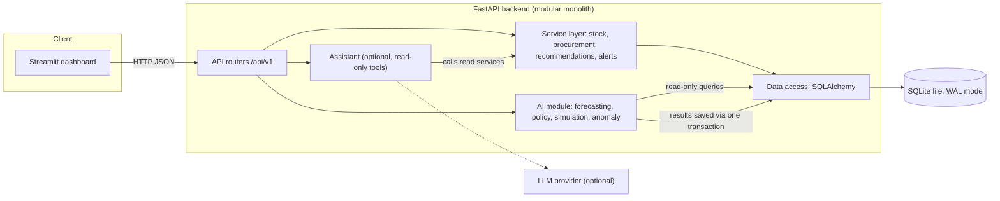
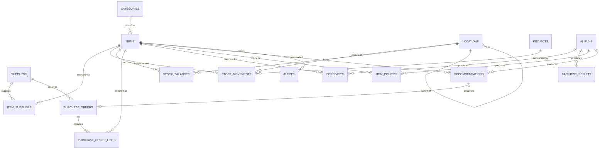
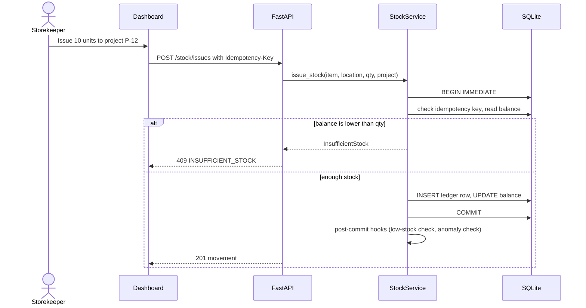
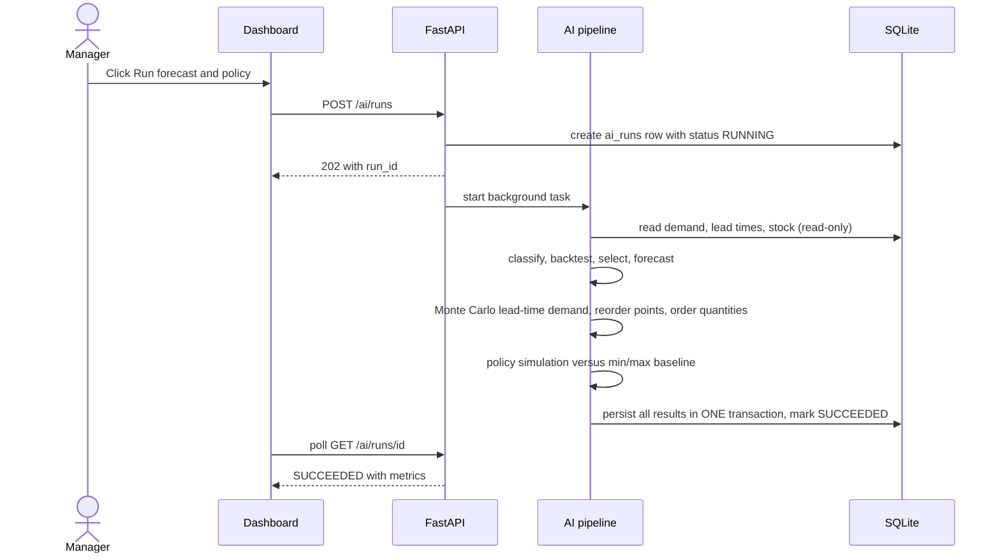
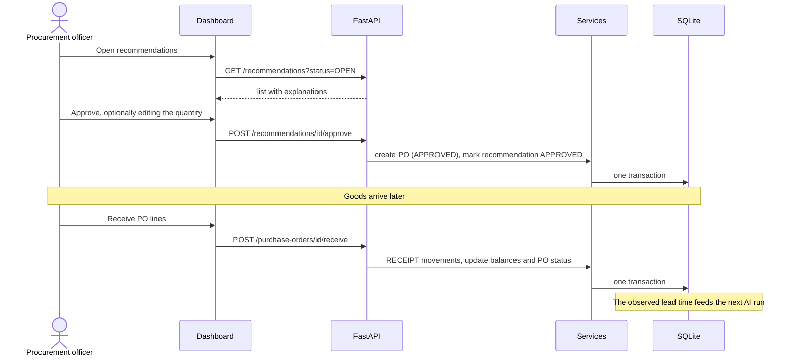

# StockSense — AI-Assisted Inventory Management System
## Technical Build Plan (Proof of Concept)

| | |
|---|---|
| **Version** | 1.0 — written Monday, Oct 12, 2026 |
| **Purpose** | Single source of truth for building, documenting and demoing the PoC |
| **Database** | SQLite (PoC decision; migration path to PostgreSQL documented) |
| **Stack** | Python 3.11, FastAPI, SQLAlchemy 2.x, SQLite, pandas/numpy/scipy, LightGBM, Streamlit, Docker Compose |
| **Tier tags** | **[T1]** must ship · **[T2]** should ship · **[T3]** only if everything else is done |

**One-paragraph summary.** StockSense is a complete inventory management system (master data, an append-only stock ledger, purchase orders, receiving, alerts, dashboard) with an AI layer that forecasts intermittent spare-parts demand, computes risk-based reorder points with Monte Carlo simulation, and proposes purchase orders that a human approves. Every AI output is explained, backtested, and compared against a traditional min/max baseline.

**How this plan maps to what the company asked for**

| Company requirement (from their emails) | Where it is answered |
|---|---|
| Complete system, not a single component | §3 scope, §4 architecture, §7 API, §12 dashboard |
| Explain what you built and why each design decision | §2, §4.4, §6, §8, Appendix B (decision log) |
| Dataset choice justified: why, how realistic, limitations; synthetic assumptions explained | §10 |
| Public GitHub repo with README (setup, architecture, decisions, how to run) | §11, §13, Appendix A |
| Well-established languages and tools | §4.3 |
| Live demo + walkthrough of decisions in the interview | §15 |
| Assumptions and limitations highlighted | §16 |

---

## Table of contents
1. Problem statement
2. Open-source reference systems
3. Scope and tiers
4. System architecture
5. Data model (SQLite)
6. Core inventory logic
7. API specification
8. AI / ML design
9. Data flows
10. Synthetic data design
11. Repository structure and key functions
12. Dashboard specification
13. Testing, quality, DevOps
14. Sprint plan
15. Demo script and interview preparation
16. Risks, limitations, roadmap
- Appendix A: README outline · Appendix B: Decision log · Appendix C: Glossary

---

## 1. Problem statement

### 1.1 Context (assumed)
The target is a mid-size **oilfield-services company that runs warehouse and free-zone storage/logistics operations**. It holds **spare parts and consumables** (drilling-fluid chemicals, wellhead and pressure-control parts, rig mechanical and electrical spares, PPE and general consumables) in warehouses and yards and issues them to drilling projects.

> The company did not describe its internal systems. This context is inferred from public information and from their statement that spare parts and consumables are "closest to our domain". It is an **assumption**, and the README must say so.

### 1.2 Problems the system addresses

| ID | Problem | Business impact |
|---|---|---|
| P1 | **Stockouts of critical spares** | Rig downtime, project delays, emergency (expensive) purchasing |
| P2 | **Overstock and expiry** of chemicals and slow movers | Cash tied up, write-offs |
| P3 | **Intermittent, project-driven demand** (many zero-demand weeks, occasional large issues) | Simple min/max rules and averages fail on this pattern |
| P4 | **Long and variable lead times**, especially for imported items | Static safety stock is either too low (stockouts) or too high (overstock) |
| P5 | **Mutable stock records** (spreadsheets, edited quantities) | No audit trail, unexplained discrepancies |
| P6 | **Manual, reactive reordering with no explanation** | Late orders, inconsistent decisions, hard to trust or review |

### 1.3 Goal
Provide a single system of record for stock with a full audit trail, and an AI layer that tells procurement **what to order, how much, and why**, early enough to avoid stockouts without inflating inventory.

### 1.4 Objectives and success metrics

| # | Objective | Measurable target for the PoC |
|---|---|---|
| O1 | Trustworthy stock records | Integrity check: **0 mismatches** between balances and ledger; negative stock impossible |
| O2 | Better demand understanding | Every active item classified (smooth / erratic / intermittent / lumpy) and forecasted |
| O3 | Beat the traditional rule | AI policy compared to a static min/max baseline in a **paired simulation**: report fill rate, stockout weeks, average inventory value, number of orders. *Report honestly even if the result is mixed.* |
| O4 | Explainable decisions | 100% of recommendations carry a stored explanation (inputs, thresholds, forecast, lead time) |
| O5 | Human stays in control | No purchase order is created without a human approval action |
| O6 | Runs anywhere | Clean clone to working demo in ≤ 5 commands |

### 1.5 Non-goals (explicitly out of scope)
Multi-echelon optimization across sites, batch/lot tracking, barcode/RFID hardware, authentication and roles, accounting/valuation beyond simple unit cost, real ERP integration, mobile app, multi-currency, supplier portals.

### 1.6 Users

| Persona | Needs |
|---|---|
| **Storekeeper** | Record receipts, issues, transfers, counts quickly and correctly |
| **Procurement officer** | See what to order, review the reasoning, approve or dismiss, receive deliveries |
| **Operations manager** | Overview, risk alerts, evidence that the AI beats the old rule |

---

## 2. Open-source reference systems

We **study design concepts** from established open-source inventory systems and build our own lean core. **No code is copied.** Check each project's license before ever reusing anything.

### 2.1 Systems reviewed

| System | What it is | Why it matters here |
|---|---|---|
| **InvenTree** | Open-source inventory system focused on parts, stock and BOMs (Django). Models include Part, StockLocation (tree), StockItem, SupplierPart, PurchaseOrder. Its stock API exposes count / add / remove / transfer operations and a stock history. | **Primary reference** for the parts-and-stock domain model and stock operations |
| **ERPNext** | Full open-source ERP with a strong stock module: multi-warehouse, stock ledger, valuation. | **Primary reference** for the append-only **stock ledger + balance ("Bin") pattern** |
| **OpenBoxes** | Open-source supply-chain system built around requisitions, stock movements, expiry and lots. | Reference for expiry/lot ideas (roadmap only) |
| Odoo Community | Broad ERP with an inventory module | Reviewed; too large to learn and defend in the time available |
| Snipe-IT | Asset management | Not a fit (assets, not consumable stock) |

> **Before quoting model names in the README, re-check them against each project's current docs.** This plan describes concepts as understood at writing time.

### 2.2 What we borrow, and where we differ

| Concept | Borrowed from | In StockSense | Deliberate difference |
|---|---|---|---|
| Item (part) master with unit of measure, category | InvenTree Part / ERPNext Item | `items`, `categories` | Adds `criticality`, `shelf_life_days`, per-item service-level override (needed by the AI policy) |
| Hierarchical stock locations | InvenTree StockLocation / ERPNext Warehouse | `locations` with `parent_id` | Three types only: WAREHOUSE, YARD, RIG_SITE |
| Supplier-specific item data (price, MOQ, supplier SKU) | InvenTree SupplierPart | `item_suppliers` | Adds nominal lead time and order multiple |
| Stock operations: count, add, remove, transfer | InvenTree stock API | `ADJUSTMENT`, `RECEIPT`, `ISSUE`, `TRANSFER_*` movements | Operations are **append-only ledger entries**, never edits |
| Immutable ledger + running balance | ERPNext Stock Ledger Entry + Bin | `stock_movements` + `stock_balances` | `CHECK (quantity_on_hand >= 0)` enforces no negative stock **at the database level** |
| Purchase order with lines and receiving | InvenTree / ERPNext | `purchase_orders`, `purchase_order_lines`, receive endpoint | Orders can be **created from AI recommendations** |
| Expiry / lots | OpenBoxes | Not built (roadmap). Shelf life caps order-up-to level instead | Keeps scope realistic |

**Why not fork one of them?** (1) The company asked us to explain *what we built and why*; a fork makes most of the code someone else's. (2) These systems are large; learning and customizing them is slower than building a lean core. (3) The differentiator is the AI layer and its evaluation. (4) The AI module is designed to read through a thin repository interface, so in production it can sit on top of InvenTree or ERPNext via their APIs.

---

## 3. Scope and tiers

| Area | [T1] Must ship | [T2] Should ship | [T3] Only if time remains |
|---|---|---|---|
| Inventory core | Items, suppliers, locations, projects; ledger; balances; receipt/issue/transfer/adjust; idempotency; integrity check | Ledger CSV export | Batch/lot, expiry tracking |
| Procurement | PO create/approve/receive/cancel; recommendation → PO | Batch approval grouped by supplier | Supplier scorecards |
| AI forecasting | Demand classification, baselines, Croston/SBA/TSB, rolling-origin backtest, method selection | **LightGBM global model** (cut-able, see §14) | Block bootstrap, hierarchical reconciliation |
| AI policy | Lead-time model, Monte Carlo reorder point, order quantity, recommendations with explanations | Shelf-life cap, overstock/dead-stock alerts | Per-location policy |
| AI evaluation | Paired policy simulation vs min/max baseline | Dataset profile page | Validation on a public real dataset |
| Alerts | Low stock, stockout risk | Anomalous issue / suspicious adjustment | — |
| UI | Overview, Items, Operations, Purchase Orders, Recommendations, Forecast Lab, Model Report | CSV downloads | Assistant page |
| Assistant | — | — | Read-only LLM assistant |
| Vision | — | — | Pallet/drum counting from a photo |
| DevOps | Docker Compose, tests for core invariants, README | GitHub Actions CI, coverage | Alembic migrations, auth |

---

## 4. System architecture

### 4.1 Style
**Modular monolith**: one FastAPI application with strict internal boundaries, plus a separate Streamlit dashboard container. Not microservices (too much operational overhead for a PoC), but the AI module only talks to data through repository functions, so it can be extracted into its own service later.

### 4.2 Diagram



### 4.3 Technology choices

| Layer | Tool | Why | Alternative considered |
|---|---|---|---|
| Language | Python 3.11 | Standard for data/AI + web APIs | — |
| API | **FastAPI** + Uvicorn | Typed, automatic OpenAPI docs (useful in the demo), fast to build | Flask (no built-in validation/docs), Django (heavier) |
| Validation | Pydantic v2 + pydantic-settings | Request/response schemas, env config | — |
| ORM | **SQLAlchemy 2.x** | Database-agnostic: switch SQLite → PostgreSQL by changing the URL | Raw SQL (less portable) |
| Database | **SQLite** (WAL) | Zero setup, single file, reproducible demo | PostgreSQL (better concurrency; roadmap) |
| Data/ML | pandas, numpy, scipy | Time-series handling, simulation | — |
| ML model | **LightGBM** | Strong on small tabular data, supports quantile and Tweedie objectives | LSTM/Transformers (need far more data, not explainable) |
| Dashboard | **Streamlit** + Plotly | Fastest path to a working UI; calls the API only | React (better UX, too slow to build) |
| HTTP client | httpx | Dashboard → API | requests |
| Tests | pytest, pytest-cov, FastAPI TestClient | Standard | — |
| Quality | ruff (lint + format) | One fast tool | flake8 + black |
| Packaging | Docker, Docker Compose | One-command run | — |
| CI | GitHub Actions | Free for public repos | — |
| Diagrams | Mermaid in Markdown | Renders on GitHub, versioned | draw.io images |

> Pin exact versions in `requirements.txt` after installing (`pip freeze`) so a fresh clone behaves identically.

### 4.4 Key architectural decisions (summary; full log in Appendix B)
1. **Ledger as source of truth**; balances are a derived, constraint-protected table.
2. **Only the API container touches the database.** The dashboard calls the API. SQLite stays single-writer.
3. **AI recommends, humans approve.** The AI never creates a PO by itself.
4. **Deterministic core, probabilistic AI.** All stock math is exact integer arithmetic; AI only influences recommendations.
5. **Results persisted atomically.** A failed AI run leaves no half-written results.

### 4.5 Deployment (Docker Compose)

| Service | Port | Notes |
|---|---|---|
| `api` | 8000 | FastAPI; `/health` healthcheck; mounts `./data:/app/data` for the SQLite file |
| `dashboard` | 8501 | Streamlit; `API_BASE_URL=http://api:8000`; waits for `api` health |

Make targets: `make up`, `make seed`, `make run-ai`, `make test`, `make lint`, `make demo-reset`.

### 4.6 Configuration (environment variables)

| Variable | Default | Purpose |
|---|---|---|
| `DATABASE_URL` | `sqlite:///./data/stocksense.db` | DB location |
| `API_BASE_URL` | `http://localhost:8000` | Used by dashboard |
| `ENABLE_ADMIN` | `false` | Enables `/admin/*` (seed/reset) |
| `ENABLE_ASSISTANT` | `false` | Enables LLM assistant |
| `ASSISTANT_API_KEY`, `ASSISTANT_MODEL` | — | Provider key and a current model name from the provider's docs |
| `SERVICE_LEVEL_CRITICAL / STANDARD / LOW` | `0.98 / 0.95 / 0.90` | Target cycle service levels |
| `ORDERING_COST` | `50` | Fixed cost per purchase order (assumption, for EOQ) |
| `HOLDING_RATE` | `0.20` | Annual holding cost as a fraction of unit cost (assumption) |
| `REVIEW_PERIOD_WEEKS` | `1` | Review period R |
| `MC_SIMULATIONS` | `5000` | Monte Carlo draws |
| `RANDOM_SEED` | `42` | Reproducibility |

---

## 5. Data model (SQLite)

### 5.1 Conventions
- Timestamps: ISO-8601 UTC text (`2026-10-12T09:30:00Z`). Dates: `YYYY-MM-DD`.
- Booleans: `INTEGER` 0/1. Quantities: **`INTEGER` in the item's base unit of measure** (limitation: no fractional quantities).
- Money: `REAL` (PoC limitation; production should use integer minor units or `Decimal`).
- Every connection runs: `PRAGMA foreign_keys=ON; PRAGMA journal_mode=WAL; PRAGMA synchronous=NORMAL; PRAGMA busy_timeout=5000;`
- All **write** units of work start with `BEGIN IMMEDIATE` (takes the write lock up front, so the balance check and insert cannot interleave with another writer).
- Hard deletes are not exposed for referenced data; use `is_active = 0`.

### 5.2 Entity-relationship diagram



### 5.3 Table specifications

**`categories`**

| Column | Type | Rules |
|---|---|---|
| id | INTEGER | PK |
| name | TEXT | NOT NULL, UNIQUE |
| description | TEXT | |

**`items`**

| Column | Type | Rules |
|---|---|---|
| id | INTEGER | PK |
| sku | TEXT | NOT NULL, UNIQUE |
| name | TEXT | NOT NULL |
| description | TEXT | |
| category_id | INTEGER | FK → categories, NOT NULL |
| uom | TEXT | NOT NULL (e.g. `pcs`, `drum`, `kg`, `box`) |
| unit_cost | REAL | NOT NULL, ≥ 0 |
| criticality | TEXT | NOT NULL, IN (`CRITICAL`,`STANDARD`,`LOW`), default `STANDARD` |
| shelf_life_days | INTEGER | NULL or > 0 |
| service_level_override | REAL | NULL or between 0.50 and 0.999 |
| is_active | INTEGER | NOT NULL, default 1 |
| created_at, updated_at | TEXT | NOT NULL |

**`suppliers`**

| Column | Type | Rules |
|---|---|---|
| id | INTEGER | PK |
| name | TEXT | NOT NULL, UNIQUE |
| country | TEXT | |
| is_import | INTEGER | NOT NULL, default 0 |
| contact_email | TEXT | |
| created_at | TEXT | NOT NULL |

**`item_suppliers`** (borrowed from InvenTree's SupplierPart idea)

| Column | Type | Rules |
|---|---|---|
| id | INTEGER | PK |
| item_id | INTEGER | FK → items, NOT NULL |
| supplier_id | INTEGER | FK → suppliers, NOT NULL |
| supplier_sku | TEXT | |
| unit_price | REAL | NOT NULL, ≥ 0 |
| moq | INTEGER | NOT NULL, default 1, ≥ 1 |
| order_multiple | INTEGER | NOT NULL, default 1, ≥ 1 |
| lead_time_days_nominal | INTEGER | NOT NULL, > 0 |
| is_preferred | INTEGER | NOT NULL, default 0 |
| | | UNIQUE (item_id, supplier_id); partial unique index: at most one preferred supplier per item |

**`locations`**

| Column | Type | Rules |
|---|---|---|
| id | INTEGER | PK |
| code | TEXT | NOT NULL, UNIQUE |
| name | TEXT | NOT NULL |
| location_type | TEXT | IN (`WAREHOUSE`,`YARD`,`RIG_SITE`) |
| parent_id | INTEGER | NULL, FK → locations |
| is_active | INTEGER | NOT NULL, default 1 |

**`projects`** (drilling campaigns; drive demand)

| Column | Type | Rules |
|---|---|---|
| id | INTEGER | PK |
| code | TEXT | NOT NULL, UNIQUE |
| name | TEXT | NOT NULL |
| rig_name | TEXT | |
| start_date | TEXT | NOT NULL |
| end_date | TEXT | NULL |
| status | TEXT | IN (`PLANNED`,`ACTIVE`,`COMPLETED`) |

**`stock_movements`** — the append-only ledger (source of truth)

| Column | Type | Rules |
|---|---|---|
| id | INTEGER | PK AUTOINCREMENT |
| item_id | INTEGER | FK, NOT NULL |
| location_id | INTEGER | FK, NOT NULL |
| movement_type | TEXT | IN (`RECEIPT`,`ISSUE`,`TRANSFER_OUT`,`TRANSFER_IN`,`ADJUSTMENT`) |
| quantity | INTEGER | **signed**, ≠ 0 (+ in, − out) |
| unit_cost | REAL | NULL; set on receipts |
| project_id | INTEGER | NULL; only allowed for `ISSUE` |
| reference_type | TEXT | NULL or IN (`PO_LINE`,`MANUAL`,`COUNT`,`TRANSFER`,`SYNTHETIC`) |
| reference_id | INTEGER | NULL |
| transfer_group_id | TEXT | NULL; same UUID on both legs of a transfer |
| reason | TEXT | **required** for `ADJUSTMENT` |
| idempotency_key | TEXT | NULL, UNIQUE |
| actor | TEXT | NOT NULL, default `system` |
| occurred_at | TEXT | NOT NULL (business time) |
| created_at | TEXT | NOT NULL (system time) |

**`stock_balances`** (derived, constraint-protected; analogous to ERPNext's Bin)

| Column | Type | Rules |
|---|---|---|
| item_id, location_id | INTEGER | composite PK, FKs |
| quantity_on_hand | INTEGER | NOT NULL, **CHECK ≥ 0** |
| updated_at | TEXT | NOT NULL |

**`purchase_orders`**

| Column | Type | Rules |
|---|---|---|
| id | INTEGER | PK |
| po_number | TEXT | NOT NULL, UNIQUE (`PO-YYYYMMDD-NNNN`) |
| supplier_id | INTEGER | FK, NOT NULL |
| status | TEXT | IN (`DRAFT`,`APPROVED`,`PARTIALLY_RECEIVED`,`RECEIVED`,`CANCELLED`) |
| order_date | TEXT | NOT NULL (set on approval) |
| expected_date | TEXT | NULL |
| source_recommendation_id | INTEGER | NULL, FK → recommendations |
| created_by, approved_by | TEXT | |
| approved_at | TEXT | NULL |
| notes | TEXT | |
| created_at | TEXT | NOT NULL |

**`purchase_order_lines`**

| Column | Type | Rules |
|---|---|---|
| id | INTEGER | PK |
| po_id | INTEGER | FK, NOT NULL |
| item_id | INTEGER | FK, NOT NULL |
| destination_location_id | INTEGER | FK, NOT NULL |
| qty_ordered | INTEGER | NOT NULL, > 0 |
| qty_received | INTEGER | NOT NULL, default 0, 0 ≤ value ≤ qty_ordered |
| unit_price | REAL | NOT NULL |

**`ai_runs`**

| Column | Type | Rules |
|---|---|---|
| id | INTEGER | PK |
| run_type | TEXT | IN (`FORECAST_AND_POLICY`,`ANOMALY`) |
| status | TEXT | IN (`RUNNING`,`SUCCEEDED`,`FAILED`) |
| started_at, finished_at | TEXT | |
| data_cutoff | TEXT | last movement date included |
| params_json | TEXT | request parameters |
| metrics_json | TEXT | class-level backtest summary, selected methods, simulation summary |
| model_version | TEXT | git commit or semantic version |
| error | TEXT | NULL |

**`forecasts`**

| Column | Type | Rules |
|---|---|---|
| id | INTEGER | PK |
| run_id, item_id | INTEGER | FKs |
| period_start | TEXT | Monday of the forecast week |
| horizon_step | INTEGER | 1..H |
| mean | REAL | |
| p50, p90 | REAL | NULL if the method has no quantile output |
| method | TEXT | |
| | | UNIQUE (run_id, item_id, period_start) |

**`backtest_results`**

| Column | Type | Rules |
|---|---|---|
| id | INTEGER | PK |
| run_id, item_id | INTEGER | FKs |
| method | TEXT | |
| rmsse, mase, bias | REAL | |
| pinball_p90 | REAL | NULL |
| cum_abs_error | REAL | absolute error of the cumulative H-week demand |
| n_windows | INTEGER | |

**`item_policies`**

| Column | Type | Rules |
|---|---|---|
| id | INTEGER | PK |
| run_id, item_id | INTEGER | FKs; UNIQUE (run_id, item_id) |
| demand_pattern | TEXT | `smooth`,`erratic`,`intermittent`,`lumpy`,`insufficient_history` |
| adi, cv2 | REAL | classification inputs |
| abc_class, xyz_class | TEXT | |
| selected_method | TEXT | |
| low_confidence | INTEGER | 1 for cold-start items |
| service_level | REAL | |
| lead_time_mean_days, lead_time_p90_days | REAL | |
| mean_weekly_demand | REAL | model forecast level |
| safety_stock, reorder_point, order_up_to | INTEGER | |
| eoq | INTEGER | |
| computed_at | TEXT | |

**`recommendations`**

| Column | Type | Rules |
|---|---|---|
| id | INTEGER | PK |
| run_id, item_id | INTEGER | FKs |
| supplier_id | INTEGER | FK |
| status | TEXT | IN (`OPEN`,`APPROVED`,`DISMISSED`,`EXPIRED`) |
| urgency | TEXT | IN (`CRITICAL`,`HIGH`,`NORMAL`) |
| on_hand, on_order, inventory_position | INTEGER | |
| reorder_point, suggested_qty | INTEGER | |
| stockout_probability | REAL | |
| expected_stockout_date | TEXT | NULL |
| explanation_json | TEXT | NOT NULL |
| created_at | TEXT | |
| decided_by, decided_at, decision_note | TEXT | |
| po_id | INTEGER | NULL, FK |
| | | Partial unique index: at most one `OPEN` recommendation per item |

**`alerts`**

| Column | Type | Rules |
|---|---|---|
| id | INTEGER | PK |
| alert_type | TEXT | IN (`LOW_STOCK`,`STOCKOUT_RISK`,`ANOMALOUS_ISSUE`,`SUSPICIOUS_ADJUSTMENT`,`OVERSTOCK`) |
| severity | TEXT | IN (`INFO`,`WARNING`,`CRITICAL`) |
| item_id | INTEGER | FK |
| location_id, movement_id, source_run_id | INTEGER | NULL FKs |
| message | TEXT | NOT NULL |
| details_json | TEXT | |
| status | TEXT | IN (`OPEN`,`ACKNOWLEDGED`,`RESOLVED`) |
| created_at, acknowledged_by, acknowledged_at | TEXT | |
| | | Partial unique index: one `OPEN` alert per (item_id, alert_type) |

### 5.4 Critical DDL (ledger, balances, append-only triggers, views)

```sql
CREATE TABLE stock_movements (
  id INTEGER PRIMARY KEY AUTOINCREMENT,
  item_id INTEGER NOT NULL REFERENCES items(id),
  location_id INTEGER NOT NULL REFERENCES locations(id),
  movement_type TEXT NOT NULL CHECK (movement_type IN
    ('RECEIPT','ISSUE','TRANSFER_OUT','TRANSFER_IN','ADJUSTMENT')),
  quantity INTEGER NOT NULL CHECK (quantity <> 0),
  unit_cost REAL,
  project_id INTEGER REFERENCES projects(id),
  reference_type TEXT CHECK (reference_type IN
    ('PO_LINE','MANUAL','COUNT','TRANSFER','SYNTHETIC')),
  reference_id INTEGER,
  transfer_group_id TEXT,
  reason TEXT,
  idempotency_key TEXT UNIQUE,
  actor TEXT NOT NULL DEFAULT 'system',
  occurred_at TEXT NOT NULL,
  created_at TEXT NOT NULL DEFAULT (strftime('%Y-%m-%dT%H:%M:%SZ','now')),
  CHECK (
    (movement_type IN ('RECEIPT','TRANSFER_IN') AND quantity > 0) OR
    (movement_type IN ('ISSUE','TRANSFER_OUT') AND quantity < 0) OR
    (movement_type = 'ADJUSTMENT')
  ),
  CHECK (movement_type <> 'ADJUSTMENT' OR reason IS NOT NULL),
  CHECK (project_id IS NULL OR movement_type = 'ISSUE')
);

CREATE INDEX ix_mov_item_time ON stock_movements(item_id, occurred_at);
CREATE INDEX ix_mov_type_time ON stock_movements(movement_type, occurred_at);
CREATE INDEX ix_mov_ref       ON stock_movements(reference_type, reference_id);
CREATE INDEX ix_mov_transfer  ON stock_movements(transfer_group_id);

CREATE TABLE stock_balances (
  item_id INTEGER NOT NULL REFERENCES items(id),
  location_id INTEGER NOT NULL REFERENCES locations(id),
  quantity_on_hand INTEGER NOT NULL DEFAULT 0 CHECK (quantity_on_hand >= 0),
  updated_at TEXT NOT NULL,
  PRIMARY KEY (item_id, location_id)
) WITHOUT ROWID;

-- Ledger is append-only: corrections are new movements, never edits.
CREATE TRIGGER trg_movements_no_update BEFORE UPDATE ON stock_movements
BEGIN SELECT RAISE(ABORT, 'stock_movements is append-only'); END;
CREATE TRIGGER trg_movements_no_delete BEFORE DELETE ON stock_movements
BEGIN SELECT RAISE(ABORT, 'stock_movements is append-only'); END;

CREATE UNIQUE INDEX ux_item_supplier_preferred
  ON item_suppliers(item_id) WHERE is_preferred = 1;
CREATE UNIQUE INDEX ux_reco_open_per_item
  ON recommendations(item_id) WHERE status = 'OPEN';
CREATE UNIQUE INDEX ux_alert_open_per_item_type
  ON alerts(item_id, alert_type) WHERE status = 'OPEN';

-- Views used by services and the AI module
CREATE VIEW v_daily_demand AS
  SELECT item_id, date(occurred_at) AS day, SUM(-quantity) AS qty
  FROM stock_movements WHERE movement_type = 'ISSUE'
  GROUP BY item_id, date(occurred_at);

CREATE VIEW v_stock_on_hand AS
  SELECT item_id, SUM(quantity_on_hand) AS on_hand
  FROM stock_balances GROUP BY item_id;

CREATE VIEW v_on_order AS
  SELECT l.item_id, SUM(l.qty_ordered - l.qty_received) AS on_order
  FROM purchase_order_lines l JOIN purchase_orders p ON p.id = l.po_id
  WHERE p.status IN ('APPROVED','PARTIALLY_RECEIVED')
  GROUP BY l.item_id;

CREATE VIEW v_po_receipt_lead_times AS
  SELECT l.item_id, p.supplier_id, p.id AS po_id, l.id AS po_line_id,
         julianday(MIN(m.occurred_at)) - julianday(p.order_date) AS lead_time_days
  FROM purchase_order_lines l
  JOIN purchase_orders p ON p.id = l.po_id
  JOIN stock_movements m ON m.reference_type = 'PO_LINE'
       AND m.reference_id = l.id AND m.movement_type = 'RECEIPT'
  GROUP BY l.id;
```

Tables, triggers, partial indexes and views are created by `init_db()` on startup (`create_all` for tables, raw SQL for the rest). Alembic migrations are a [T3] item.

**Demand definition.** Demand = ISSUE movements only. Transfers and adjustments are not demand.

---

## 6. Core inventory logic

### 6.1 Invariants (each has at least one test)
1. `stock_balances.quantity_on_hand` is never negative (database CHECK + service check).
2. For every (item, location), `quantity_on_hand = SUM(stock_movements.quantity)`. `GET /stock/integrity-check` proves it.
3. Ledger rows are never updated or deleted (triggers).
4. A transfer writes **two** ledger rows (OUT and IN) with the same `transfer_group_id`, atomically.
5. Posting the same `Idempotency-Key` twice returns the first result and creates no second movement.
6. A PO line can never be received beyond its ordered quantity.
7. Only one `OPEN` recommendation per item; approving a recommendation twice is rejected.

### 6.2 The one function that changes stock

```python
def post_movement(db, *, item_id, location_id, movement_type, quantity,   # quantity is signed
                  occurred_at=None, unit_cost=None, project_id=None,
                  reference_type=None, reference_id=None,
                  transfer_group_id=None, reason=None,
                  idempotency_key=None, actor="system") -> Movement:
    # 1. BEGIN IMMEDIATE (write lock acquired before reading the balance)
    # 2. If idempotency_key exists -> return the stored movement (no side effects)
    # 3. Validate: item active, location active, type/sign rules, reason for ADJUSTMENT
    # 4. Upsert stock_balances row (item, location) with quantity 0 if missing
    # 5. new_qty = balance + quantity; if new_qty < 0 -> raise InsufficientStock
    # 6. INSERT stock_movements row
    # 7. UPDATE stock_balances SET quantity_on_hand = new_qty, updated_at = now
    # 8. COMMIT
    # 9. After commit: alert_service.evaluate_low_stock(item_id)
    #                  alert_service.evaluate_issue_anomaly(movement)  [T2]
```

Every business operation (`receive_stock`, `issue_stock`, `transfer_stock`, `adjust_stock`, `receive_po`) is a thin wrapper that calls `post_movement` inside a single transaction. A count adjustment takes `counted_quantity`, reads the current balance and posts `delta = counted − current` with a mandatory reason.

### 6.3 State machines

**Purchase order:** `DRAFT → APPROVED → PARTIALLY_RECEIVED → RECEIVED`; `DRAFT/APPROVED → CANCELLED` (only if nothing received). Orders created from a recommendation start at `APPROVED` (the recommendation approval is the human approval).

**Recommendation:** `OPEN → APPROVED | DISMISSED | EXPIRED`. A new AI run marks older `OPEN` recommendations `EXPIRED` and creates fresh ones.

**AI run:** `RUNNING → SUCCEEDED | FAILED`. Only one run may be `RUNNING` at a time.

### 6.4 Inventory position
`inventory_position = on_hand (all locations) + on_order (open PO quantity not yet received)`. Reorder decisions compare the inventory position, not on-hand, with the reorder point.

---

## 7. API specification

### 7.1 Conventions
- Base path `/api/v1`. JSON only. Interactive docs at `/docs` (OpenAPI).
- Lists: `limit` (default 50, max 200) and `offset`; response `{"items": [...], "total": N, "limit": L, "offset": O}`.
- Write endpoints for stock accept an `Idempotency-Key` header. Callers may send `X-Actor` (free text) until real auth exists.
- Status codes: `200` OK, `201` created, `202` accepted (async), `404` not found, `409` conflict, `422` validation error.
- Error body (all errors):

```json
{ "error": { "code": "INSUFFICIENT_STOCK",
             "message": "Only 4 units available at WH-01 for item ITM-0007",
             "details": { "item_id": 7, "location_id": 1, "available": 4, "requested": 10 } } }
```

Error codes: `VALIDATION_ERROR`, `NOT_FOUND`, `INSUFFICIENT_STOCK`, `DUPLICATE_REQUEST`, `INVALID_STATE`, `RUN_IN_PROGRESS`, `FEATURE_DISABLED`.

### 7.2 Endpoints

**System**

| Method | Path | Description | Tier |
|---|---|---|---|
| GET | `/health` | Liveness | T1 |
| GET | `/ready` | DB reachable, schema present | T1 |

**Master data**

| Method | Path | Description | Tier |
|---|---|---|---|
| GET, POST | `/categories` | List / create | T1 |
| GET, POST | `/items` | List (filters: `q`, `category_id`, `is_active`, `criticality`, `below_reorder`) / create | T1 |
| GET, PATCH | `/items/{id}` | Detail (includes stock summary) / update (deactivate via `is_active=false`) | T1 |
| GET, POST | `/items/{id}/suppliers` | Supplier terms for an item / add | T1 |
| PATCH | `/items/{id}/suppliers/{supplier_id}` | Update terms | T1 |
| GET, POST | `/suppliers` | List / create | T1 |
| GET, PATCH | `/suppliers/{id}` | Detail / update | T1 |
| GET, POST | `/locations` | List / create | T1 |
| PATCH | `/locations/{id}` | Update | T1 |
| GET, POST | `/projects` | List / create | T1 |
| PATCH | `/projects/{id}` | Update | T1 |

**Stock**

| Method | Path | Body (key fields) | Description | Tier |
|---|---|---|---|---|
| GET | `/stock` | filters `item_id`, `location_id` | Balances per item and location | T1 |
| GET | `/stock/items/{item_id}` | | On hand by location, on order, inventory position, days of cover | T1 |
| POST | `/stock/receipts` | `item_id, location_id, quantity, unit_cost, occurred_at?` | Receive without a PO | T1 |
| POST | `/stock/issues` | `item_id, location_id, quantity, project_id?, reason?` | Issue stock; `409` if insufficient | T1 |
| POST | `/stock/transfers` | `item_id, from_location_id, to_location_id, quantity` | Atomic two-leg transfer | T1 |
| POST | `/stock/adjustments` | `item_id, location_id, counted_quantity, reason` | Cycle count correction | T1 |
| GET | `/stock/movements` | filters `item_id, location_id, movement_type, project_id, from, to` | The ledger (paginated) | T1 |
| GET | `/stock/integrity-check` | | Balances vs ledger; returns list of mismatches | T1 |

`PUT`/`DELETE` on movements are intentionally **not implemented** (return `405`).

**Procurement**

| Method | Path | Description | Tier |
|---|---|---|---|
| GET | `/purchase-orders` | List (filter `status`, `supplier_id`) | T1 |
| POST | `/purchase-orders` | Create manual PO (`DRAFT`) with lines | T1 |
| GET | `/purchase-orders/{id}` | Detail with lines | T1 |
| POST | `/purchase-orders/{id}/approve` | `DRAFT → APPROVED` | T1 |
| POST | `/purchase-orders/{id}/receive` | Body `{lines:[{line_id, quantity, location_id}], received_at?}`; creates RECEIPT movements atomically | T1 |
| POST | `/purchase-orders/{id}/cancel` | Only if nothing received | T1 |

**AI and recommendations**

| Method | Path | Description | Tier |
|---|---|---|---|
| POST | `/ai/runs` | Start a run (async, returns `202 {run_id}`) | T1 |
| GET | `/ai/runs` | List runs | T1 |
| GET | `/ai/runs/{id}` | Status, parameters, metrics (selected methods, backtest summary, policy simulation) | T1 |
| GET | `/ai/forecasts` | Filters `item_id`, `run_id` (default latest) | T1 |
| GET | `/ai/policies` | Latest policy per item (filter `item_id`) | T1 |
| GET | `/ai/backtests` | Per-item, per-method metrics | T1 |
| GET | `/recommendations` | Filters `status`, `urgency`, `item_id` | T1 |
| GET | `/recommendations/{id}` | Detail with explanation | T1 |
| POST | `/recommendations/{id}/approve` | Body `{quantity?, supplier_id?, note?}` → creates PO (`APPROVED`) | T1 |
| POST | `/recommendations/approve-batch` | Body `{ids:[...]}` → one PO per supplier | T2 |
| POST | `/recommendations/{id}/dismiss` | Body `{reason}` required | T1 |
| GET | `/alerts` | Filters `status`, `severity`, `alert_type` | T1 |
| POST | `/alerts/{id}/acknowledge`, `/alerts/{id}/resolve` | | T1 |

**Dashboard data**

| Method | Path | Description | Tier |
|---|---|---|---|
| GET | `/dashboard/summary` | KPIs (see §12) | T1 |
| GET | `/dashboard/abc` | ABC/XYZ distribution and value | T1 |
| GET | `/items/{id}/demand-history` | Weekly actual demand plus latest forecast bands | T1 |

**Admin (only when `ENABLE_ADMIN=true`)**

| Method | Path | Description | Tier |
|---|---|---|---|
| POST | `/admin/seed` | Generate and load synthetic data (`seed`, `n_items`, `weeks`) | T1 |
| POST | `/admin/reset` | Drop and recreate schema (demo only) | T1 |
| GET | `/admin/dataset-profile` | Class mix, zero-week %, ADI/CV² scatter data, lead-time stats | T2 |

**Assistant (only when `ENABLE_ASSISTANT=true`)**

| Method | Path | Description | Tier |
|---|---|---|---|
| POST | `/assistant/chat` | `{message, conversation_id?}` → `{answer, tool_calls[]}` | T3 |

### 7.3 Example payloads

Issue stock:
```http
POST /api/v1/stock/issues
Idempotency-Key: 5d1c3e0a-...   X-Actor: storekeeper1
{ "item_id": 7, "location_id": 1, "quantity": 10, "project_id": 3, "reason": "Section 12-1/4 drilling" }
```
```json
{ "id": 18231, "movement_type": "ISSUE", "quantity": -10, "item_id": 7, "location_id": 1,
  "project_id": 3, "occurred_at": "2026-10-13T08:12:00Z", "balance_after": 34 }
```

A recommendation:
```json
{ "id": 52, "item_id": 7, "status": "OPEN", "urgency": "HIGH",
  "on_hand": 34, "on_order": 0, "inventory_position": 34,
  "reorder_point": 61, "suggested_qty": 90, "supplier_id": 2,
  "stockout_probability": 0.27, "expected_stockout_date": "2026-11-04",
  "explanation": {
    "demand_pattern": "intermittent", "method": "tsb",
    "forecast_mean_weekly": 9.4, "service_level": 0.95,
    "lead_time_days_p50": 38, "lead_time_days_p90": 55,
    "reorder_point": 61, "safety_stock": 22,
    "rule": "inventory_position 34 <= reorder_point 61",
    "order_up_to": 124, "moq": 25, "order_multiple": 5, "eoq": 63 },
  "summary_text": "Order 90 units from Supplier B: stock 34 is below the reorder point 61. About a 27% chance of running out before delivery (lead time ~5 weeks)." }
```

---

## 8. AI / ML design

### 8.1 Where AI is added

| # | Feature | Technique | Input | Output | Human control | Tier |
|---|---|---|---|---|---|---|
| A1 | Demand pattern classification | ADI / CV² (Syntetos–Boylan) | Weekly demand history | smooth / erratic / intermittent / lumpy | Shown in UI | T1 |
| A2 | Demand forecasting | Baselines + Croston / SBA / TSB + global LightGBM; rolling-origin backtest; per-pattern selection | Weekly demand, project activity | Mean and upper-quantile forecasts per item | Backtest table visible | T1 (LightGBM T2) |
| A3 | Lead-time estimation | Empirical distribution from received POs, shrunk toward supplier and nominal values | `v_po_receipt_lead_times` | Lead-time samples per item | Editable nominal terms | T1 |
| A4 | Safety stock and reorder point | **Monte Carlo** simulation of lead-time demand | Forecast level, demand shape, lead-time samples, service level | Reorder point, safety stock, order-up-to | Service levels configurable | T1 |
| A5 | Replenishment recommendations with explanations | Rule layer over A2–A4 | Inventory position, policy | Order proposals, urgency, stockout probability, text explanation | **Approve / edit / dismiss** | T1 |
| A6 | Policy evaluation | Paired walk-forward simulation vs min/max baseline | History, policies | Fill rate, stockout weeks, inventory value, order count | Read-only report | T1 |
| A7 | Anomaly detection | Robust z-score (median/MAD) on issue sizes; adjustment size rule | Ledger | Alerts | Acknowledge / resolve | T2 |
| A8 | Natural-language assistant | LLM with **read-only tools** (no SQL generation) | User question | Answer grounded in tool results | Cannot change data | T3 |
| A9 | Receiving photo count | Pretrained YOLO fine-tuned on a public pallet/drum dataset | Photo | Detected count vs expected quantity | Warning only | T3 |

**Why not deep learning as the core?** About 100–150 items with 2 years of weekly data, most with many zero weeks, is a small-data, intermittent setting. Statistical methods designed for intermittent demand (Croston family) are the accepted baseline there, a gradient-boosted global model can borrow strength across items, and both stay explainable. LSTM/Transformer models need far more data and are hard to justify to a planner.

### 8.2 Pipeline (`ai/pipeline.py: run_forecast_and_policy`)

1. **Snapshot.** Fix `data_cutoff`. Load weekly demand per item from `v_daily_demand` (weeks start Monday). Each series begins at the item's **first movement**; earlier weeks are not zeros, they are "item did not exist".
2. **Classify.** For each item with ≥ 26 weeks: compute ADI, CV², pattern, ABC, XYZ.
3. **Backtest.** Rolling origin: 6 origins, step 4 weeks, horizon 4 weeks. Every candidate method forecasts; compute metrics against actuals.
4. **Select.** Choose one method **per demand pattern** (lowest mean RMSSE across items in that pattern; ties go to the simpler method). Per-pattern selection is more stable and easier to explain than per-item selection, which overfits noise.
5. **Cold start.** Items with < 26 weeks of history use `cold_start`: forecast = median weekly demand of items in the same category and criticality, `low_confidence = 1`.
6. **Final fit and forecast** for H = 8 weeks; store mean (and p50/p90 where available).
7. **Lead-time model** per item's preferred supplier (§8.5).
8. **Policy** via Monte Carlo (§8.6) → `item_policies`.
9. **Recommendations** (§8.7).
10. **Policy simulation** (§8.9), if requested.
11. **Persist** forecasts, backtests, policies, recommendations and metrics in **one write transaction**; mark the run `SUCCEEDED`. Heavy computation runs *before* the write lock is taken. Any exception marks the run `FAILED` with the error and leaves previous results untouched.

Target runtime: under 60 seconds for ~120 items on a laptop (measure and report; adjust `MC_SIMULATIONS` if needed).

### 8.3 Demand classification
- **ADI** = (number of periods in the series) / (number of periods with demand > 0).
- **CV²** = (std of non-zero demand sizes / mean of non-zero demand sizes)².
- Cut-offs (Syntetos–Boylan): ADI < 1.32 and CV² < 0.49 → **smooth**; ADI < 1.32 and CV² ≥ 0.49 → **erratic**; ADI ≥ 1.32 and CV² < 0.49 → **intermittent**; ADI ≥ 1.32 and CV² ≥ 0.49 → **lumpy**.
- **ABC** by annual consumption value (last 52 weeks of issues × unit cost): A = cumulative top 80%, B = next 15%, C = last 5%.
- **XYZ** by coefficient of variation of weekly demand (all weeks): X < 0.5, Y 0.5–1.0, Z > 1.0.

### 8.4 Forecasting methods

| Method | Description | Typical use |
|---|---|---|
| `naive` | Last observed weekly value | Baseline |
| `ma8` | Mean of last 8 weeks | Baseline |
| `ses` | Simple exponential smoothing, α by grid search on in-sample error | Smooth demand |
| `croston` | Separately smooths non-zero sizes z and inter-demand intervals p; forecast = z / p | Intermittent |
| `sba` | Croston × (1 − α/2) (bias correction) | Intermittent |
| `tsb` | Smooths demand *probability* every period and size on demand periods; forecast = probability × size; copes with items that stop selling | Intermittent / lumpy |
| `lgbm` [T2] | **One global LightGBM model** across items. Features: lags 1, 2, 3, 4, 8; rolling means 4/8/13; rolling share of non-zero weeks; weeks since last demand; **number of active projects that week**; log unit cost; category and criticality codes; **horizon as a feature** (rows stacked over horizons 1–8). Objectives: Tweedie (point), quantile 0.9 (upper bound) | Smooth / erratic, items with project sensitivity |

All forecasters implement one interface (`fit(y, **ctx)`, `predict(h)`) so a new method can be added without touching the pipeline.

**Metrics** (computed per item, then averaged per pattern):
- **RMSSE** (root mean squared scaled error; error scaled by the in-sample naive error; works with zeros as long as the series is not constant) — primary.
- **MASE** (mean absolute scaled error) and **bias** (mean signed error).
- **Cumulative H-week absolute error** — closest to what inventory needs (demand over a window).
- **Pinball loss at q = 0.9** and 90% coverage for upper-bound forecasts.
- Items whose scale is 0 (all-zero history) are skipped and flagged `dead_stock_candidate`.

### 8.5 Lead-time model
- Observations: `v_po_receipt_lead_times` for the item and its preferred supplier.
- **≥ 5 observations:** use the item's own observations.
- **< 5:** shrink toward the supplier's observations, then toward `lead_time_days_nominal`. Mix by weight `w = n / (n + 5)` for the own-data share.
- No observations anywhere: sample `nominal × U(0.85, 1.25)`.
- Convert days to weeks with `ceil(days / 7)` (weekly bucket model; stated limitation).

### 8.6 Safety stock and reorder point (Monte Carlo)
Why Monte Carlo and not the textbook `z · σ · √L`? That formula assumes roughly normal demand, which is wrong for intermittent demand with many zeros and occasional large issues.

For each item:
1. Protection interval `P = L + R` weeks, where `L` is sampled lead time (weeks) and `R` the review period (1 week).
2. **Level from the model, shape from history.** Take the last 52 weeks of weekly demand `h`. Rescale: `h' = h × (m_f / m_h)`, where `m_f` is the model's mean weekly forecast and `m_h` the mean of `h`. (If `m_h = 0`, lead-time demand is 0.)
3. Repeat `N` times (`MC_SIMULATIONS`): draw `L` from the lead-time samples; draw `P` values from `h'` with replacement; sum them → one lead-time-demand sample `LTD`.
4. `ROP = ceil(quantile(LTD, service_level))`, `SS = max(0, ROP − mean(LTD))`.
5. `EOQ = sqrt(2 · D · K / (h_rate · c))`, with `D = 52 · m_f`, `K = ORDERING_COST`, `h_rate = HOLDING_RATE`, `c = unit_cost`.
6. `S = ROP + EOQ`, rounded up to the supplier's `order_multiple` and at least `ROP + MOQ`.
7. **Shelf-life cap:** if `shelf_life_days` is set, `S_max = 0.8 · m_f · (shelf_life_days / 7)`. If `S > S_max` then `S = max(ROP + 1, S_max)` and the explanation records `shelf_life_capped = true`.

Service levels: item override if set; otherwise by criticality (`CRITICAL 0.98`, `STANDARD 0.95`, `LOW 0.90`).

*Known simplification:* i.i.d. resampling ignores week-to-week correlation (project bursts). Upgrade path: moving-block bootstrap with 2–4-week blocks.

### 8.7 Recommendation rules
For every active item with a policy:
- `inventory_position = on_hand + on_order`.
- If `inventory_position > ROP` → no recommendation.
- Else `suggested_qty = S − inventory_position`, rounded up to `order_multiple`, and at least `MOQ`.
- `stockout_probability = P(LTD > on_hand)` from the same simulation (**conservative**: ignores open orders that may arrive inside the lead time).
- `expected_stockout_date = today + 7 · on_hand / m_f` days (indicative; `null` if `m_f = 0`).
- **Urgency**
  - `CRITICAL`: `on_hand = 0` or `stockout_probability ≥ 0.50`
  - `HIGH`: `stockout_probability ≥ 0.20`, or (item criticality `CRITICAL` and position ≤ ROP)
  - `NORMAL`: otherwise
- Items with no demand in 52 weeks and `on_hand > 0` → `OVERSTOCK` alert ("dead stock candidate"), no recommendation.
- Items with no supplier terms → no recommendation; `WARNING` alert "no supplier configured".
- `explanation_json` stores every input listed in §7.3; `summary_text` is built from a **deterministic template** (an LLM may paraphrase it later, never generate the numbers).

### 8.8 Anomaly detection [T2]
- **Issue anomaly:** for each new ISSUE, take the item's previous 26 weeks of issue sizes (need ≥ 8). Robust z = `0.6745 · (x − median) / MAD`. Flag if `z > 3.5` and `x ≥ 2 · median`. If `MAD = 0`, flag if `x > 3 ×` the 95th percentile of history. Alert `ANOMALOUS_ISSUE`.
- **Suspicious adjustment:** a negative `ADJUSTMENT` of at least 20% of the on-hand quantity and at least 5 units → alert `SUSPICIOUS_ADJUSTMENT`.
- Why robust statistics instead of Isolation Forest? Small per-item histories, and explainability ("this issue was 6× the usual size").

### 8.9 Policy simulation (the evidence page)
Compares two policies on the **same demand and same sampled lead times** (common random numbers, fixed seed) over the **last 26 weeks**:

| Policy | Definition |
|---|---|
| **Baseline: static min/max** | `min = avg weekly demand (trailing 12 wks) × (nominal lead time in weeks + 1)`; `max = min + 4 × avg weekly demand`. Reorder to `max` when position ≤ `min`. Typical spreadsheet rule |
| **StockSense AI policy** | ROP and S re-estimated every 4 weeks using only data available at that time (walk-forward, using the method selected for the pattern) |

Metrics per criticality class and overall: **fill rate** (units served / units demanded), **stockout weeks**, **average inventory value**, **number of orders**. Lead times are sampled from *observed* lead times only (no peeking at generator ground truth).

> Do not promise a win in the README. Report what the simulation shows, state that on synthetic data the outcome depends on generator assumptions, and explain the trade-off (service level vs inventory value).

### 8.10 Explainability and governance
- Every recommendation shows demand pattern, method, forecast, lead-time p50/p90, service level, reorder point, safety stock and the triggering rule.
- Every run stores parameters, `data_cutoff` and model version; results are reproducible with the same seed.
- A **model card** (`docs/model-card.md`) states intended use, data, metrics, limitations and "not for autonomous purchasing".
- Human approval is mandatory for any PO created from AI output.

### 8.11 Assistant [T3]
- Read-only tools: `search_items`, `get_item_status`, `list_recommendations`, `get_forecast`, `explain_recommendation`, `get_alerts`.
- No SQL generation, no write tools. Approvals stay in the UI.
- Max 5 tool calls per question; every tool call logged and shown in the UI; graceful fallback when the provider is unavailable.
- CI tests use a **mocked** LLM (no network).

### 8.12 Vision module [T3, stretch only]
`POST /vision/count`: photo → detector → count, compared with the expected PO quantity, warning only. A COCO-pretrained detector does not know pallets or drums; it needs fine-tuning on a public pallet/drum dataset (check the dataset license first). **Do not start this unless every T1 and T2 item is done**; a half-working module in a live demo is worse than none.

---

## 9. Data flows

### 9.1 Issuing stock



### 9.2 AI run



### 9.3 Replenishment loop (and the feedback that improves the next run)



---

## 10. Synthetic data design

**This section is the answer to "why this data, how realistic, what are the limitations".** Put the same content in `docs/synthetic-data.md`.

### 10.1 Why synthetic
1. No public dataset of oilfield spare-parts and consumables inventory exists, and the company's real data is confidential and was not provided.
2. Synthetic data provides **ground truth** (true demand process, true lead-time distributions), so the forecasting and policy can be evaluated honestly.
3. Intermittent, project-driven demand can be built in on purpose, which is the characteristic that makes this domain hard.

### 10.2 What is generated

| Entity | Specification (defaults in `config/synthetic.yaml`) |
|---|---|
| Categories | 5: drilling-fluid chemicals, wellhead and pressure-control parts, rig mechanical spares, electrical and instrumentation spares, PPE and general consumables |
| Items | 120 (24 per category) |
| Demand-pattern mix | 25% smooth, 15% erratic, 35% intermittent, 25% lumpy |
| Suppliers | 6: three local (nominal lead time 7–14 days), three import (35–70 days) |
| Locations | WH-01 (main free-zone warehouse), YD-01 (yard), RIG-A, RIG-B |
| History | 104 weeks (24 months) ending at the seed date |
| Projects | 8–12 drilling campaigns of 8–16 weeks, 2–3 running at once |
| Criticality | ~15% CRITICAL, ~55% STANDARD, ~30% LOW; chemicals get a shelf life (180–720 days) |

### 10.3 Generating process

**Demand** for item *i* in week *t*:
- Occurrence: `O ~ Bernoulli(π_i(t))`, with `π_i(t) = min(0.95, π_i · (1 + β_i · A_t))`, where `A_t` is the number of active projects and `β_i` the item's project sensitivity (0 for general consumables, higher for project-specific parts).
- Size (when `O = 1`): `1 + NegativeBinomial` or lognormal, with coefficient of variation set by the pattern (low for smooth, high for lumpy).
- Pattern parameters: smooth `π_i` 0.8–0.95, erratic 0.7–0.9 with high size variance, intermittent `π_i` 0.1–0.3 with low variance, lumpy `π_i` 0.05–0.2 with high variance.
- No seasonality (stated limitation); demand variation comes from projects.

**Lead times:** lognormal around the supplier's mean; coefficient of variation ≈ 0.15 (local) and ≈ 0.35 (import); 5% of orders suffer an extra 14-day delay.

**History is produced by simulating the legacy process**, a static min/max rule reviewed monthly with a human delay. This yields realistic stockouts and overstock in the history instead of perfect stock. Receipts, issues and POs are written as real ledger entries with consistent timestamps.

**Censored demand (important realism point):** when stock runs out, the issue is smaller than true demand. The generator saves **true demand** to `data/synthetic/ground_truth_demand.csv` (not loaded into the DB). The model sees only issues, like in real life. State in the README that *issue history under-states demand during stockouts*.

### 10.4 Validation of the generator (run in `make seed`, results shown on the Model Report page)
- Determinism: same seed → identical data hash.
- Integrity check passes (0 mismatches, no negative balances).
- Realized class mix, % zero weeks, ADI/CV² scatter, lead-time statistics printed and plotted, so reviewers can see the data matches the stated assumptions.

### 10.5 Limitations to state openly
Parameters are **my assumptions**, informed by general knowledge of spare-parts demand, not measured from the company. Items are mostly independent apart from the project effect. No seasonality, price changes, currency effects, supplier disruptions beyond simple delays, or demand substitution. A model that fits synthetic data proves the pipeline works, **not** that it will match the company's real accuracy.

### 10.6 Optional sanity check on real data [T3]
Run the same forecasting code on a small slice of a **public real retail dataset** (for example the M5 competition sample on Kaggle, aggregated weekly) and report the result separately. This only validates the forecasting module on real data, not the oilfield domain.

---

## 11. Repository structure and key functions

```
stocksense/
├─ README.md
├─ docs/
│  ├─ architecture.md · data-dictionary.md · synthetic-data.md
│  ├─ model-card.md · demo-script.md · decisions/ADR-001..ADR-010.md
├─ config/synthetic.yaml
├─ app/
│  ├─ main.py                      # FastAPI app, routers, error handlers
│  ├─ core/    config.py · db.py · errors.py · logging.py · deps.py
│  ├─ models/  (SQLAlchemy ORM, one file per table group)
│  ├─ schemas/ (Pydantic request/response models)
│  ├─ api/v1/  items.py suppliers.py locations.py projects.py stock.py
│  │           purchase_orders.py recommendations.py alerts.py ai.py
│  │           dashboard.py admin.py assistant.py
│  ├─ services/ stock_service.py procurement_service.py
│  │            recommendation_service.py alert_service.py dashboard_service.py
│  ├─ ai/
│  │  ├─ data.py  classify.py  backtest.py  selector.py  lead_time.py
│  │  ├─ policy.py  recommend.py  simulation.py  anomaly.py  pipeline.py
│  │  └─ forecasters/ base.py baselines.py intermittent.py lgbm.py
│  ├─ assistant/ tools.py agent.py             # [T3]
│  └─ cli.py                                    # seed, run-ai, integrity-check
├─ dashboard/ Home.py · api_client.py · pages/
├─ scripts/ generate_synthetic.py
├─ tests/
├─ data/                                        # SQLite file (gitignored)
├─ Dockerfile.api · Dockerfile.dashboard · docker-compose.yml
├─ Makefile · pyproject.toml · requirements.txt · .env.example
└─ .github/workflows/ci.yml
```

### Key functions

| Module | Function / class | Responsibility |
|---|---|---|
| `core/db.py` | `get_engine()`, `init_db()`, `write_session()`, `read_session()` | PRAGMAs, create tables/triggers/views, `BEGIN IMMEDIATE` write unit of work |
| `services/stock_service.py` | `post_movement`, `receive_stock`, `issue_stock`, `transfer_stock`, `adjust_stock`, `get_balances`, `integrity_check` | All stock changes (§6.2) |
| `services/procurement_service.py` | `create_po`, `approve_po`, `receive_po`, `cancel_po`, `create_po_from_recommendation` | PO lifecycle; atomic receiving |
| `services/recommendation_service.py` | `list_recommendations`, `approve`, `dismiss`, `approve_batch` | Human decision step |
| `services/alert_service.py` | `raise_alert` (dedupes), `evaluate_low_stock`, `evaluate_issue_anomaly` | Alert rules |
| `services/dashboard_service.py` | `summary`, `abc_distribution`, `demand_history` | KPI queries |
| `ai/data.py` | `load_weekly_demand(db, cutoff)`, `load_lead_time_observations(db)` | Build clean series from the ledger |
| `ai/classify.py` | `adi_cv2`, `classify_pattern`, `abc_xyz` | §8.3 |
| `ai/forecasters/*` | `NaiveForecaster`, `MovingAverageForecaster`, `SESForecaster`, `CrostonForecaster`, `SBAForecaster`, `TSBForecaster`, `GlobalLGBMForecaster` | §8.4 |
| `ai/backtest.py` | `rolling_origin_backtest`, `rmsse`, `mase`, `bias`, `pinball` | §8.4 metrics |
| `ai/selector.py` | `select_methods_by_pattern` | Per-pattern selection |
| `ai/lead_time.py` | `estimate_lead_time_samples` | §8.5 |
| `ai/policy.py` | `simulate_ltd`, `compute_policy`, `eoq`, `order_up_to` | §8.6 |
| `ai/recommend.py` | `build_recommendations`, `build_explanation`, `render_summary_text` | §8.7 |
| `ai/simulation.py` | `replay_policy`, `compare_policies` | §8.9 |
| `ai/anomaly.py` | `robust_z`, `check_issue`, `check_adjustment` | §8.8 |
| `ai/pipeline.py` | `run_forecast_and_policy(run_id, params)` | Orchestration, atomic persistence |
| `scripts/generate_synthetic.py` | `generate(cfg, seed)`, `load_into_db(data)` | §10 |

---

## 12. Dashboard specification (Streamlit, calls the API only)

| Page | Content |
|---|---|
| **1. Overview** | KPI cards, ABC chart, open alerts, top open recommendations by urgency |
| **2. Items and Stock** | Searchable table; item detail: balances by location, ledger history, weekly demand chart with forecast band, supplier terms |
| **3. Operations** | Forms: receive, issue (project required), transfer, count adjustment; clear success and `409` messages |
| **4. Purchase Orders** | List by status; detail; receive lines form |
| **5. Recommendations** | Table sorted by urgency; explanation panel; **Approve** (editable quantity), **Dismiss** (reason), batch approve [T2] |
| **6. Forecast Lab** | Pick an item: history, forecast fan chart, backtest comparison of methods, selected method and why |
| **7. Model Report** | Dataset profile (class mix, zero-week %, ADI/CV²), backtest summary per pattern, **policy simulation: baseline vs AI**, limitations box |
| 8. Assistant [T3] | Chat with visible tool calls |

**KPI definitions:** active SKUs; inventory value = Σ(on_hand × unit_cost); items at or below reorder point; items with zero stock that had demand in the last 8 weeks; open recommendations by urgency; open alerts by severity; median days of cover.

---

## 13. Testing, quality, DevOps

### 13.1 Tests (target ≈ 30; the first group is non-negotiable)

| Group | Examples |
|---|---|
| **Ledger invariants [T1]** | Issue beyond balance → 409 and no ledger row; transfer is atomic (both legs or neither); idempotency replay creates one movement; UPDATE/DELETE on ledger raises; integrity check detects an artificially corrupted balance; randomized sequence of operations keeps balances equal to ledger sums |
| **Procurement [T1]** | Cannot over-receive; partial receipt sets `PARTIALLY_RECEIVED`; cancel blocked after receipt; approving a recommendation twice → 409 |
| **AI math [T1]** | ADI/CV² on hand-made series; Croston on constant series equals the constant; ROP increases with service level; ROP increases with lead time; zero-demand item gives no recommendation; shelf-life cap applied |
| **Generator [T1]** | Same seed → same hash; integrity passes after seeding |
| **API [T1]** | Pydantic validation errors return the standard error body; pagination works |
| **Assistant [T3]** | Mock LLM; write attempts rejected |

### 13.2 CI (GitHub Actions) [T2]
On push: `ruff check`, `pytest --cov`, `docker compose build`. Add a README badge.

### 13.3 Operational basics
Structured logs with a request id; `/health` and `/ready`; AI run status and errors visible in UI; secrets only via environment variables; `.env.example` committed, `.env` ignored; CORS limited; admin endpoints off by default.

### 13.4 Security (PoC position, stated openly)
No authentication in the PoC. Roadmap: OAuth2/JWT with roles (storekeeper, procurement, manager, admin) and a real audit log of who approved what.

---

## 14. Sprint plan

> **Reality check.** The full plan is roughly **30 hours** of focused work. With AI-assisted coding, T1 alone is realistically **20–25 hours**, and you must also read and run every piece yourself, because you will defend all of it in the interview. Today is **Monday, Oct 12**; the interviews are **Wed/Thu, Oct 14–15**, and your slot is not yet confirmed. **Treat Tuesday 11:59 PM as the real deadline.** If the company offers a choice, ask for a **Thursday** slot. Send the repo link with a short summary on Tuesday night.

### Schedule

| When | Sprints | Result |
|---|---|---|
| Mon evening | S0 + S1 | Running API with a correct, tested inventory core |
| Tue daytime | S2 + S3 | Synthetic data, POs, working AI pipeline |
| Tue evening | S4 + S5 (T1 parts) | Dashboard, README, tests, push to GitHub |
| Wed / Thu | Rehearsal and polish only | No new features |

### Sprint 0 — Foundation (≈ 1.5–2 h)
- [ ] Create repo, `.gitignore`, `pyproject.toml`/`requirements.txt`, ruff, pytest, `.env.example`
- [ ] `core/config.py`, `core/db.py` (PRAGMAs, `write_session` with `BEGIN IMMEDIATE`), error handlers, logging
- [ ] `Dockerfile.api`, `Dockerfile.dashboard`, `docker-compose.yml`, `Makefile`
- [ ] `/health`, `/ready`; placeholder dashboard home page
- **Definition of done:** `docker compose up` serves `/health` = OK and the dashboard opens; `make test` runs (even with 1 test).

### Sprint 1 — Inventory core (≈ 5–6 h)
- [ ] ORM models and `init_db()` (tables, triggers, partial indexes, views)
- [ ] Master-data CRUD: categories, items, suppliers, item_suppliers, locations, projects
- [ ] `post_movement` and the four operations; idempotency; `GET /stock`, `/stock/movements`, `/stock/items/{id}`
- [ ] `integrity_check`
- [ ] Ledger invariant tests (≥ 10)
- **Definition of done:** a test script runs receipt → issue → transfer → adjust; over-issue returns `409`; UPDATE/DELETE on the ledger is blocked; integrity check returns 0 mismatches.

### Sprint 2 — Procurement and synthetic data (≈ 4–5 h)
- [ ] PO create/approve/receive/cancel; `v_po_receipt_lead_times`
- [ ] `scripts/generate_synthetic.py` + `config/synthetic.yaml`; `make seed`; ground-truth CSV
- [ ] Dataset profile (plots or JSON) for the Model Report
- [ ] Tests: PO flow, generator determinism, integrity after seed
- **Definition of done:** `make seed` loads 120 items × 104 weeks; integrity OK; realized class mix is close to the configured mix; running seed twice with the same seed gives the same hash.

### Sprint 3 — AI engine (≈ 7–8 h)
**3a Forecasting and backtest (≈ 4 h)**
- [ ] `ai/data.py`, `classify.py`
- [ ] Baselines, Croston, SBA, TSB; unit tests
- [ ] `backtest.py` (rolling origin, metrics); `selector.py`; cold-start rule
- [ ] [T2] `GlobalLGBMForecaster` (**cut here first if behind**)

**3b Policy, recommendations, simulation (≈ 3–4 h)**
- [ ] `lead_time.py`, `policy.py` (Monte Carlo, EOQ, shelf-life cap)
- [ ] `recommend.py` (rules, urgency, explanation, template text)
- [ ] `simulation.py` (baseline vs AI)
- [ ] `pipeline.py` with atomic persistence; `/ai/*`, `/recommendations/*`; approve → PO
- **Definition of done:** `POST /ai/runs` finishes (target < 60 s) and fills forecasts, backtests, policies, recommendations and simulation metrics; math tests pass; approving a recommendation creates an `APPROVED` PO.

### Sprint 4 — Dashboard and integration (≈ 4–6 h)
- [ ] `api_client.py`; pages 1–7 (§12)
- [ ] Alerts (low stock, stockout risk); [T2] anomaly alerts
- [ ] End-to-end path from a clean start
- **Definition of done:** from `docker compose up` → `make seed` → `make run-ai`, you can complete the whole demo script (§15) in the UI without touching the terminal.

### Sprint 5 — Hardening, documentation, demo (≈ 4–5 h)
- [ ] README (Appendix A), `docs/architecture.md`, `model-card.md`, `synthetic-data.md`, 6–10 short ADRs (from Appendix B)
- [ ] Screenshots, architecture diagram, **a 2–3 minute screen recording as demo fallback**
- [ ] [T2] CI workflow, coverage badge
- [ ] **Fresh-clone test**: clone into a new folder, follow the README exactly
- [ ] Tag `v0.1.0`; push to a public repo; email the link
- **Definition of done:** a stranger can run it in ≤ 5 commands; all T1 tests green; README lists limitations honestly.

### Cut order if time runs out
1. Assistant [T3] → 2. YOLO [T3] → 3. Public-dataset validation [T3] → 4. LightGBM [T2] → 5. Batch approval, anomaly alerts, CI [T2].
**Never cut:** one-command startup, ledger tests, backtest, policy simulation page, README.

### Risk register

| Risk | Likelihood | Mitigation |
|---|---|---|
| Interview slot is Wednesday morning | Medium | Treat Tue night as deadline; ask for Thursday; keep Wed for rehearsal only |
| AI run too slow | Medium | Lower `MC_SIMULATIONS`; vectorize with numpy; cache lead-time samples |
| Live demo failure | Medium | Pre-seeded DB snapshot, recorded fallback video, rehearsed script, offline-capable (no external API needed) |
| SQLite lock errors under concurrent use | Low | WAL, `busy_timeout`, `BEGIN IMMEDIATE`, one writer (API only) |
| Simulation shows AI not clearly better | Medium | Report honestly; explain the service-level vs inventory-value trade-off; tune only on a training window, never on the evaluation window |
| Cannot explain code you did not write | **High if you skip reading it** | Budget reading time; run every module; keep a "why" note per module |

---

## 15. Demo script and interview preparation

### 15.1 Live demo (≈ 6–7 minutes)
1. **Overview page:** KPIs, alerts, ABC chart (30 s).
2. **Recommendations:** open a `HIGH` item; walk through the explanation (why now, how much, how likely a stockout) (90 s).
3. **Approve** with an edited quantity → PO created (30 s).
4. **Receive** the PO → stock updates; show the ledger rows (60 s).
5. **Forecast Lab:** history, forecast band, why this method won in the backtest (60 s).
6. **Model Report:** dataset profile, backtest per pattern, **baseline vs AI simulation**, limitations (90 s).
7. **Architecture:** one slide or the README diagram; mention SQLite → PostgreSQL path and how the AI layer can sit on an existing ERP (60 s).

### 15.2 Questions to prepare for

| Question | Short answer |
|---|---|
| Why synthetic data? How realistic? | No public oilfield-spares dataset and no company data provided; synthetic gives ground truth; assumptions listed; known limits (§10) |
| Why not LSTM / Prophet? | Small, intermittent data; Croston-family and GBM are the accepted fit; explainability |
| Why a ledger instead of a quantity column? | Audit trail, reproducibility, no silent edits; balances derived and constraint-protected |
| How do you prevent double-issuing the same stock? | `BEGIN IMMEDIATE` write transaction + balance `CHECK ≥ 0`; idempotency keys |
| Why SQLite? What changes for production? | Zero-setup PoC; SQLAlchemy makes the DB swappable; PostgreSQL for concurrency, row locks, migrations |
| Why Monte Carlo for safety stock? | Demand is not normal; many zeros; the formula `z·σ·√L` underestimates risk |
| How do you handle a new item with no history? | Cold-start rule from category peers, marked low confidence; improves as data accrues |
| What if the AI is wrong? | Human approval, explanation shown, dismiss with reason; recommendations never auto-execute |
| What would you do with real data? | Replace the generator, re-run backtest, recalibrate service levels and cost parameters, check demand censoring |
| What are the weaknesses? | i.i.d. bootstrap, weekly buckets, single-location policy, synthetic data, no auth (§16) |
| How would this integrate with an ERP? | AI module reads via repository interface; swap to ERPNext/InvenTree REST adapters |

---

## 16. Risks, limitations, roadmap

### 16.1 Limitations to write in the README
- **Synthetic data** drives all quantitative results; parameters are assumptions.
- **Censored demand:** issue history understates demand during stockouts.
- **Weekly buckets** and `ceil(days/7)` lead-time rounding are approximations.
- **i.i.d. bootstrap** ignores correlation across weeks.
- **Single network-level policy**; no per-location or multi-echelon optimization; receipts go to one destination per line.
- **Integer quantities, `REAL` money, single currency.**
- **No lot/batch/expiry tracking**; shelf life only caps order-up-to level.
- **No authentication or roles**; free-text actor.
- **SQLite:** single writer, no row-level locks; fine for a PoC, not for many concurrent users.
- **No scheduler:** AI runs are triggered manually.
- Policy simulation compares policies on one history; it is evidence, not proof.

### 16.2 Roadmap (next steps if the PoC is accepted)
Authentication and RBAC; PostgreSQL + Alembic; real data onboarding and validation; scheduled AI runs; per-location policies and transfers; lot/expiry (FEFO); barcode scanning; supplier performance scoring; block bootstrap and hierarchical forecasting; adapter to the company's ERP; drift monitoring and forecast-accuracy dashboards.

---

## Appendix A — README outline

1. **StockSense** — one-sentence pitch, screenshot, badges
2. **Problem and solution** (§1 condensed)
3. **Quick start** — `git clone`, `cp .env.example .env`, `docker compose up --build`, `make seed`, `make run-ai`; URLs for dashboard and API docs
4. **Features** (grouped: inventory, procurement, AI)
5. **Architecture** — diagram and component explanation
6. **Data model** — ER diagram, link to data dictionary
7. **AI design** — where AI is used, methods, evaluation, results table (baseline vs AI)
8. **Data** — why synthetic, assumptions, realism checks, limitations
9. **Design decisions** — build vs buy (why not ERPNext/InvenTree), ledger design, SQLite, Monte Carlo, human-in-the-loop
10. **API overview** — link to `/docs`, a few curl examples
11. **Testing** — how to run, what is covered
12. **Limitations and roadmap** (§16)
13. **Acknowledgements** — InvenTree, ERPNext, OpenBoxes (design inspiration, no code reused)

## Appendix B — Decision log (turn each into a short ADR)

| # | Decision | Alternatives | Reason | Trade-off |
|---|---|---|---|---|
| 1 | Append-only ledger + balance table | Mutable quantity column | Audit trail, correctness, DB-level non-negative constraint | Two writes per movement |
| 2 | SQLite for PoC | PostgreSQL | One-file, zero setup, reproducible demo | Single writer; migration later |
| 3 | Modular monolith | Microservices | Simplicity; clear module boundaries keep extraction possible | Less independent scaling |
| 4 | Only API touches DB | Dashboard reads DB directly | One writer, one place for rules | Extra HTTP hop |
| 5 | Intermittent-demand methods + GBM, not deep learning | LSTM, Prophet | Data size and shape; explainability | May miss complex patterns |
| 6 | Per-pattern method selection | Per-item selection | Stability, explainability | Slightly less tailored |
| 7 | Monte Carlo reorder point | Normal-approximation safety stock | Non-normal intermittent demand | More compute, needs seed control |
| 8 | Human approval for every AI-created PO | Auto-ordering | Trust, accountability | Slower |
| 9 | LLM only as read-only interface | Text-to-SQL, write tools | Safety, correctness | Less flexible |
| 10 | Streamlit | React | Time-to-demo | Less polished UX |
| 11 | Weekly demand buckets | Daily | Suits sparse demand, reduces noise | Coarser lead-time handling |
| 12 | Network-level policy | Per-location | Scope control | Cannot optimize across sites |
| 13 | Take inventory design from open-source systems, not code | Fork ERPNext/InvenTree | Own the explanation; faster to learn | Features are narrower |

## Appendix C — Glossary (plain language)

| Term | Meaning |
|---|---|
| **SKU / Item** | One distinct stock-keeping product |
| **Ledger** | A list of every stock movement; never edited, only added to |
| **On hand / On order / Inventory position** | In stock now / ordered but not yet arrived / on hand + on order |
| **Lead time** | Days from placing an order to receiving it |
| **Safety stock** | Extra stock that protects against demand or delay surprises |
| **Reorder point (ROP)** | When the inventory position falls to this level, reorder |
| **Order-up-to level (S)** | The level an order tries to bring the position back to |
| **EOQ** | Economic order quantity: order size balancing order cost and holding cost |
| **MOQ / order multiple** | Smallest quantity a supplier sells / the pack size orders must be a multiple of |
| **Service level / fill rate** | Chance of not running out during a cycle / share of demand served from stock |
| **Intermittent demand** | Many periods with zero demand, then occasional orders |
| **ADI / CV²** | Average gap between demands / variability of demand sizes; used to classify demand |
| **Croston / SBA / TSB** | Forecasting methods built for intermittent demand |
| **Backtest (rolling origin)** | Testing a method on past data it has not seen, repeated at several cut-off dates |
| **RMSSE / MASE** | Forecast error scaled against a simple naive forecast |
| **Pinball loss** | Error measure for quantile (upper-bound) forecasts |
| **Monte Carlo simulation** | Estimating risk by repeating a random experiment thousands of times |
| **Bootstrap** | Resampling from real past data |
| **Idempotency key** | A unique request id so a retried request is applied only once |
| **WAL mode** | SQLite setting that lets readers work while a write happens |
| **Modular monolith** | One deployable application with clearly separated internal modules |
| **Human-in-the-loop** | A person reviews and approves what the AI proposes |
